# Kathryn – Chesapeake Bay Skipjack

A 3D CAD model of the *Kathryn*, a historic Chesapeake Bay skipjack sailboat built in 1901.

The model was created using SOMA CAD and AI-assisted CAD modeling, using historic vessel drawings and archival photographs as references.

**Trailboards corrected (15 November 2026):** See the [implementation and verification report](docs/TRAILBOARD_CORRECTION.md) ([PDF](docs/trailboard-correction.pdf)) for the source-traced head, scrolls, name enclosure, annotated after views and drawing/photo comparisons. The [approved gap analysis](docs/TRAILBOARD_GAP_ANALYSIS.md) preserves the before evidence and specification.

**Earlier bow attachment review (903-part model):** The [illustrated attachment analysis](docs/BOWSPRIT_ATTACHMENT_REVIEW.md) ([PDF](docs/bowsprit-trailboards-gap-analysis.pdf)) preserves the earlier structural gaps and repair plan. Its measurements describe that earlier model.

## Gallery

| Bow | Stern |
|:---:|:---:|
| 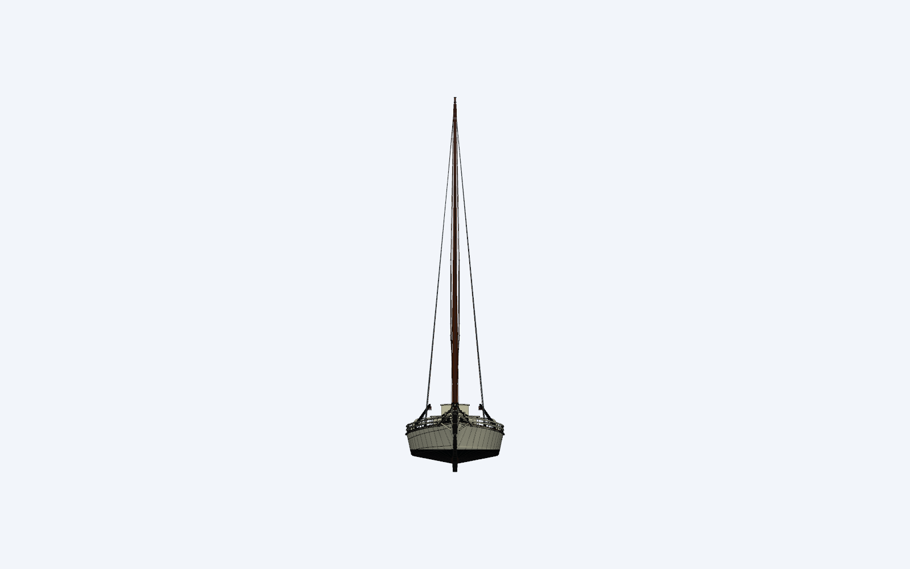 | 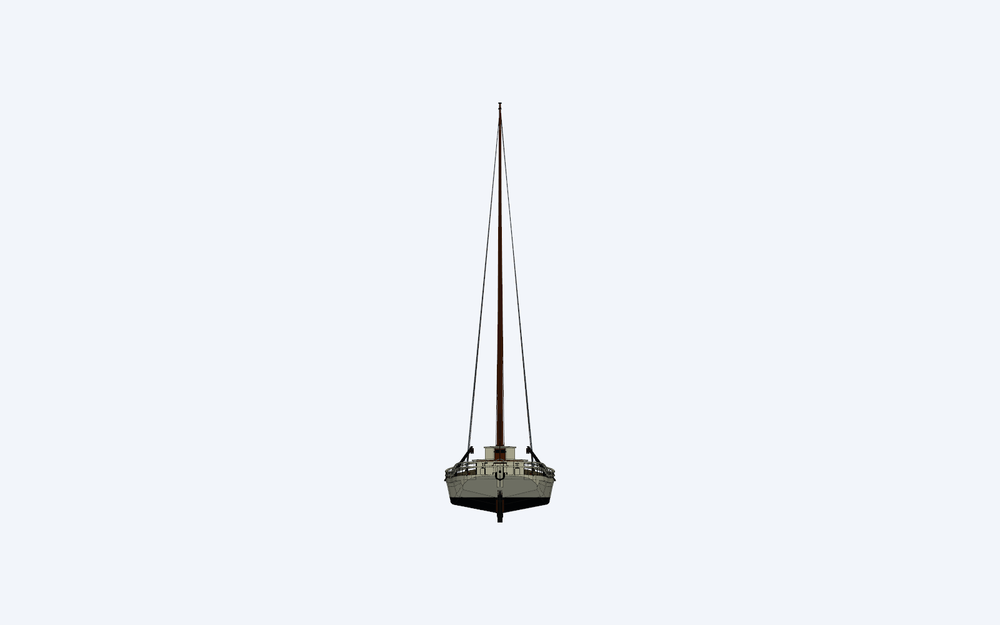 |
| **Port side** | **Starboard side** |
| 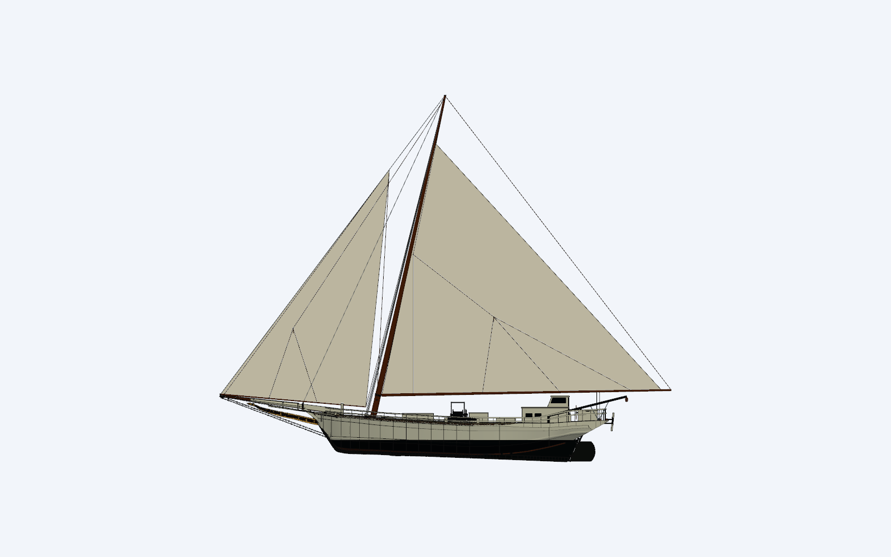 | 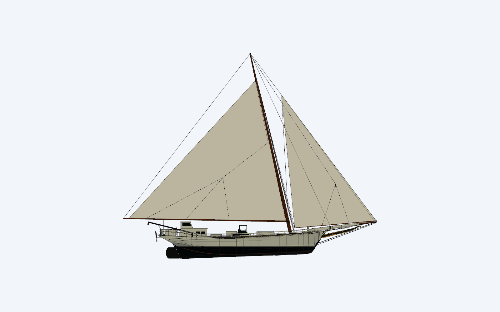 |
| **Bow quarter** | **Stern quarter** |
| 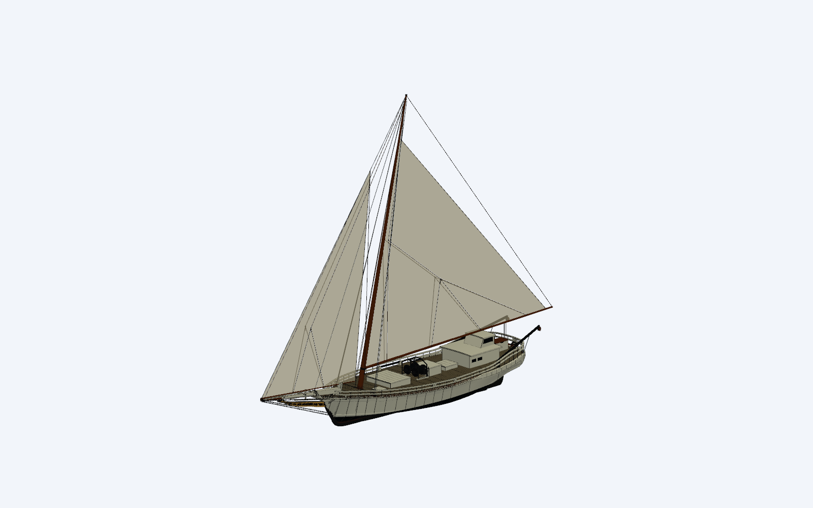 | 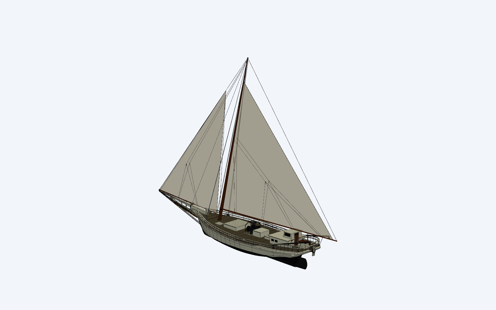 |
| **Plan** | **Centreline section** |
| 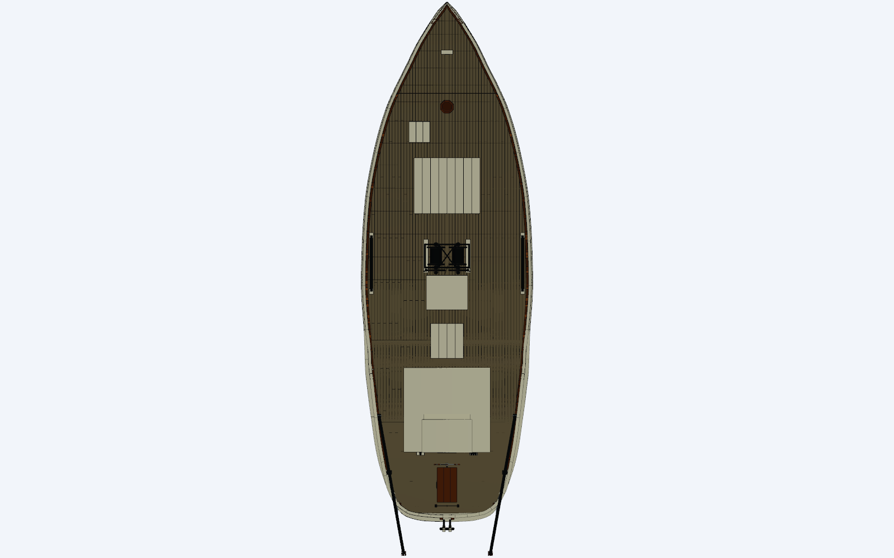 | 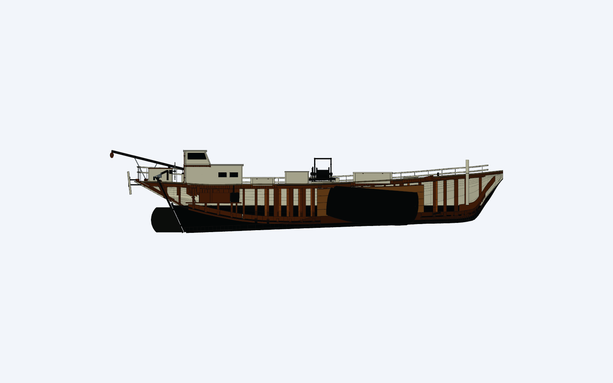 |
| **Hold section** | **Interior cutaway** |
| 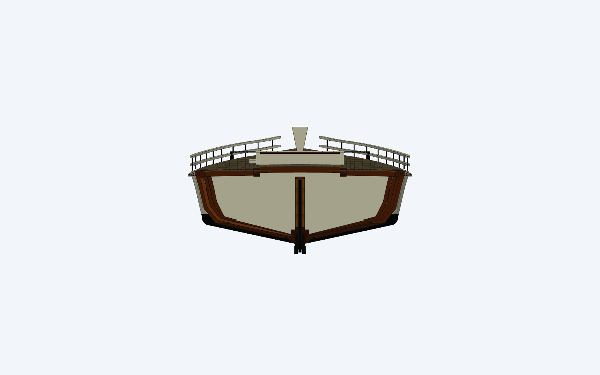 | 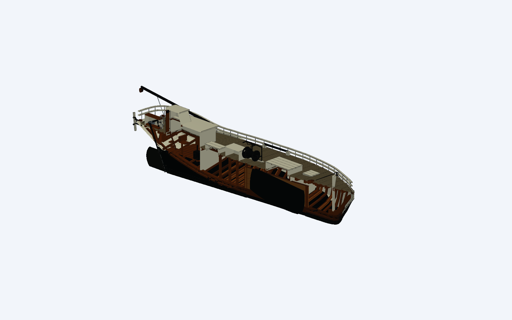 |

## Aft deck from above

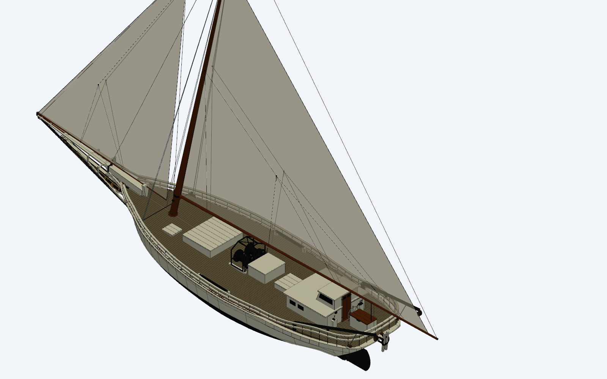

## Model files

- `model.py` — the entry point; builds and registers every part
- `src/parts/` — hull, deck, spars, rigging and interior geometry
- `src/checks/` — validation, measured-drawing checks and render scripts
- `references/` — measured drawings, source notes and archived photographs
- `output/` — generated STEP/STL files (not committed)

## Building and viewing the model

### In SOMA

1. Install [SOMA](https://somacad.app/) (the app bundles the CadQuery Python
   environment it needs).
2. Start SOMA and choose **Open folder** on the start page (or **Model → Open
   folder**), then select this repository folder. SOMA uses `model.py` as the
   entry point and builds the model automatically; with **Auto on** it rebuilds
   whenever the code changes.
3. The **Parameters** panel exposes `MODEL_SCALE` (1 = full size in
   millimetres, 32 = 1:32). The **section** tool in the viewer cuts the model
   open for inspection; the part tree shows every timber by group.

The repository is the SOMA project folder itself; no separate `.soma` archive
is needed.

### Without SOMA

The geometry is plain CadQuery. With Python 3.10 or newer:

```sh
python -m pip install cadquery numpy scipy
python build_without_soma.py
```

This runs `model.py` with a small stand-in for the four `soma` helper
functions and writes `output/model_standalone.step` as a named STEP assembly.
Add `--stl` for a whole-model STL, `--out PATH` to choose another file, and
`--help` for the options. Values in `parameters.json` are applied by name when
present. The SOMA viewer cache, Parameters panel and GLB export are SOMA-only.

## About Skipjacks

The Chesapeake Bay skipjack is a traditional wooden sailing vessel developed in the late 19th century to harvest oysters from the shallow waters of the Chesapeake Bay.

As the oyster industry expanded, watermen needed an affordable, efficient boat capable of working in shallow water. The skipjack answered that need with a relatively simple design: a broad, shallow-draft hull, a centerboard, and a single mast carrying a large mainsail and jib.

Typically ranging from 25 to 50 feet in length, skipjacks were designed specifically for oyster dredging. Their wide beam provided stability, while their shallow draft allowed them to reach oyster beds that larger vessels couldn't access.

They were working boats, not pleasure craft. Crews sailed across the oyster beds, dragging heavy metal dredges along the bottom to harvest oysters. Their design was practical, economical, and remarkably effective.

Although most closely associated with Maryland and the Chesapeake Bay, skipjacks and similar shallow-draft working sailing vessels were part of a broader maritime tradition extending south along the Atlantic coast. Related working sailing craft could be found as far south as Beaufort, North Carolina.

Today, the skipjack is an iconic symbol of Chesapeake Bay maritime history and Maryland's official state boat.

## Why the Kathryn?

I've always been fascinated by skipjacks.

They remind me of traditional sharpie sailboats, but they're considerably wider and have a much more substantial presence. Their proportions are unusual and appealing, combining the simplicity of a working sharpie with a broad hull that offers the potential for a proper cabin.

I've often thought that a skipjack would make a fascinating recreational sailboat, perhaps with a few modifications while retaining the character of the original design.

I would have loved to have built one.

Since that hasn't happened, creating a 3D model seemed like a good way to spend some time exploring the design.

## The Kathryn

The subject of this model is the *Kathryn*, a Chesapeake Bay skipjack built in 1901 in Crisfield, Maryland.

Some of her principal dimensions are:

| Specification    | Measurement         |
| ---------------- | ------------------- |
| Year Built       | 1901                |
| Length           | 50 feet             |
| Beam             | 16 feet 8 inches    |
| Depth            | 4 feet 2 inches     |
| Original Purpose | Oyster dredging     |
| Rig              | Single-masted sloop |

The *Kathryn* is particularly interesting because her hull differs from the more common hard-chine skipjack design. She features a V-bottom with a rounded chine and longitudinal planking, along with a distinctive convex bow and counter stern.

She is documented in the Historic American Engineering Record (HAER) and recognized as a National Historic Landmark.

## Creating the 3D Model

The model was created using **SOMA CAD**, an AI-assisted CAD application built around CadQuery.

This was a bit of an experiment in AI-assisted, or "vibe-coded," CAD modeling.

I supplied SOMA with the original historical drawings, photographs of the vessel, and some basic direction about what I wanted to create. The AI coding agent interpreted the reference material and generated the CAD geometry.

### SOMA CAD

[SOMA CAD](https://somacad.app/) is an open-source desktop application that allows you to create parametric 3D models using an AI coding agent.

Rather than manually constructing every component in a traditional CAD interface, you describe what you want to build, and the AI agent writes the underlying CAD code.

SOMA provides the environment to build, view, measure, and refine the resulting geometry.

- GitHub: [GitHub - Kai-Jungsthoefel/SOMA: Desktop app for designing parametric 3D models in CadQuery together with the coding agent of your choice · GitHub](https://github.com/Kai-Jungsthoefel/SOMA)

### CadQuery

SOMA uses [CadQuery](https://cadquery.readthedocs.io/), a Python-based parametric CAD framework.

CadQuery allows 3D geometry to be constructed programmatically using dimensions, profiles, extrusions, lofts, and other geometric operations.

The advantage is that the model is generated through editable code rather than being limited to a collection of manually created CAD features.

- GitHub: [GitHub - CadQuery/cadquery: A python parametric CAD scripting framework based on OCCT · GitHub](https://github.com/CadQuery/cadquery)

### The Result

For this project, I provided SOMA with the historical drawings and photographic references and let the AI agent do the heavy lifting.

The resulting CAD geometry was exported as an STL file.

The goal was to create a reasonably realistic three-dimensional representation of the *Kathryn*, capturing her distinctive hull proportions and overall appearance.

## Historical References

The model was based primarily on the following historical resources:

**National Park Service – National Historic Landmark Documentation**

Original historical documentation for the Kathryn:

https://npgallery.nps.gov/NRHP/GetAsset/NHLS/94001192_text

**Library of Congress – Historic American Engineering Record**

Archival photographs of the Kathryn:

https://www.loc.gov/resource/hhh.md1454.photos/?st=gallery&c=160

**Historic American Engineering Record – Kathryn**

Historic measured drawings and documentation:

https://www.loc.gov/pictures/item/md1454/

These drawings and photographs provided the reference material used to develop the 3D model.

## About the Model

This is a digital reconstruction based on the available historical drawings and photographs. Some details have necessarily been interpreted from the reference material.

The intention is to create a visually representative model of the original vessel, rather than a certified construction plan or exact reproduction.

The repository contains the CAD model and associated project files.

---

*The Kathryn is a reminder of a time when sail-powered working boats were an essential part of life along the Chesapeake Bay. It's a beautiful design, and one I would still love to build someday.*

**One small note:** I've retained the Beaufort reference in the broader context of Atlantic working-sailboat traditions rather than claiming that Chesapeake skipjacks themselves were routinely operated there.
