# Bowsprit and trailboards: attachment gap analysis

Review date: 15 November 2026. As-found model: local commit **e341989**; 903 registered parts. Status: **attachment correction required**. This report documents the current geometry and a correction plan; it does not implement the repair.

The bow is still incorrectly assembled. The model contains only the short, rounded outer portion of the bowsprit; the square inboard portion shown in the original arrangement is missing. The last repair added a knee and pin around that shortened spar. It improved its appearance without resolving the original geometry. Raising the jib then left its stay and club disconnected from the bowsprit. The paired trailboards have some solid contacts, but their backing, fixing surfaces and relationship to the headrails remain unresolved.

The clearest sail-support defect is measurable: the jib stay is **7.41 inches clear of the bowsprit solid**, and no fitting bridges the gap. A valid CAD build does not establish a working rig. This is a geometric and historical reconstruction review; it does not predict a breaking load or certify the strength of timber, fastenings or rigging.

This review supersedes the present-day conclusions in [the earlier bow report](BOWSPRIT_GAP_ANALYSIS.md). That report's older images show a different model. Its statements that the current boat has one centreline board or no heel knee are obsolete. Its recommendation to move the Samson post should not be followed without resolving the missing inboard spar first.

## 1. Evidence and measurement basis

**Original drawings govern the reconstruction.** D1-D6 below are annotated crops of the supplied HAER MD-117 scans, not newly drawn interpretations. P1 is the vessel-specific survey photograph. C1-C6 are newly rendered views of the current exported model. R1 explains the proposed load relationships and is explicitly conceptual.

The source coordinate F increases forward from the recorded-length aft witness. Model Y = 25 - F; port is +X and Z is up. Measurements below are full-size feet or inches. Exported CAD uses millimetres, at 304.8 mm per source foot.

The audit rebuilt the relevant bow solids directly from the current Python modules and measured their minimum separation and common volume using OCCT. Their bounding boxes agree with the existing SOMA export within **0.000513 mm**. That supports using the current exported mesh as the visual witness. All 40 audited solids are valid; geometric validity is distinct from correct assembly.

The cached full SOMA build reports 903 parts and no warnings. The attempted new full build was interrupted, and the viewer render RPC is unavailable from this sandbox. Accordingly, the illustrations use VTK to render the actual saved GLB, checked against the freshly generated bow geometry. No fresh complete-build or strength-test pass is claimed. Model geometry and parameters were not changed for this report.

Primary dimensional cross-check: the [National Park Service landmark nomination, printed page 4](https://npgallery.nps.gov/NRHP/GetAsset/NHLS/94001192_text) records a 22-foot bowsprit with an inboard section approximately 12 by 11 inches. Printed page 5 describes the club-footed jib and chain support arrangement. This is an independent historical record: reconcile it with the HAER survey before imposing an exact replacement length. Equipment changed between records; LOC-P22 explicitly records the anchor windlass removed.

## 2. What is wrong in the current model

### G1 - Critical: the model mistakes the rounded transition for the complete spar's heel

The current bowsprit axis runs from F = 52.770 to F = 64.233 and is **11.484 ft long**. Its aft end is 7.053 ft forward of the Samson-post station at F = 45.717. The geometry is a circular taper, with a nominal aft diameter of only **8.16 inches**. It has no square inboard section.

The existing measurement ledger calls the rounded start at approximately Sheet 4 grid X = 1102 the heel. D1 and D2 show substantial square structure continuing inboard toward the post. P1 independently shows that square continuation. The NPS length exceeds the modeled spar by about **10.52 ft**, and its after section also differs. These are substantial reconstruction discrepancies, not a minor support adjustment.

The most likely root cause is misidentifying the visible start of the rounded outer portion as the end of the whole bowsprit. The exact hidden heel termination and its joinery still require a careful trace. The 22-foot record is a cross-check, not permission to extend a cone arbitrarily by 10.52 ft.

**Consequence:** the model omits the inboard geometry needed to represent the actual seating and retention arrangement. It then places the bed and decorative boards relative to the wrong end of the spar. Moving the Samson post toward this truncated spar would shift a source-located structural feature to accommodate the error.

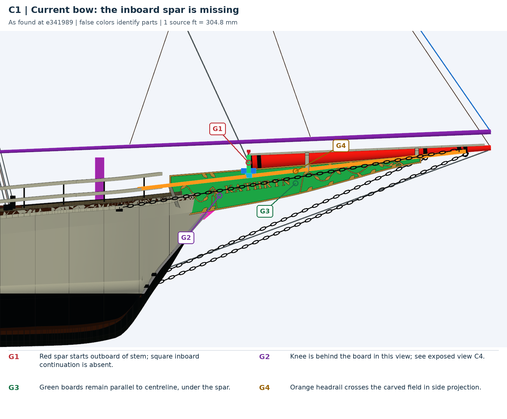

### G2 - High: the new heel support is incomplete joinery around an incorrect spar

The new magenta knee is real geometry. It intersects the painted stem by 0.01632 cubic feet and the bearing cross-timber by 0.00284 cubic feet. The saddle touches the spar, with zero common volume because the spar was subtracted from the saddle. It is inaccurate to describe this version as completely floating.

Those contacts do not close the attachment issue. The added knee remains about **9.98 inches** from the separate internal oak stem knee. This does not prove that a real external knee must directly touch that internal member, but the connecting fastenings and structural transfer through the stem are not resolved. The cross-timber itself is **2.02 inches** clear of the spar; the saddle is the intervening bearing component.

The modeled fid intersects solid, **uncut** bowsprit timber by 0.002664 cubic feet. There is no matching bore or mortise in `make_bowsprit()`, no defined bearing clearance, and no resolved retaining arrangement. The current part name and a pin-shaped object do not establish a usable pin joint. The original vertical fastening needs to be identified before assigning it a function, orientation and size.

**Consequence:** the added components suggest support, but they do not represent a verified bed and restraint arrangement for downward bearing, uplift, axial movement and lateral movement. The model needs the original assembly reconstructed as a coordinated set of parts.

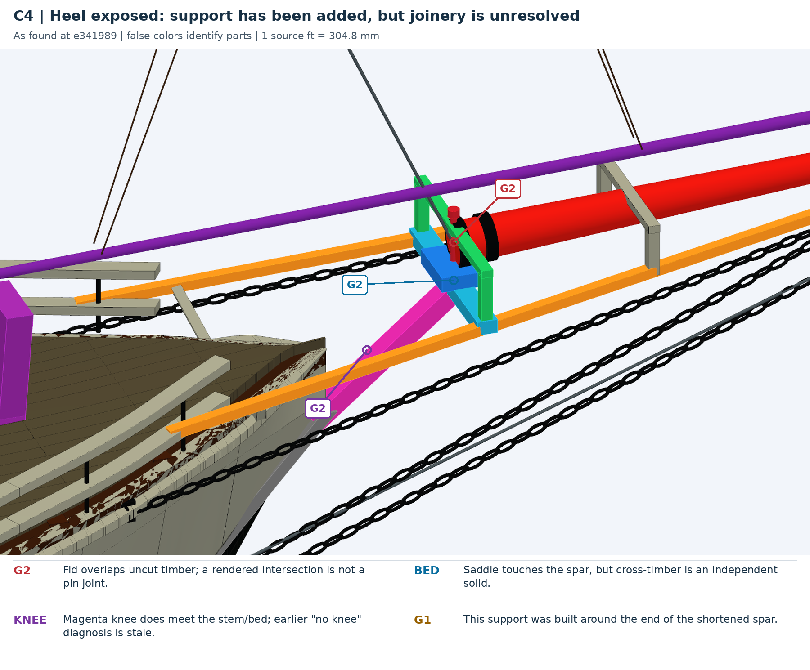

### G3 - High: the trailboards are translated plates without a resolved longhead mounting

There are now two boards. Each is 11.907 ft long and 1.92 inches thick. Their inner faces are X = +/-0.24 ft and their outer faces X = +/-0.40 ft: a **5.76-inch space** between the inner faces. Both lie in planes parallel to the centreline over their full length. The upper edge still comes from the underside of the extrapolated circular spar, including aft of the point where that spar actually ends.

This placement was produced by translating the former centreline geometry sideways. It was not derived from a traced mounting surface on the longhead. The code even retains the obsolete explanation that the panel is one centreline board seated into the spar.

The fresh contact audit is important: a board is **0.504 inch clear of the painted stem**, **0.663 inch clear of the bowsprit**, and **3.917 inches clear of its walking board**. It does intersect the heel cross-timber, headrail knee and the very forward part of the headrail. Therefore the boards are not wholly disconnected objects. However, those intersections do not define a fitted backing, joint lands or fasteners. No continuous longhead backing is modeled to explain their placement.

**Consequence:** the carving reads as two narrow fins suspended under the spar. The plan and underside do not explain how the boards are mounted. The proper solution is to identify and reconstruct their actual backing and fixings. Do not assume they must be spread to the headrails along their entire length; the sources need to determine that relationship.

Trailboards carry their own weight and local attachment loads. They are ornamental parts of the longhead, and should not become the invented primary support for the sail rig.

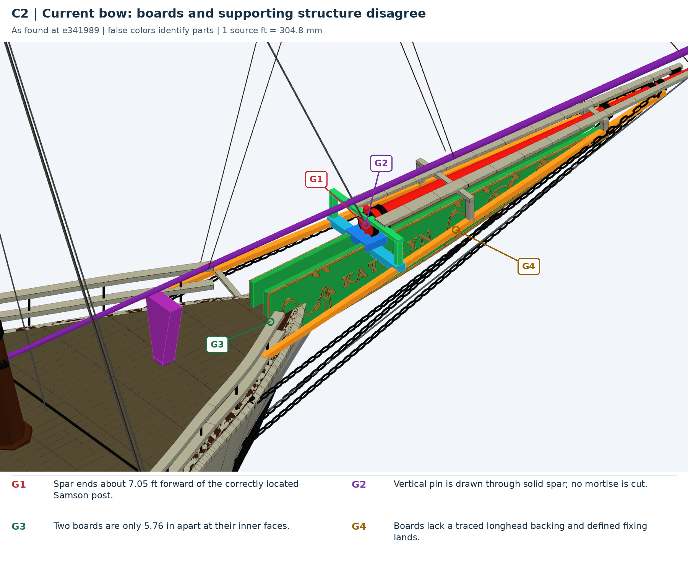

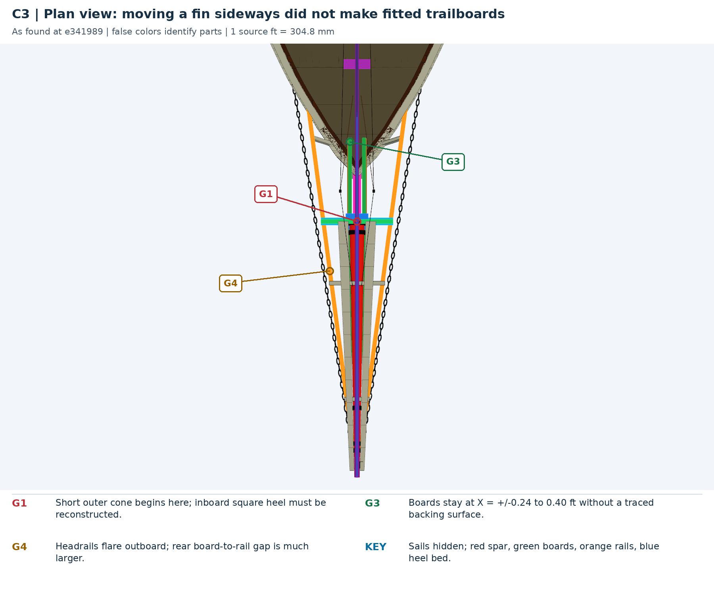

### G4 - High: headrails, board silhouette and fixing geometry are independently constructed

The orange headrail crosses the carved field in the side view. Much of this is overlap in projection because the rail is farther outboard; it is not all a solid collision. There is also a measured solid intersection with the board near its forward end: 0.001325 cubic feet. The headrail knee intersects the aft board by 0.000425 cubic feet. These are geometric interpenetrations without modeled housings or identified fastenings.

D3 shows a different relationship between the upper rail, carved field, lower longhead outline and eagle termination. D1/D2 establish the structural plan/profile relationship. The board upper edge must not simply be made coincident with the underside of the spar and accepted because the lettering is readable.

**Consequence:** the outside silhouette is wrong, while the existing contact tests can pass on small accidental overlaps. Rail roots, headwork support and decorative backing must share the same traced reference geometry. Genuine source overlaps should be retained; unexplained clashes and disconnected ends should be corrected.

### G5 - Critical: the raised jib tack and stay have no connection to the spar

The previous repair translated the entire jib upward by 0.75 ft. The tack and club fore end now lie **9 inches above the bowsprit axis at the tip**. The jib stay runs from the masthead to that raised point. Its minimum solid-to-solid separation from the bowsprit is **7.414 inches**. The club is **6.233 inches** clear of the bowsprit. No tack strop, pendant, pivot, eye assembly or other fitting bridges those spaces.

A raised tack can be legitimate if a real attachment connects it to the spar. The present defect is the absent connection, not the mere existence of clearance. The lower bobstay geometry and bands remained at their old stations when the tack was raised, so the upper load and lower reaction do not share a defined fitting assembly.

**Consequence:** as drawn, jib-stay tension terminates in free space above the spar. This is the clearest reason the assembly does not represent a rig capable of carrying the modeled sail load.

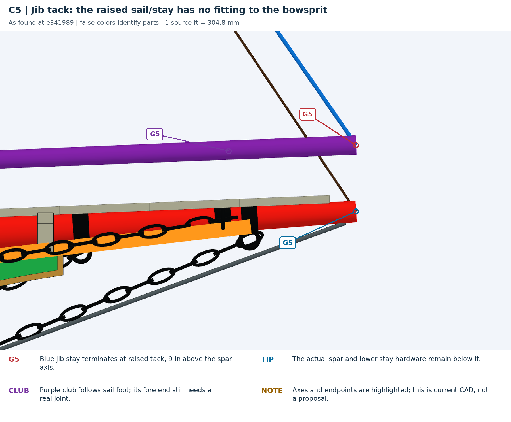

### G6 - High: the jib triangle preserves lengths but no longer fits its stay

The current jib head is **0.32465 ft, or 3.90 inches**, away from the new stay centreline. The whole triangle moved up, while the top end of the stay remained at the masthead. Keeping luff, foot and leech lengths unchanged did not preserve the head-to-stay relationship.

D6 gives the governing jib lengths: luff 49 ft 6 in, foot 25 ft 8 in and leech 42 ft. These can be preserved while solving a new head point on the actual stay and a compatible clew point. The source also describes draft at the jib foot, so the flat plate is only a sail-envelope demonstration.

**Consequence:** the head and luff do not follow the stay. This prevents the current sail envelope from validating the rigging geometry. Resolve the actual tack fitting first, then solve the sail around it.

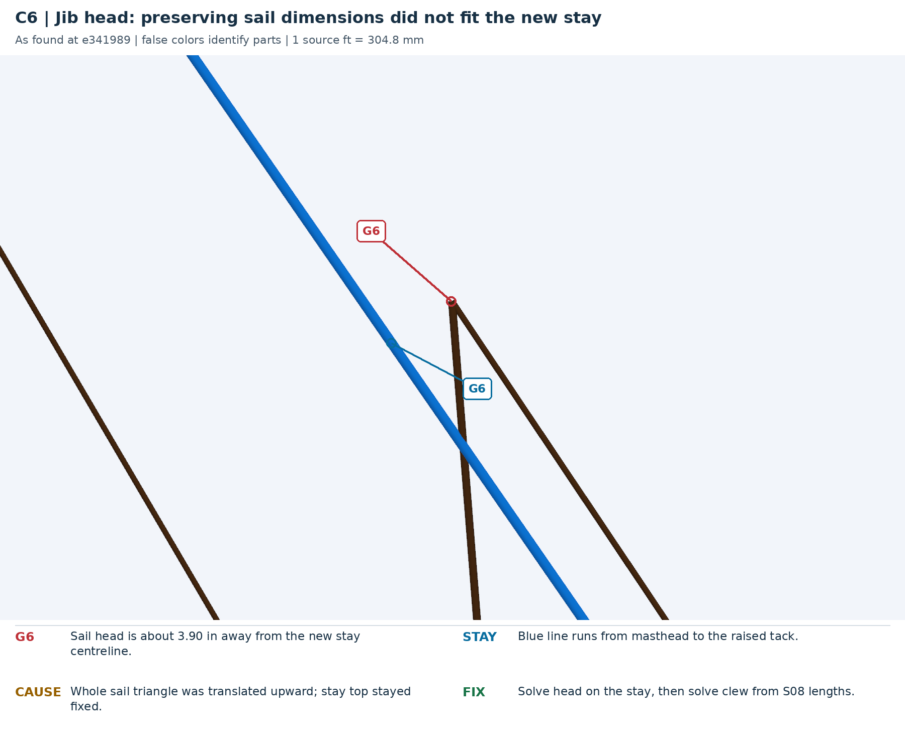

### G7 - Medium: secondary bow fittings and running-line routing remain schematic

The downhaul is modeled as one line from the jib head to the old tip coordinate. The original S03 running-rigging key specifies a route through the cheek block at the bowsprit end and back to its cleat. The modeled cheek block exists, but this line does not follow a sheave or return to the foredeck cleat. This needs correction once the tack assembly is fixed.

The bow module has two chain bobstays and side stays; the later rigging module also adds a separate straight `Bobstay`. Each line needs a source identity and a physical termination. Verify whether any additional line is intended by the survey rather than retaining an unexplained duplicate. The visual count of parallel dashed source lines must not be mistaken for a count of individual stays without checking the key and photographs.

The source eagle/longhead termination and fixing details are not faithfully represented by the generic border, scrolls and leaves. This is a fidelity gap separate from the sail-support failure.

### G8 - High: the existing acceptance evidence does not test these defects

The M6 check validates part validity, sail edge lengths and selected lazyjack stations. It does not require the jib-stay foot to attach to the bowsprit, the head to lie on the stay, a pin to have a hole, or the complete inboard spar to match the source. The earlier bow figure generator deliberately preserves pre-repair images when it sees side boards. That behavior explains why a report marked implemented can still show obsolete evidence.

**Consequence:** a successful build or M6 pass cannot close this bow issue. The correction needs attachment-specific acceptance checks and new current-model witnesses.

## 3. Annotated original evidence

### D1 and D2 - Sheet 4 governs the spar and headwork arrangement

The red witnesses identify the inboard square section. The blue witness identifies the rounded transition used by the current heel pick. These views must be read together with the source registration and the surveyed post location. Restore the missing relationship before deciding where any support timber should move.

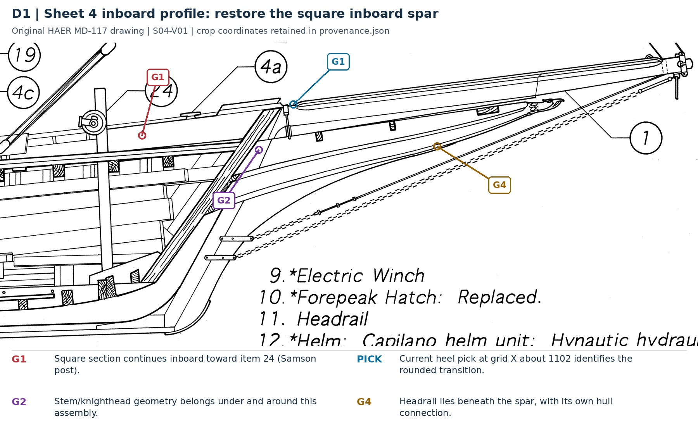

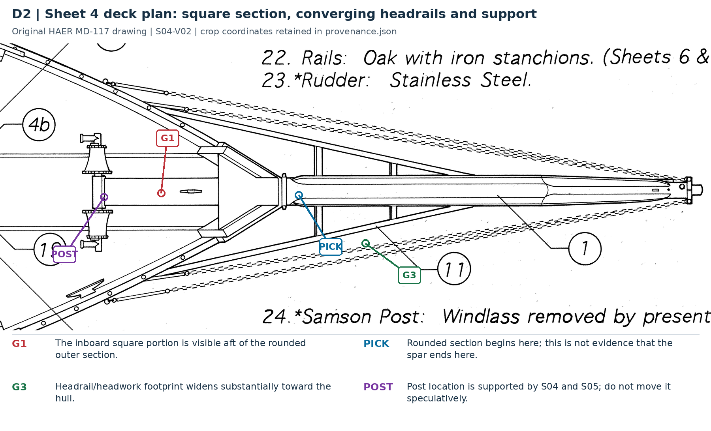

### D3 - Sheet 1 governs the ornamental silhouette

This detail is not a calibrated orthographic construction drawing. Use it to establish carved outline, lettering position, layer order and the eagle termination. Obtain physical dimensions and mounting coordinates from the scaled arrangement views and vessel photographs. Neither a pair of widely splayed boards nor a single centreline shelf should be assumed solely from this side illustration.

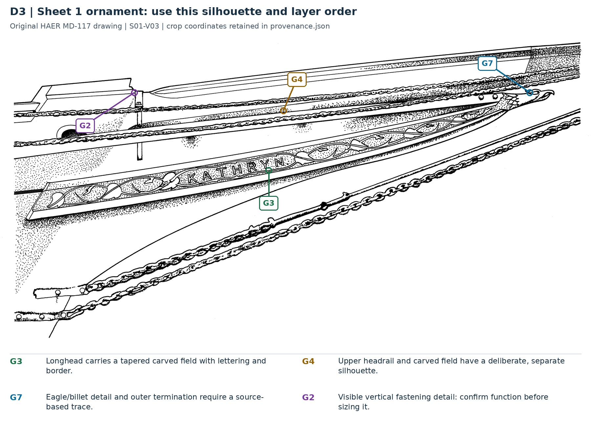

### D4 and D5 - Stays must return load into actual hull structure

Sheet 3 shows the relationship of the upper stays, lower bobstays and stem straps. Sheet 5 locates the internal structure and post. These are complementary views; the decorative boards cannot substitute for the structural attachments they illustrate.

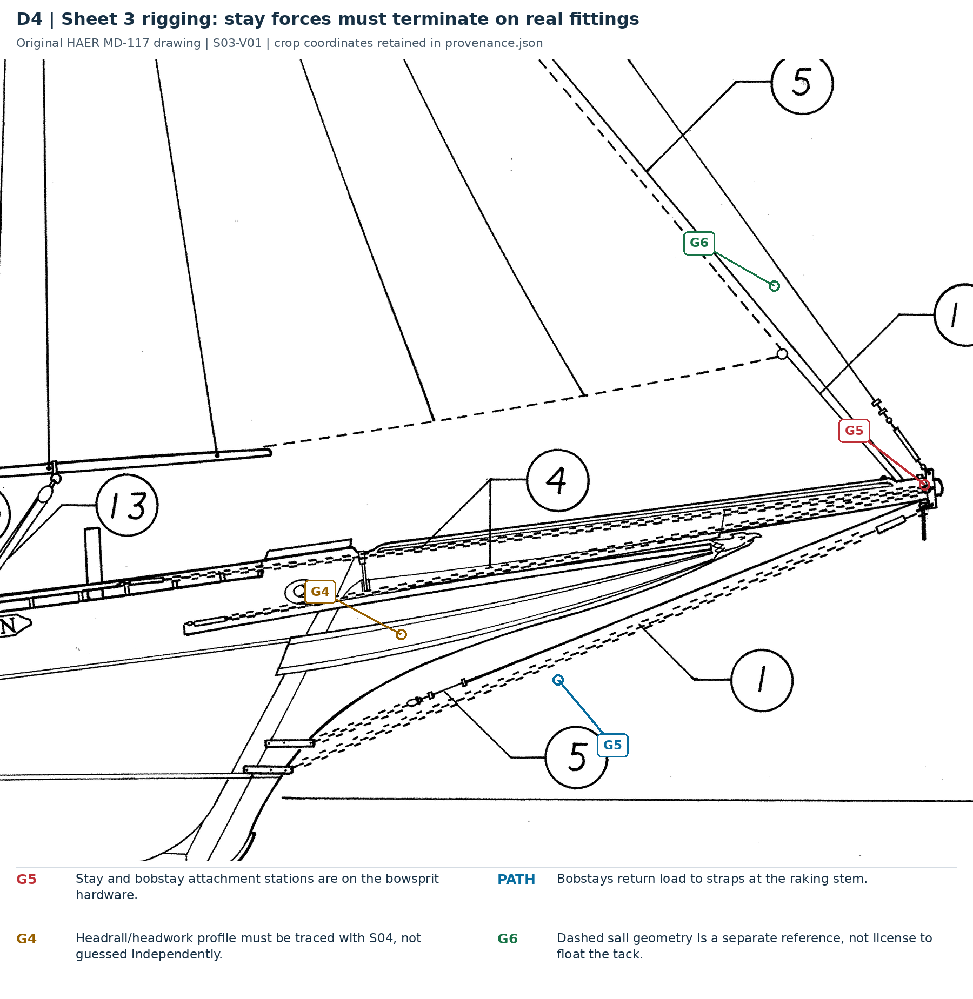

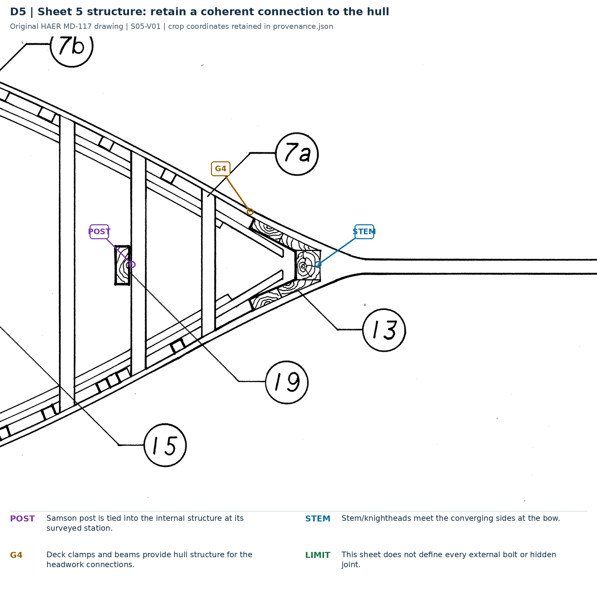

### D6 - Sheet 8 supplies dimensions, with an explicit limit on demonstration details

Use the printed edge lengths, not a ruler on the illustrative details. The note says the depicted mast hoops and jib hanks are demonstrations rather than part of Kathryn's actual sail rig. Correcting the luff position does not mean copying those hanks into the model as historical hardware.

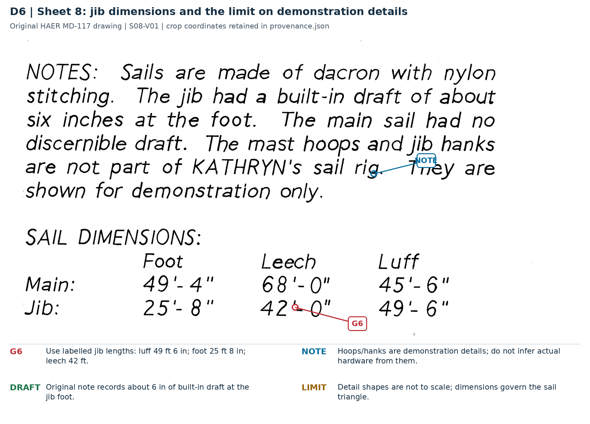

### P1 - Photograph checks the assembled relationship

LOC-P22 is captioned as the bowsprit and Samson-post detail with the anchor windlass removed. It shows the square inboard member, fitted headwork and close relationship to the post. Use it to identify components and their ordering, not to extract lengths from perspective. The [official photograph caption register](https://tile.loc.gov/storage-services/master/pnp/habshaer/md/md1400/md1454/data/md1454cap.pdf) identifies this as MD-117-22; the gallery page number is 23.

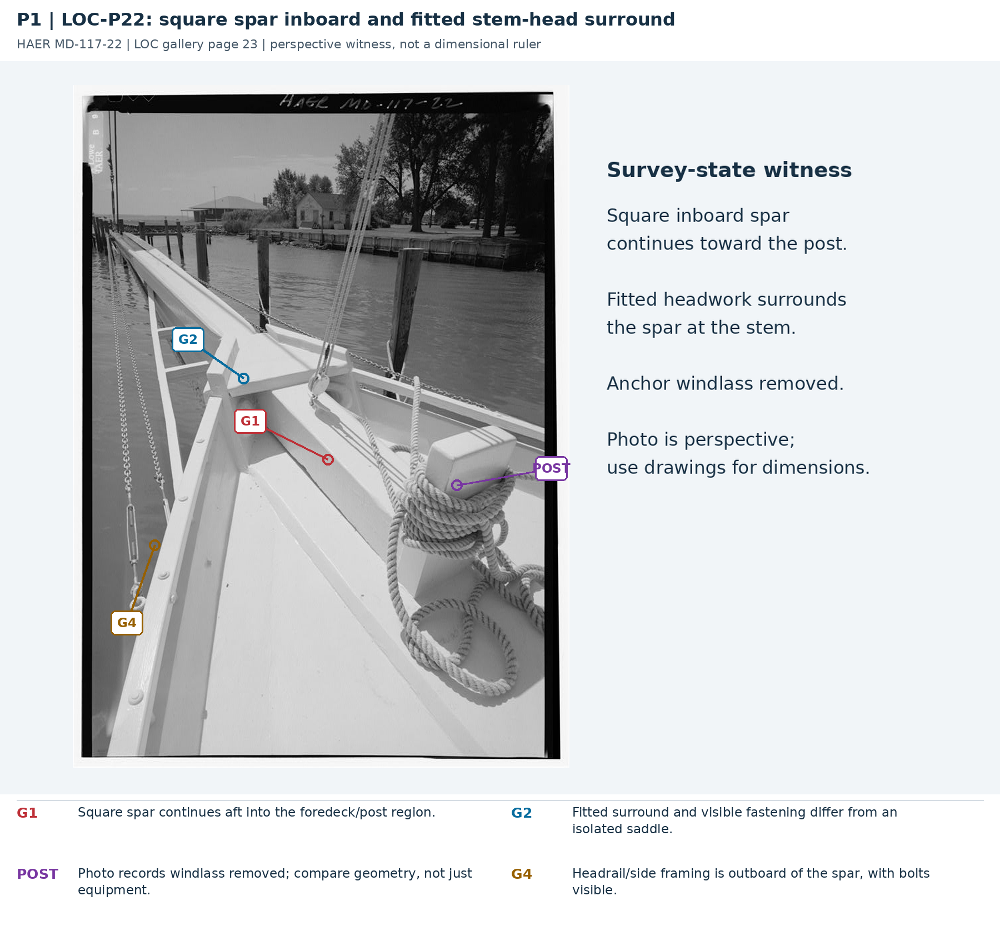

## 4. Detailed correction plan

### Phase 1 - Establish a single source-controlled bow definition

**Purpose:** resolve G1 and prevent another set of independently placed patches.

1. Trace Sheet 4 profile and plan together: tip, rounded transition, square inboard section, true after termination, post, stem head, knightheads/headstock, cross-timbers and headrail roots. Use original pixels and the existing calibrated transform; retain every pick in a new bow registration ledger.
2. Cross-check Sheet 3 and Sheet 5. Separate visible measured edges from inferred hidden geometry. Use LOC-P17/P18/P22 to identify components and the windlass-removed survey state.
3. Reconcile total length and section with the NPS 22-foot and 12-by-11-inch record. Record any survey-state difference explicitly. Set the uncertainty of source picks at the existing registration scale, approximately 0.15-0.20 ft, rather than claiming millimetre historical accuracy.
4. Leave the mast and source-located Samson post in place while tracing. If an actual source conflict emerges, document the competing picks and proposed resolution before moving either structure.

**Deliverable and exit condition:** one plan/profile overlay with shared stations and an unambiguous distinction between full heel and rounded transition. Every primary bow component gets a source identity or an explicit reconstruction note. A length discrepancy must be resolved, not hidden by shifting the post.

### Phase 2 - Rebuild the full spar, bed and retaining arrangement

**Purpose:** resolve G1/G2 before decorative parts are refitted.

1. Replace the single cone with a complete, continuous bowsprit: square or otherwise source-traced inboard section, the appropriate transition and tapered outer spar. Preserve a deliberate joint to the real bed. Derive axis height and rake from the traced assembly rather than from the post deck height plus a disconnected offset.
2. Reconstruct the source stem-head/knighthead/headstock and bearing geometry. Retain existing knee or cross-bearers only where supported by the new trace. Remove or revise the added diagonal prop if it duplicates or contradicts the original structure.
3. Define contact faces: spar-to-bed, bed-to-support, support-to-stem/deck structure. For each, state whether it is bearing, a housing, a through-fastened joint or a deliberately simplified display interface.
4. Identify the visible vertical fastening. If a pin or fid is supported by the evidence, cut the corresponding passage and model its head/retention and bearing surfaces. Do not use overlapping uncut timber as the finished joint.
5. Show how the assembly resists fore-and-aft motion, uplift and lateral motion as well as downward bearing. Identify the structural members receiving these reactions. Do not infer strength solely from contact volume.

**Deliverable and exit condition:** exposed heel and longitudinal section in which the entire spar and every intended load-transfer interface can be followed into the hull. No primary joint relies on decorative trailboard contact or an unexplained boolean overlap.

### Phase 3 - Close the tack, stay and bobstay connections

**Purpose:** resolve the critical free-space termination in G5.

1. Establish source stations for all collars, eyes, straps and stay ends using D1/D2/D4 and photographs. Reconcile the chain stays with the later schematic rigging lines; give each an identity.
2. Select the tack position from the original assembly. If the source requires an elevated tack, model the actual bridging fitting or strop and its connections to the spar. If it does not, return the tack to the source-derived attachment rather than retaining the arbitrary 9-inch lift.
3. Build a coordinated tip fitting assembly for the jib stay and the bobstay reactions, with real collars/eyes, bearing and restraints. Connect side-stay ends to their collars and hull chainplates; define fastenings/backing at the hull end.
4. Review the inboard head-stay termination after the full heel is restored. It must end at the correct fitting, not automatically at whichever point is named `BOWSPRIT_HEEL`.

**Deliverable and exit condition:** close-up from both sides plus a section through the tip. No stay ends in free space; a continuous, named attachment path connects the sail/stay and club to the bowsprit and then to hull structure.

### Phase 4 - Fit trailboards to the corrected longhead

**Purpose:** resolve G3/G4 without using ornament to conceal structural errors.

1. Trace the carved outer silhouette and eagle from S01; register its longitudinal placement with the scaled S03/S04 views. Derive board planes or fitted surfaces from the actual longhead backing. Determine from the evidence whether the two decorated faces belong to separate boards or to facing pieces on a common backing.
2. Rebuild the board upper and lower edges from that geometry. Remove the dependency on the extrapolated underside of the shortened spar. Preserve a sensible timber thickness and explain any unmeasured thickness as an assumption.
3. Give each board actual fixing lands, rebates, screws/bolts or simplified documented fixing features at the reconstructed backing. Fit the aft end to the stem/headwork and the forward end to its source termination.
4. Refit headrails and their knees from the same registration. Check plan, side, underside and transverse sections. Preserve source-supported layering; eliminate unexplained interpenetration with boards, carving and walking boards.
5. Reapply lettering, border and carved detail to the corrected surfaces. Add the source eagle termination and restore the intended paint treatment after the mounting is correct.

**Deliverable and exit condition:** both sides and underside show an explainable mounting arrangement. The carving matches the source silhouette and sits on its board; board-to-structure fastenings exist. Board count or side offset alone does not constitute acceptance.

### Phase 5 - Solve the sail and running rig around real attachments

**Purpose:** resolve G6/G7 while retaining the printed sail dimensions.

1. Fix tack T and masthead/stay top M from the corrected fittings. Place the head H along T-to-M so that distance T-H is 49.5 ft. Reject a configuration if the available stay length cannot accommodate that luff and its hardware allowance.
2. Solve the clew as the appropriate intersection of a 25.6667-foot radius from T and a 42-foot radius from H in the selected demonstration plane. Choose the aft clew solution. Keep the current drawing-based dimensions independent of clearance adjustments.
3. Fit the club to the foot with source-supported tack/pivot and clew attachments. Rebase lazyjack stations to that club. Check port and starboard arrangements and clearance from spar, walking boards and stays.
4. Route the downhaul through the actual cheek-block sheave and back to the correct foredeck cleat. Confirm the halyard, sheet-to-hounds and pin-rail routes against the original rigging key.
5. Check raised and lowered/furled arrangements if both are displayed. A flat demonstration sail may remain a reference envelope, but its attachment geometry must be compatible with the real rig.

**Deliverable and exit condition:** luff/head lie on the actual stay, edge lengths remain correct, and all tack, club and running-line interfaces terminate at named fittings.

### Phase 6 - Validate, publish new witnesses and close the findings

**Purpose:** resolve G8 with evidence appropriate to the correction.

1. Add targeted checks for spar completeness, intended bearing contacts, pin passages, tack/stay connectivity, head-to-stay alignment, board fixing contacts and clearance. Use a declared CAD geometry tolerance; do not confuse it with source-measurement uncertainty.
2. Run `soma build` after every model increment. Check solids and the registered part list. Update the expected count deliberately if parts change, and run the project's clean committed-build check with that count for each geometry checkpoint.
3. Render current profile, plan, quarter, underside, exposed heel, tip and jib-head views. Compare to the locked source registration without separately rescaling each part to make it fit.
4. Replace obsolete acceptance claims and add a finding-by-finding closure record. Keep the historical images labelled by commit; do not present pre-repair renders as current evidence.

**Deliverable and exit condition:** G1-G8 each have a source reference, implemented change, measured check and current-model picture. A complete build and a visually plausible side view are necessary but insufficient on their own.

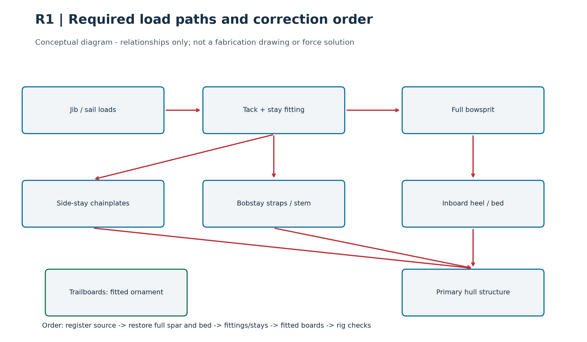

## 5. Specific acceptance checks

- **Source registration:** full spar envelope and key stations fit the S03/S04/S05 evidence within declared pick uncertainty. The distinction between heel and rounded transition is explicit. Any disagreement with the 22-foot record has a documented resolution.
- **Spar and support:** one valid complete timber solid, with source-based inboard section; intended bed and restraint interfaces exist. Demonstrate downward bearing, axial restraint, uplift restraint and lateral restraint through named components.
- **Pins and bolts:** axes pass through matching bores or mortises, with intended bearing and retention. No fastener is simply driven through an uncut CAD solid. Simplified hidden detail is disclosed.
- **Stay ends:** all terminate on named fitting geometry. At CAD scale, require attachment-node residuals no greater than a declared tolerance such as 1 mm, unless the connecting fitting's documented geometry accounts for the offset. The present 188 mm stay-to-spar gap fails this requirement.
- **Jib:** head-to-stay distance is within the declared rigging tolerance after accounting for actual attachments. The present approximately 99 mm error fails. Luff/foot/leech remain within the existing dimensional check tolerance, with finite hardware allowances handled explicitly.
- **Trailboards:** both decorative faces have a source-supported backing and fixing arrangement. Check intended contacts and cuts at actual joint lands, and unintended collisions everywhere else. A tiny corner overlap cannot substitute for a mounting joint.
- **Rig function:** club attaches at its source-defined fore end and clew; downhaul reaches cheek block and cleat; lazyjacks remain attached to the revised club. Check the displayed sail states and their clearances.
- **Evidence freshness:** all acceptance illustrations identify the corrected commit and build; annotations match measured current geometry. No unresolved item is labelled implemented merely because a previous visual patch was committed.

Physical strength remains a separate later task if the model is to support engineering decisions: establish sail/rig loads, timber properties, fastener specification, bearing areas and joint stiffness, then evaluate member and joint stresses. This report already identifies geometric disconnections without inventing those inputs.

## 6. Files, provenance and reproduction

The audit data are in [measurements.json](images/bow_attachment_review/measurements.json). Exact source crop boxes, reference hashes, model hashes and render provenance are in [provenance.json](images/bow_attachment_review/provenance.json). Clean and annotated images are retained together in `docs/images/bow_attachment_review/`.

Original scans remain in `references/drawings/`; unmodified native drawing views remain in `references/drawing_package/`. Primary drawings used: S01-V03, S03-V01, S04-V01, S04-V02, S05-V01 and S08-V01. Supporting photographs: LOC-P17, LOC-P18 and LOC-P22 in the supplied vessel-specific photo archive.

Implementation ownership: `src/parts/bow.py` for headwork, boards and bow stays; `src/parts/spars.py` for the complete spar; `src/parts/rigging.py` for sail and line solutions; `src/parts/params.py` plus the new source ledger for shared bow stations. Coordinate internal changes with `deck.py`, `hull_frames.py` and the frame/source layout rather than moving the post in isolation.

Reproduce measurements with `python docs/tools/build_bow_attachment_review.py --measure`, illustrations with `--figures`, and the searchable illustrated PDF with `--pdf`. The PDF is written to `output/pdf/bowsprit-trailboards-gap-analysis.pdf`. These commands read the geometry and references; they do not repair or alter the model.

Primary online source addresses for the standalone PDF: https://npgallery.nps.gov/NRHP/GetAsset/NHLS/94001192_text and https://www.loc.gov/item/md1454/ . Photograph captions: https://tile.loc.gov/storage-services/master/pnp/habshaer/md/md1400/md1454/data/md1454cap.pdf .
