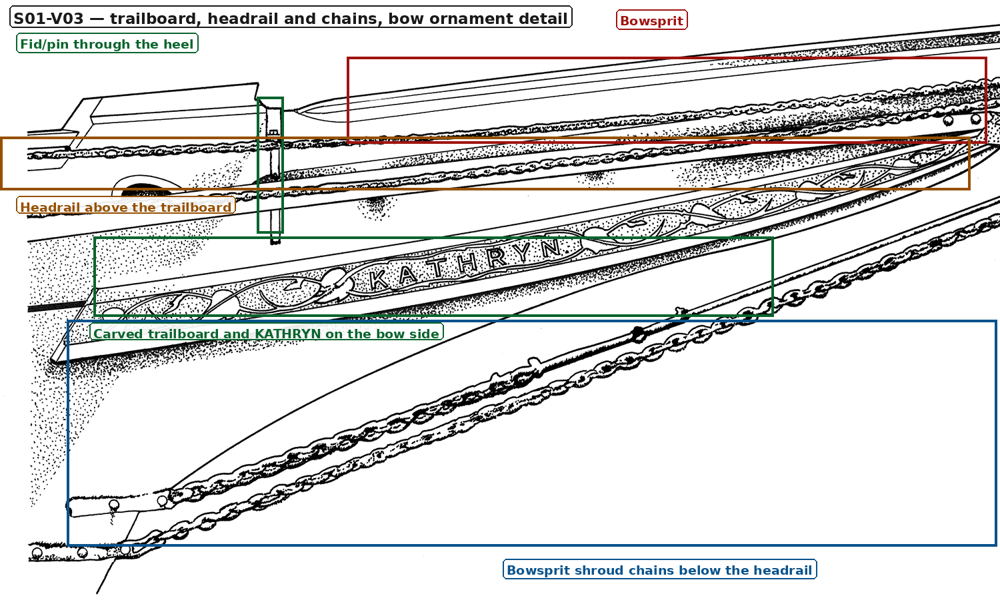
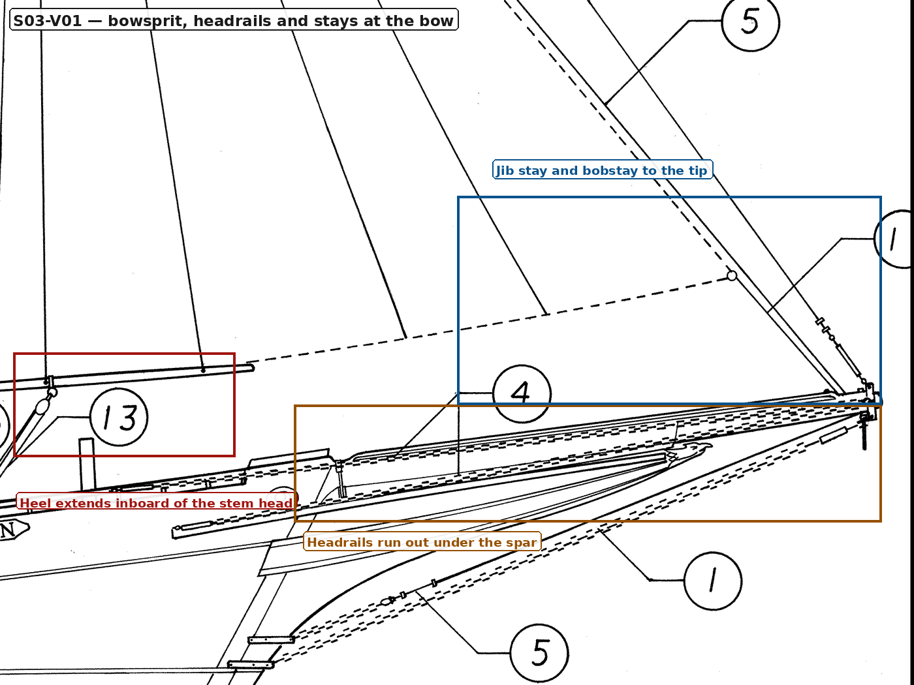
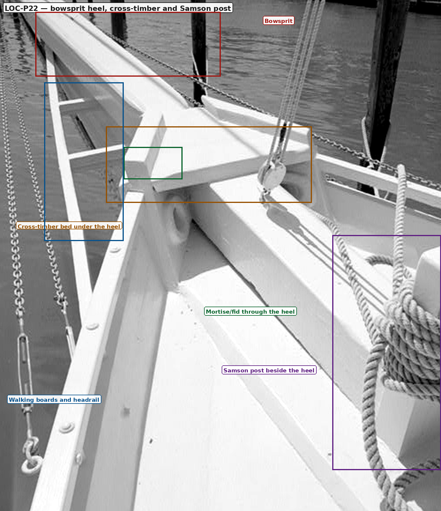
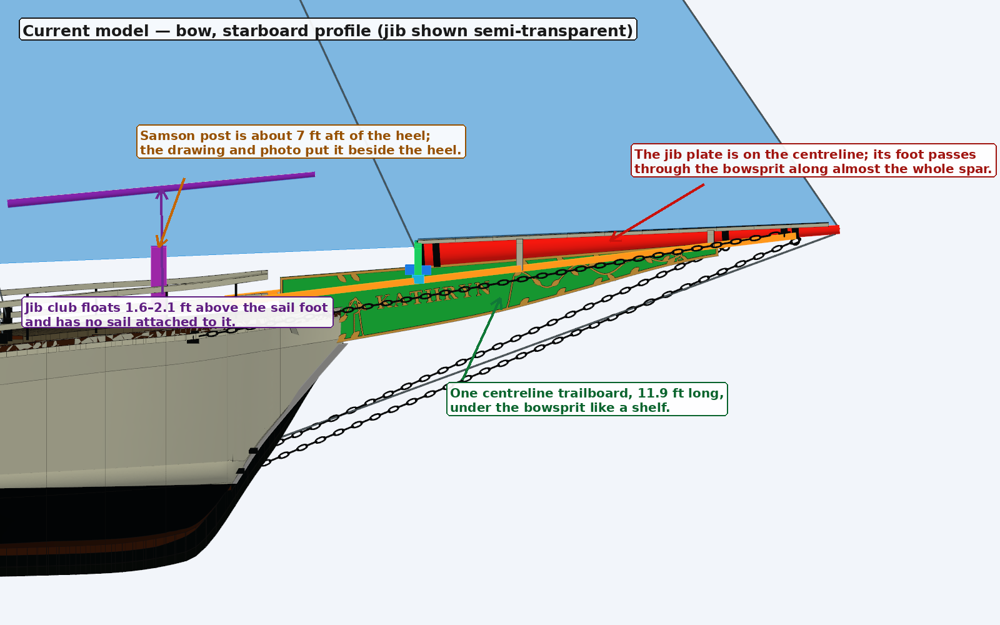
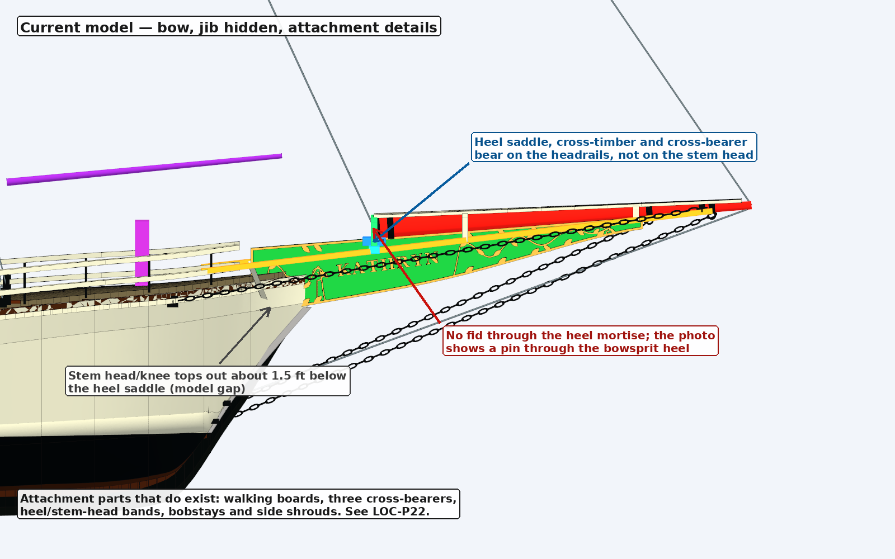
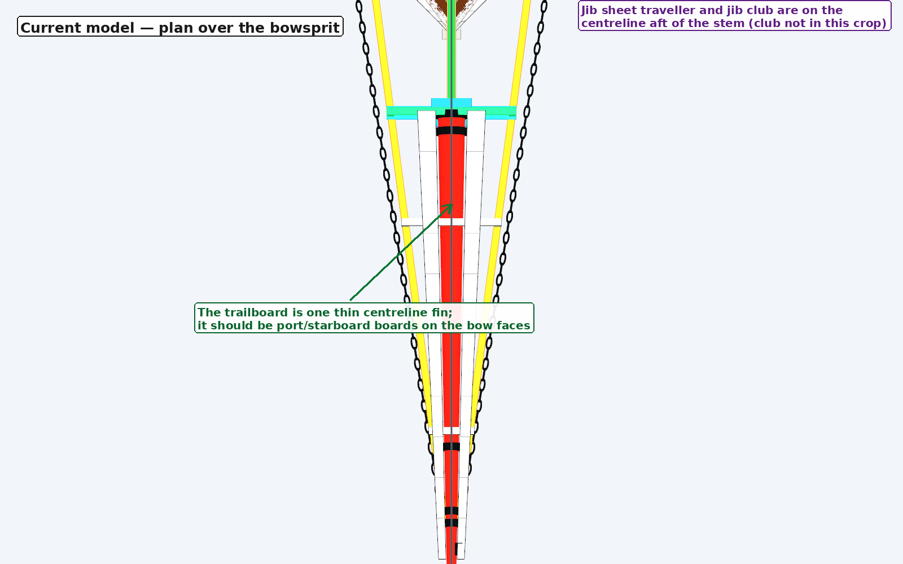
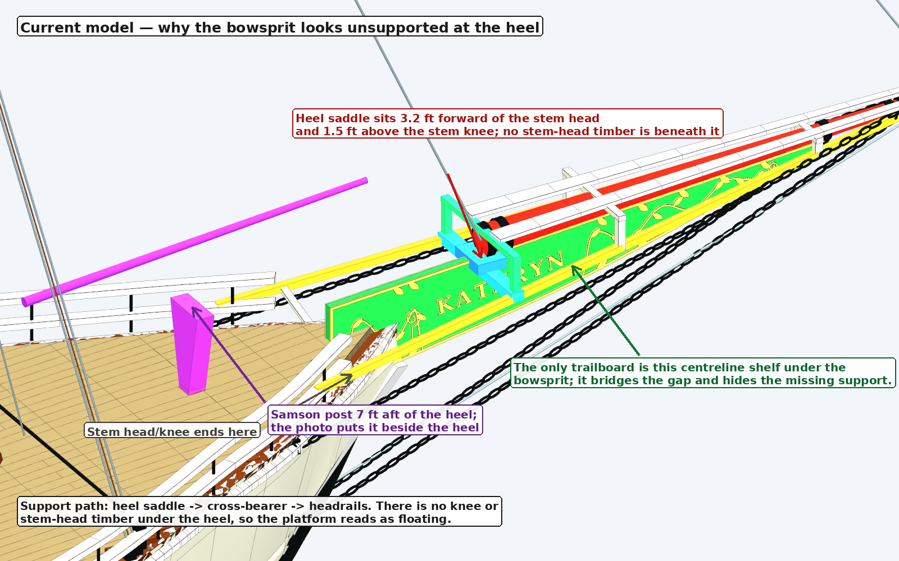
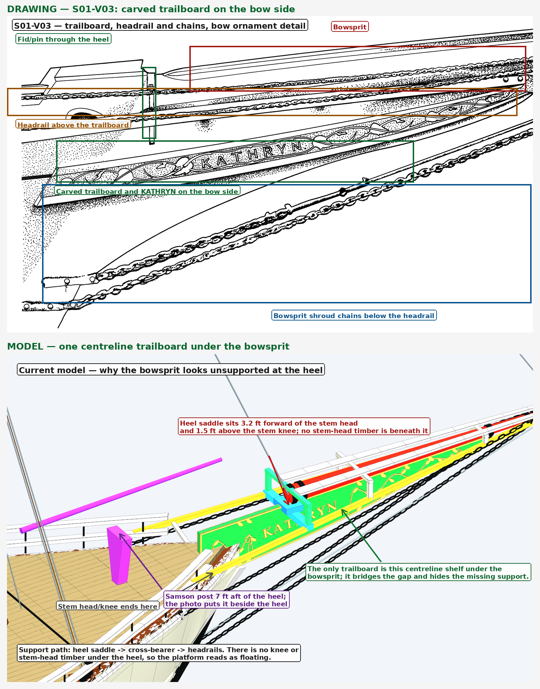
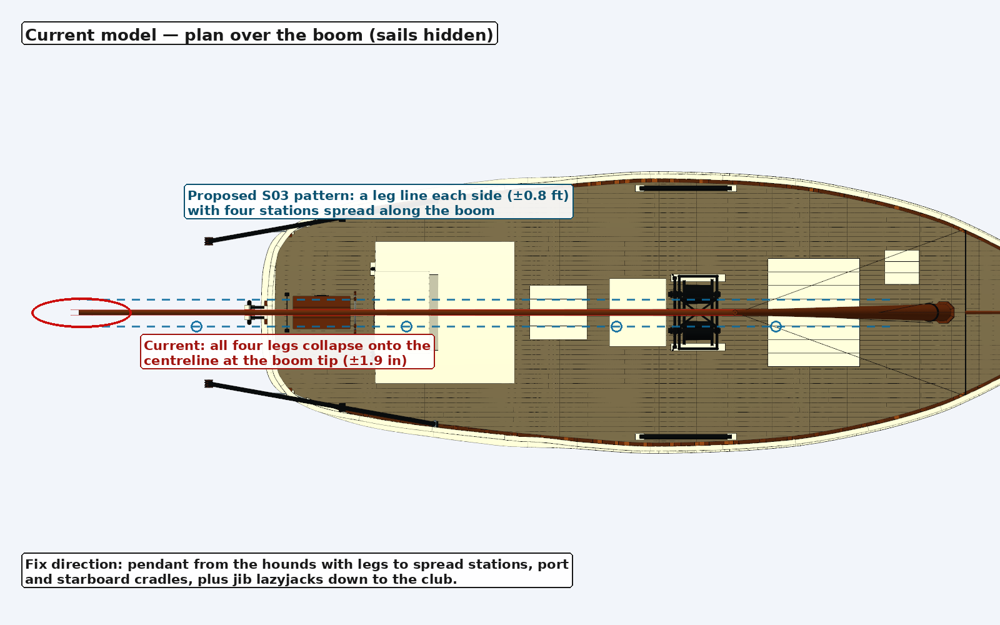
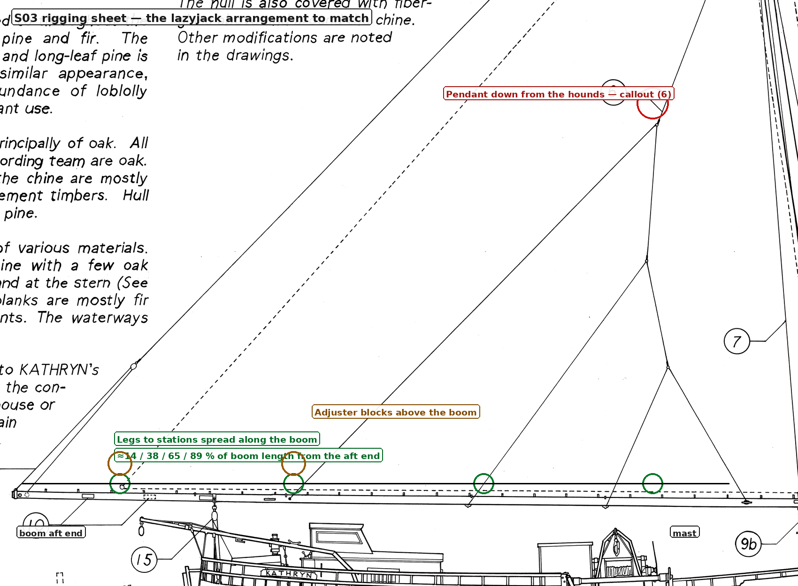

# Bowsprit, trailboards and jib — gap analysis and fix plan

> **Current review (15 November 2026):** This report records the earlier investigation and partial repair. Its implemented status does not mean bow attachments are accepted. See [Bowsprit and trailboards: attachment gap analysis](BOWSPRIT_ATTACHMENT_REVIEW.md) for freshly measured defects, current annotated pictures, annotated original drawings and the detailed correction plan.

**Historical status: partial visual repair implemented 2026-11-14; attachment correction remains required.**
The bow was broken mainly because the added S08 jib demonstration sail was a
flat centreline plate whose foot passed through the bowsprit. The bowsprit
part itself was not changed when the sails were added (`d299778` added
`parts/rigging.py` and registered it; it did not touch `parts/bow.py` or
`parts/spars.py`). Trailboard, jib-club and heel attachment disagreed with the
drawings and photos. The lazyjack rig is included here as well, because the
jib lazyjacks attach to the same bowsprit/club assembly; the detailed lazyjack
analysis is in `docs/LAZYJACK_GAP_ANALYSIS.md`.

## 0a. Implementation update (2026-11-14)

- **Jib:** the S08 triangle (luff 49′6″, foot 25′8″, leech 42′0″) is raised
  0.75 ft, putting the foot above the bowsprit. The jib club is now a 25.7-ft
  spar along the foot from the raised tack at the bowsprit tip to the raised
  clew; the jib stay follows the raised tack; the jib lazyjacks were rebased
  onto the new club at one-third and two-thirds of its length. The sail plate
  no longer intersects the bowsprit.
- **Trailboards:** the single centreline shelf is gone. Port and starboard
  side boards now sit at X ±0.24…0.40 ft, re-using the carved border,
  scrollwork and KATHRYN letters. The headrail still crosses the upper part
  of the side board in profile; that is a remaining cosmetic mismatch.
- **Heel:** a `Bowsprit heel knee` now runs from the stem head up to the heel
  bearing cross-timber, and a `Bowsprit fid` passes through the heel mortise
  and cross-timber. The heel has a visible support path to the stem. The
  Samson post remains at its S05 position, still about 7 ft aft of the heel
  (LOC-P22 suggests it should be closer). Moving it touches the foredeck
  framing and is left as an open item.
- **Validation:** `soma build` is 903 parts; `check_m6_rigging.py` passes
  (luff/foot/leech preserved, lazyjacks checked against the new club); the
  README gallery images were regenerated. The annotated model figures in
  §2 are the **as-found** evidence captured before this change; the figure
  generator guards them from being overwritten by the fixed build.
- **Remaining:** Samson-post proximity, headrail/trailboard overlap, and the
  jib head sits about 0.5 ft off the new stay because the whole triangle was
  translated rather than re-triangulated. The S08 dimensions still hold.

## 0. Summary

- **Jib vs bowsprit (hard collision).** The jib is a flat vertical plate on
  the centreline, tacked at the bowsprit tip. Its foot runs from the tip
  (Y −39.23, Z 11.26 ft) to the clew (Y −13.59, Z 10.22 ft) and passes
  **through the bowsprit over almost the whole spar**, which is also on the
  centreline. The render shows the blue plate slicing the red spar. This is
  why the bowsprit looks damaged.
- **Jib club is in the wrong place for the sail.** The club runs from the
  deck traveller (Y −16.61, Z 11.96 ft) forward to the stem head
  (Y −24.97, Z 12.76 ft). The sail foot is 1.6–2.1 ft **below** it, and the
  club's aft end is about 3 ft above the deck traveller. The sail is not on
  its club and the club is not sheeted to the traveller.
- **Trailboard is a centreline shelf.** The model has one 11.9-ft centreline
  board under the bowsprit. S01-V03 shows the carved trailboard with the
  vessel name on the **bow side faces**, between the hull and the headrail.
- **Why the bowsprit looks floating.** The heel saddle is at Y −28.12…
  −27.42 ft, which is **3.2 ft forward of the stem head** (the stem's
  forwardmost point Y −25.85) and **1.5 ft above the stem knee** (knee top Z 8.49). The
  only support under it is the cross-bearer spanning the headrails; there is
  no stem-head timber or knee beneath the heel. The trailboard then bridges
  the gap, so the whole platform reads as floating. The drawings and LOC-P22
  bed the heel on the cross-timber at the stem head, with the fid and the
  Samson post beside it.
- **The trailboard hides that gap.** The only trailboard is a centreline
  shelf under the bowsprit; it runs aft over the stem head and forward under
  the floating heel. S01-V03 instead shows the carved name board on the bow
  side faces, above the hull and below the headrail.
- **Headrails and walking boards** exist and broadly match the source
  arrangement, but their outboard projection should be checked while the
  trailboard/heel are rebuilt.

## 1. Sources and figures

- `references/drawing_package/S01/S01-V03` — bow ornament and chains: the
  carved trailboard, name, headrail and the shroud chains.
- `references/drawing_package/S03/S03-V01` — hull profile and rigging: the
  bowsprit heel, headrails, jib stay and bobstay at the bow.
- `references/drawing_package/S04/S04-V01` — inboard profile: the bowsprit,
  stem head, Samson post and foredeck.
- `references/drawing_package/S04/S04-V02` — deck plan: bowsprit, jib club
  (13) and jib sheet traveller (14).
- `references/drawing_package/S08/S08-V01` — jib sail plan (luff 49′6″,
  foot 25′8″, leech 42′0″).
- LOC-P22 — detail of the bowsprit, cross-timber, mortise and Samson post.
- LOC-P01/C01 — profile with the sails down; the furled jib and its spar lie
  along the bowsprit.

Figures are generated by `src/checks/build_bow_gap_assets.py`; see
`docs/images/bowsprit/`.

## 2. Current model, measured

| Item | Current geometry (model feet) | Source/expected |
|---|---|---|
| Bowsprit axis | heel (0, −27.75, 10.57), tip (0, −39.24, 11.26); length 11.49, rise 0.70 (3.5°); Ø 0.68→0.24 | S03/S04: heel extends inboard; rise looks steeper |
| Jib tack/head/clew | (0, −39.23, 11.26), (0, −11.35, 52.16), (0, −13.59, 10.22) | S08 plan; 3D placement not drawn |
| Jib foot line | from tip Z 11.26 to clew Z 10.22; at Y −33, Z 11.01 | must clear the bowsprit |
| Bowsprit at Y −33 | axis Z 10.89, radius 0.24 → top 11.12, bottom 10.65 | the foot is inside the spar |
| Jib club | Y −16.61 → −24.97, Z 11.96 → 12.76; 8.36 long, Ø 0.22→0.14 | S04 items 13/14; photos show it under the furled jib |
| Deck jib traveller | Y −16.7 → −16.5, Z 8.37–8.99 | club aft end should sheet here |
| Trailboard | one centreline board, X ±0.08, Y −35.93 → −24.03, Z 7.91–10.90 | S01-V03: side-mounted board with name |
| Heel saddle/cross-timber | Z 10.05–10.29 / 9.84–10.06; cross-bearer 1 Z 9.86–10.92 at Y −27.8 | bears on headrails at X ±1.51, Z 9.91 |
| Stem head/knee top | Z 8.15 / 8.49 | 1.5–1.9 ft below the saddle |
| Samson post | Y −20.72, top Z 10.79 | photo/drawing: beside the heel |
| Fid/pin | not modelled | LOC-P22 shows the mortise and pin |
| Headrails | X 0.08–2.28, Z 9.23–11.17, converging to the tip | S01-V03: rail above the trailboard |
| Walking boards | X 0.14–0.84, Y −38.93 → −27.77 | LOC-P22 confirms |

## 3. Gap table

| # | Gap | Evidence | Severity / confidence |
|---|---|---|---|
| B1 | The S08 jib plate is on the centreline and its foot passes through the bowsprit along ~the whole spar. | model geometry + render | high / certain |
| B2 | The jib is not attached to its club; the club floats 1.6–2.1 ft above the foot and 3 ft above the traveller. | model geometry | high / certain |
| B3 | The heel is carried by the headrail platform (cross-bearer), not bedded on the stem head/knee as drawn. | model + S04/S03/LOC-P22 | high / high |
| B4 | No fid/pin through the heel mortise. | LOC-P22; current part list | medium / high |
| B5 | Samson post is ~7 ft aft of the heel; the drawings/photos put it beside the heel. | model + LOC-P22/S04 | medium / medium |
| B6 | The trailboard is one centreline shelf; S01-V03 shows side-mounted carved boards with the name. | model + S01-V03 | high / high |
| B7 | The trailboard's carved border/scrollwork is wrapped around a centreline board; on a side board the relief and letters must be re-fitted. | S01-V03 | medium / high |
| B8 | The bowsprit rise (3.5°) may be shallower than the drawings; confirm by scaling S03/S04. | model vs S03/S04 | low–medium / medium |
| B9 | The headrails project 2.28 ft at the aft end; verify against S01-V03/P22. | model vs drawings | low / medium |
| B10 | Jib gear (sheet/downhaul) follows the old clew/hounds, so it will not fit the corrected club. | rigging.py | high / certain |
| L1 | The as-found rig has no jib lazyjacks; the design caption says the gear guides the sail "to the boom and club". | LOC-C01/P01 caption, S03 callout (6) | high / high |
| L2 | The implemented jib lazyjacks land on the displaced club (Y −19.4/−22.2, Z 12.35/12.6), so they hang on a spar that is not on the sail. | working-tree rigging.py | high / certain |
| L3 | Jib lazyjack pendant/legs must clear the bowsprit, headrails and forestays once the club is moved along the bowsprit; the as-built positions are not checked against those parts. | analysis | medium / high |

## 4. Recommendations

### 4.1 Rebuild the jib around its club (fixes the visual break)

1. **Keep the S08 sail dimensions** (luff 49′6″, foot 25′8″, leech 42′0″) and
   the S08 plan shape. Determine the 3D tack/clew pose from the rig, not from
   a flat plate on the centreline.
2. **Tack** at the bowsprit tip (or at the club's forward end at the tip),
   above the spar.
3. **Club along the foot**, from the tack to the clew; clew at the club's aft
   end, sheeted to the deck jib traveller (14). The club should sit just
   above the bowsprit and rise aft to the traveller, with enough clearance
   that neither the club nor the sail cuts the bowsprit or the trailboard.
4. **Attach the sail to the club** (foot along the club, with a small gap for
   the bolt rope) and move the jib lazyjacks (added in the M6 lazyjack fix) to
   the corrected club.
5. **Re-lead the jib sheet** from the clew to the traveller (the S03 note also
   mentions the pin rail); keep the halyard and downhaul on the corrected
   tack/head.
6. If the sail must remain a display plate, give it a small leeward offset
   and a foot clearance so it cannot intersect the centreline gear — but the
   correct fix is the club/foot geometry.

### 4.2 Move the trailboards to the bow sides

1. Replace the single centreline trailboard with **port and starboard side
   boards**, mounted on the bow faces between the hull planking and the
   headrail, following the stem rake, as in S01-V03.
2. Re-use the existing carved border, vines, scrolls and KATHRYN letters,
   re-fitted to the side-board outlines (mirror port/starboard; letters
   readable from each side).
3. Keep a narrow centreline stem fairing only if needed to close the gap at
   the stem head; it should not read as the name board.
4. Re-check the headrail height and projection so the trailboard sits below
   it as drawn.

### 4.3 Correct the heel and attachment

1. **Bed the heel** on the stem-head timber/cross-timber as drawn in S04 and
   photographed in LOC-P22; close the 1.5-ft gap between the stem head/knee
   and the heel saddle (raise the stem head/knee or lower the heel bearing).
2. Add the **fid/pin** through the heel mortise and the cross-timber; keep the
   heel band and stem-head band.
3. Reconcile the **Samson post** position: the photo shows it beside the
   heel; the model has it 7 ft aft. Move the post/heart timber or extend the
   heel to match the source, and check the foredeck framing with it.
4. Verify the **bowsprit rise and tip height** against S03/S04 before
   reworking the heel; a steeper rise changes the tip and the head-stay
   geometry.

### 4.4 Validate

- Render a profile with the jib hidden and with the jib on the corrected
  club; check that no sail/club/lazyjack line intersects the bowsprit,
  trailboards, headrails or deck.
- Overlay the bow profile on S03/S04 at matched scale; check the heel,
  Samson post, headrail and trailboard outlines.
- Keep the S08 sail dimensions and the `check_m6_rigging` assertions; extend
  them with a jib/club/bowsprit clearance check.
- Update `docs/milestones/M6.md` and the analysis figures after the change.

## 5. Lazyjack rigging at the bow

The lazyjack rig is part of the same bow/jib system: the jib lazyjacks are
supposed to guide the jib down to its club. The full evidence, current-model
measurements and fix are in `docs/LAZYJACK_GAP_ANALYSIS.md`; the relevant
points for this analysis are:

- **As found:** four straight lines in total (two per side) from one point
  inside the mast to the boom tip; they collapse onto the centreline, one line
  per side ends 0.5 ft beyond the boom, and there are no jib lazyjacks. S03 callout (6) shows a pendant from the hounds
  with legs spread along the boom, and the LOC-C01/P01 caption says the gear
  guides the sails down **to the boom and club**.
- **Implemented fix (working tree, not yet built/committed):** a main pendant
  from the hounds to two junction blocks and four legs per side to stations
  along the boom, plus jib pendants to a junction above the club and two legs
  per side onto the club. `check_m6_rigging.py` passes.
- **Bow dependency:** the jib lazyjack legs currently land on the club at
  Y −19.4 and −22.2 ft, Z 12.35/12.6 ft. That is the displaced club (B2), so
  the jib lazyjacks hang on a spar that floats above the jib foot and aft of
  the bowsprit. When the club is corrected in §4.1, move the jib lazyjack
  bases, junction and tails with it, and re-check them against the bowsprit,
  trailboards, headrails and forestays.
- **Main lazyjacks:** their boom stations are aft of the bowsprit, so the
  bowsprit/trailboard fix does not move them. The main-sheet and mast
  interactions are covered in the lazyjack analysis.

## 6. Open questions

1. **Jib working pose.** Does S04/S08 place the clew at the deck traveller
   with the club along the foot, or is the club stowed along the bowsprit
   when furled? The photos show the stowed pose; the set pose needs a
   decision from the drawings before rebuilding.
2. **Trailboard shape.** S01-V03 is a perspective/elevation detail; the
   side-board outline and relief layout need tracing on the sheet at the
   drawing scale.
3. **Heel/post dimension.** The exact heel-to-Samson-post spacing is
   uncertain because the S03/S04 scans are not uniformly scaled; confirm by
   calibrating the sheet's own scale bar before moving timber.
4. **Headrail projection.** Confirm the 2.28-ft outboard end from S01-V03/
   LOC-P22; the model's wide headrail V may be too broad.

## 7. References

- `src/parts/bow.py` — stem, headrails, trailboard geometry.
- `src/parts/spars.py` — bowsprit, jib club.
- `src/parts/rigging.py` — jib sail, tack/head/clew, jib gear, lazyjacks.
- `src/checks/build_bow_gap_assets.py` — figure generator for this document.
- `docs/LAZYJACK_GAP_ANALYSIS.md` — full lazyjack gap analysis and fix.
- `docs/images/lazyjack/` — annotated lazyjack evidence used in §5.
