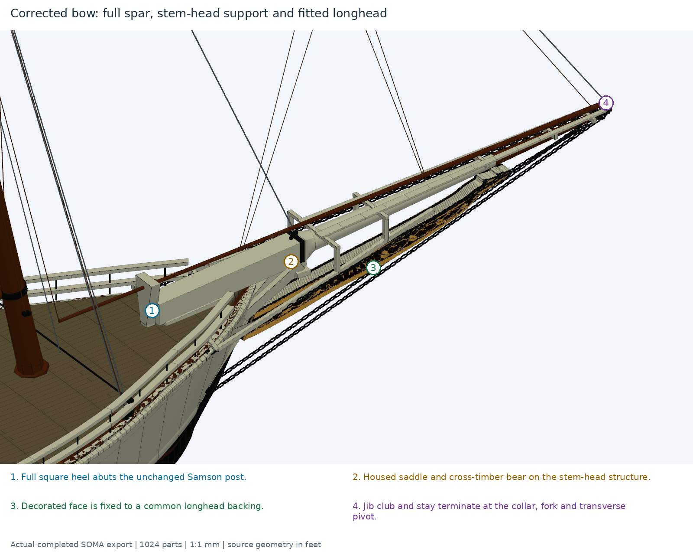
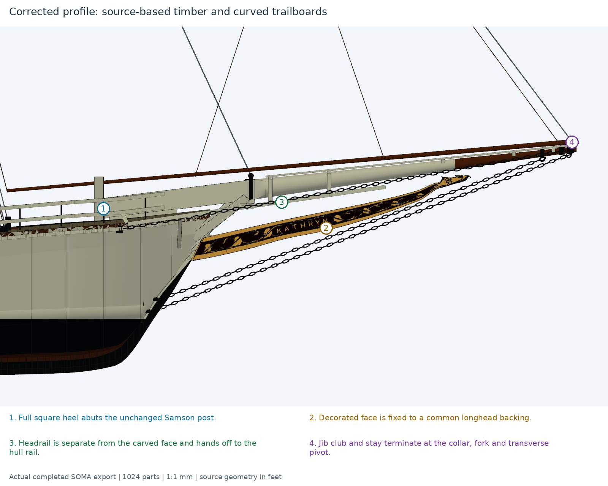
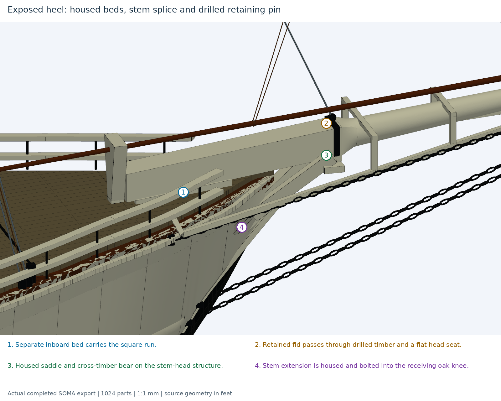
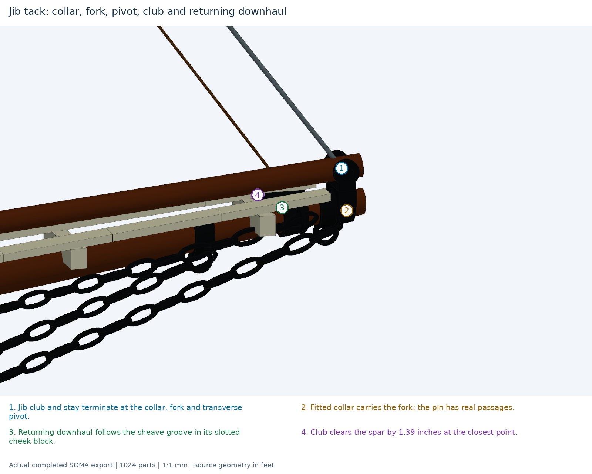
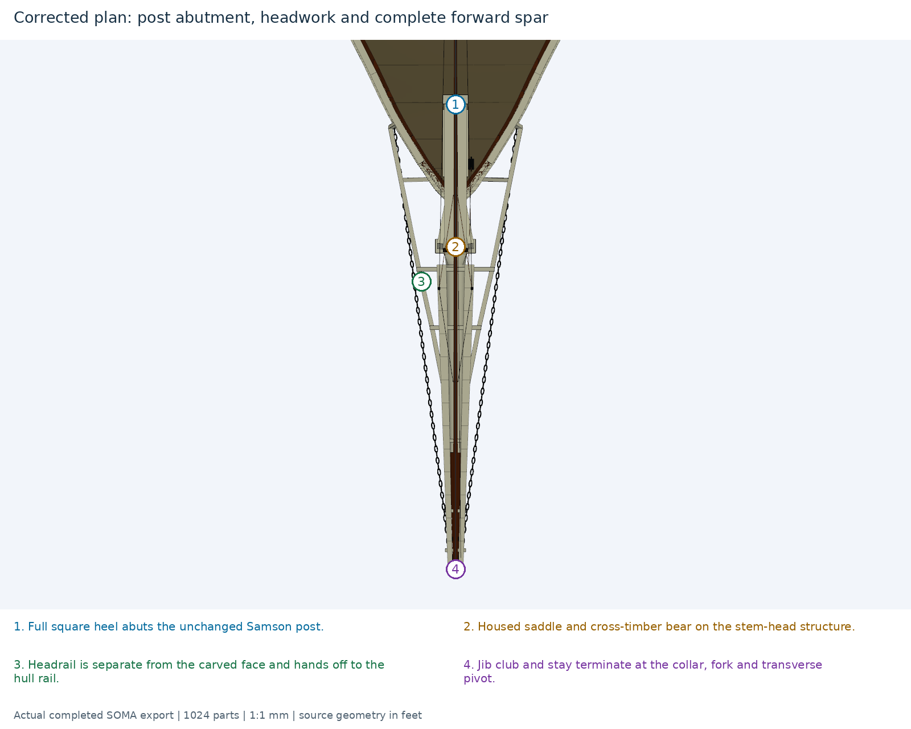
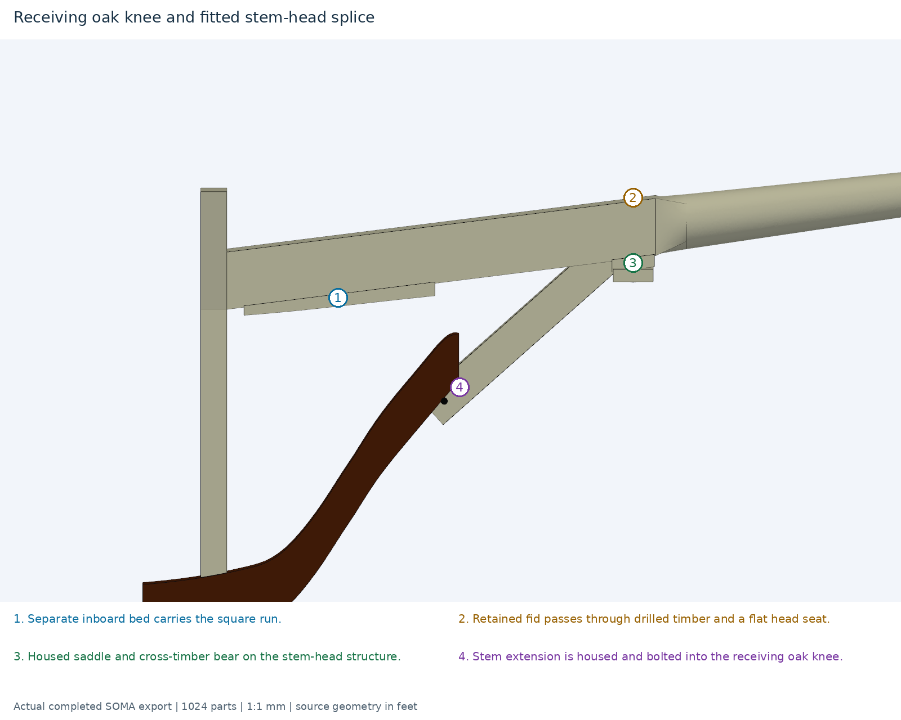
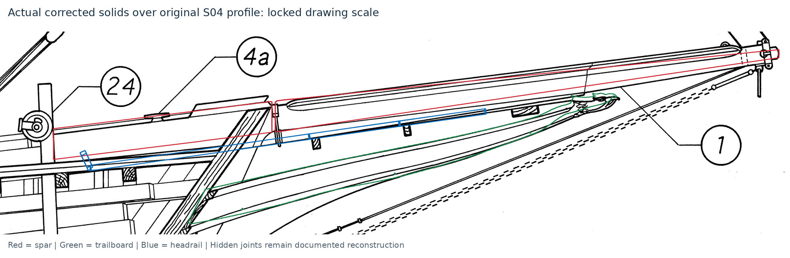
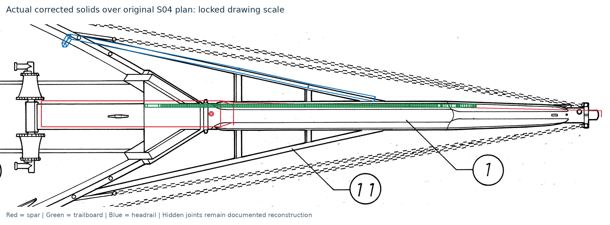

# Bowsprit and trailboard correction

15 November 2026. Implementation of the six phases in [the attachment review](BOWSPRIT_ATTACHMENT_REVIEW.md). Status: **clean committed-tree build and attachment checks passed**; verification of geometry commit **bb9a621** is recorded with the [trailboard correction](TRAILBOARD_CORRECTION.md). The original review and its pictures remain the as-found record of e341989.

The correction replaces the shortened outer cone with a complete spar, seats it against the existing Samson post, houses the stem-head structure into the receiving oak knee, and connects the jib through a real collar, fork and transverse pivot. The carved boards fit a common longhead backing and have their own fixing passages. The sail is solved around the actual tack and stay, and the downhaul returns through its cheek block to a foredeck cleat.

## Source decisions

The new [bow registration ledger](../references/drawing_package/bow_remedy_registration.json) retains original scan hashes, drawing picks, coordinate transforms and inferred hidden details. Sheet 4 profile and plan establish the complete spar and rounded transition; Sheet 5 fixes the existing Samson-post station; Sheet 1 controls ornament; Sheet 3 controls line identity and routing; Sheet 8 controls jib dimensions.

The traced spar axis is **21.576 feet**, with a **12 by 11 inch** square inboard section. The after face abuts the unchanged post at F = 45.926; the forward timber ends at F = 67.334. The earlier 22-foot NPS description differs by about 5.1 inches, or 1.9 percent. Its nominal length is retained as a cross-check. The measured HAER survey stations govern this reconstruction; no claim is made that the different records dimension identical end allowances and fittings.

The rounded transition is a distinct station near F = 52.772. It is no longer treated as the complete spar's heel. The mast, Samson-post station, main hull and accepted stern were not moved to make the bow fit. The receiving internal oak knee now has the housing and transverse passages needed for the new headwork.

The longhead outline was traced from the scaled Sheet 4 profile and refined with the Sheet 1 ornament detail. Headrails follow the separate item-11 plan relationship and terminate beneath the walking-board assembly, aft of the eagle. Their local rear handoff is fitted to the existing hull/rail geometry. Secondary timber curves and concealed fixing sizes remain qualified reconstruction details rather than exact historic cutting patterns.

## Corrected structure and joints

### G1 - Complete spar

The timber now includes the square inboard run, a square-to-round transition and the tapered forward part. It is one continuous valid solid. Its after end has a vertical abutting face at the post rather than extending through the post. The forward 5.5 feet have a separate thin varnish finish, following the historical description.

### G2 - Fitted support and retention

An inboard bed carries the square portion. At the stem head, the saddle, cross-timber, cheeks and stem extension form a coordinated support assembly. The extension has a matching housing and two transverse bolt passages in the receiving oak knee. These joints use fitted faces rather than uncut overlapping timbers.

The retaining fid has a real passage through the spar and supporting timbers, a flat head seat, and a drilled transverse retaining clip below the cross-timber. The former diagonal prop around the end of the short spar has been removed.

The bed provides bearing, the existing post provides the after stop, and the stem-head assembly and retained fid provide restraint. These are represented attachment relationships; fastener size, timber strength and actual joint stiffness still require separate engineering inputs before any construction use.

### G3 and G4 - Backed, fitted decorative faces

Both board faces fit the sides of a common half-foot-wide longhead backing. Any separate rear filling is registered as its own fitted piece. The board faces are 1.44 inches thick. Three fixing stations per face have passages in the board and backing, with visible heads. The green border ground, maroon field, carved gold lettering and eagle eye remain distinct parts.

The board upper edge comes from the traced longhead, independently of the spar underside. The headrails have their own source-based placement and knee connections. Their projected relationship to the carved field is checked in profile, plan and quarter views. The decorative boards carry their own mounting loads; they are not used as a substitute for the spar's primary support.

### G5 - Connected tack and club

The jib stay now terminates at a transverse pin held by a fork on a fitted bowsprit collar. The club has a matching pivot passage and a short forward overhang beyond the pivot. The collar, fork, pin and timber create the missing connection. The previous free-space termination above the spar is gone.

The club clears the bowsprit by approximately **1.39 inches**. Small collar and pin clearances are explicit CAD assembly allowances, checked at a one-millimetre attachment tolerance.

### G6 - Sail solved on its stay

The jib head is solved on the line from the actual tack to the masthead. The clew is then solved from the three printed dimensions: luff 49 feet 6 inches, foot 25 feet 8 inches, and leech 42 feet. The sail is not translated vertically to make clearance.

The club follows that foot, with its lazyjack stations rebased to the solved geometry. The flat sail remains a display reference. Its narrow foot allowance is trimmed clear of the club, and the tiny detached region at the pivot is excluded. The nominal dimension controls remain the printed triangle; this is not a sailmaker's cloth-cutting pattern or a simulation of draft.

### G7 - Returning downhaul and identified stays

The jib downhaul runs from the head, around the actual cheek-block sheave, and back to a new foredeck cleat. The cheek block includes a slotted case, axle and separate grooved sheave. The return follows a tangent/arc route rather than ending at an arbitrary tip coordinate.

The two chain bobstays remain, together with the side stays and their collars/eyes. The extra schematic straight `Bobstay` has been removed. Stem straps and hull chainplates retain their vessel-specific mounting stations. Their concealed fastening details remain reconstruction-level geometry; no strength rating is inferred from their appearance.

### G8 - Acceptance based on exported geometry

[check_bow_attachment.py](../src/checks/check_bow_attachment.py) reads the exact BREP from a completed SOMA build. It checks source dimensions, intended contacts, housed joints, empty pin passages, board fixing relationships, head-to-stay alignment, sail dimensions, club clearance and the returning downhaul. It rejects the old third bobstay and shortened-spar prop.

The M3 post/heel regression now checks the full spar's abutment at the unchanged post. The M6 regression checks that the jib head lies on its actual stay. The old exterior check delegates its superseded bow assumptions to the new attachment check.

The decorative composition was subsequently rebuilt from the approved [trailboard specification](TRAILBOARD_GAP_ANALYSIS.md). The [trailboard implementation](TRAILBOARD_CORRECTION.md) records the native contour tracing, independent source checks, corrected headrails and retained assumptions. The current witnesses below have been regenerated from that completed 1024-part model.

## Current witnesses

## Original drawings with the corrected solids overlaid

These overlays use the declared registration and original imperial scale. Each component keeps the same scale and datum. Local source discrepancies and inferred rear handoffs are identified above; the images are not independent fits made to hide those differences.

## Validation and remaining limits

The official working build and cache-free archive build of **bb9a621** both succeed with 1024 parts and zero warnings, and the exact exported-solid joint checks pass. All 1024 part bounds and volumes agree between those exports. The committed-tree log and source/image fingerprints are recorded in the linked trailboard implementation package. The machine-readable attachment acceptance is written to `docs/images/bow_remedy/acceptance.json`.

Known limits are recorded in the source ledger: unprinted hidden joint dimensions and local timber fairing are reconstruction choices; the nominal historic length differs from the assembled survey trace; flexible rope and cloth behaviour are not simulated. These limits do not restore permission for disconnected fittings, unbored pins or decorative boards used to conceal missing support.
