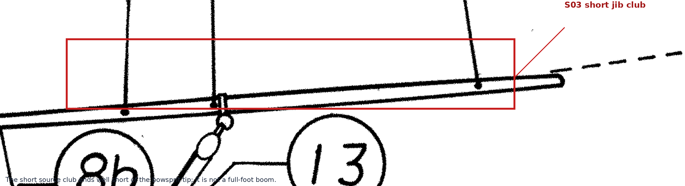
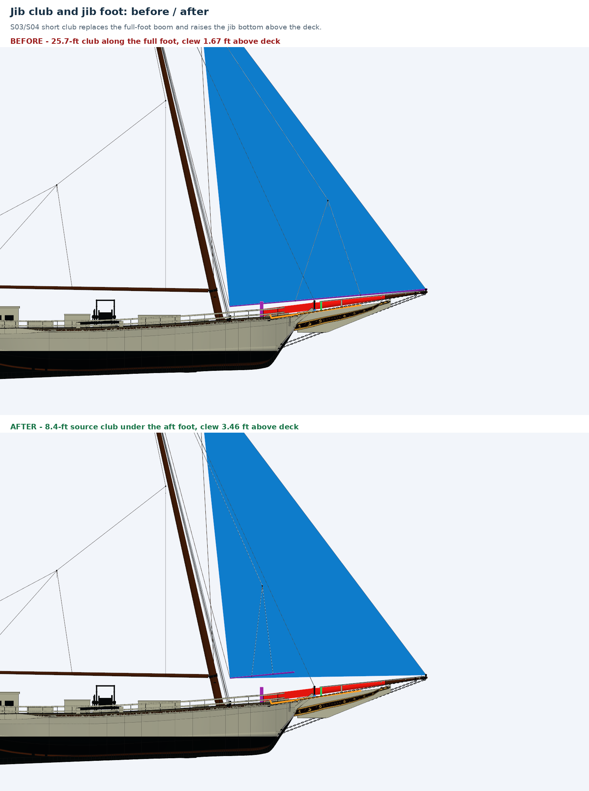
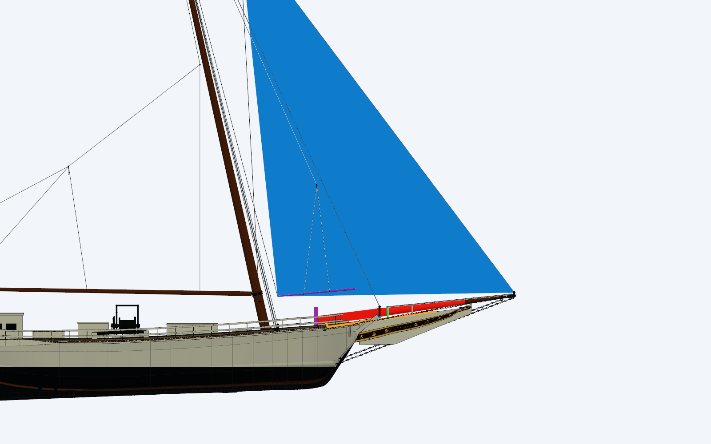
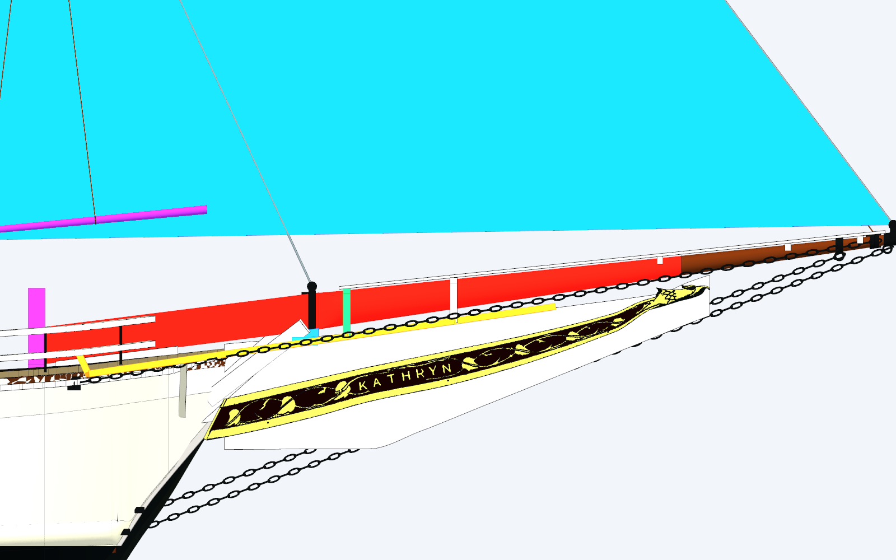

# Jib-club correction: short source spar and raised jib bottom

15 November 2026. Status: **implemented and verified from the completed working export**; a fresh committed-tree proof is recorded with the follow-up documentation commit. The current model contains **1025 registered parts**.

The previous trailboard/bow correction rebuilt the jib club as a 25.7-ft spar running from the bowsprit tip to the clew along the full jib foot. That is not the Sheet 3 arrangement. S03-V01 shows a **short jib club** under the aft part of the foot, high above the deck. The current model now uses that source club and the raised jib pose.

## Source basis

- **S03-V01 / Sheet 3** shows the short club and its sheet at the bow, above the headrail. The club ends well short of the bowsprit tip; it is not a full-length boom.
- **S04 items 13 and 14** locate the short club and the jib-sheet traveller at the bow.
- The S08 sail plan supplies the luff and foot plan dimensions. Its 42-ft leech is a plan dimension; the straight 3D chord from the masthead to the source clew is shorter because the clew is raised to the club.

The source record is in [jib_club.json](../references/drawing_package/jib_club.json). The original S03 and S04 scans are not modified.

## What changed

- The jib club is now an **8.40-ft** tapered spar from the clew forward under the aft part of the jib foot. It does not extend to the tack.
- The club aft end is at the source clew; the clew is **3.46 ft above deck**, and the club fore end is **3.54 ft above deck**. The previous full-foot club put the clew only **1.67 ft** above deck.
- The jib sail remains a reference display. Its luff stays on the actual stay and is 49.5 ft. The source clew gives a 25.53-ft foot and a 40.21-ft straight leech chord. The S08 plan values are retained in the ledger for comparison; the 42-ft plan leech includes unmodelled roach.
- The lazyjack strops and legs now land on the short club, not on the old full-foot spar. The jib sheet, halyard and downhaul still follow the actual tack/head and club.
- The jib tack pivot, collar and fork remain at the bowsprit tip. The short club is a separate spar on the jib foot; it is no longer forced to touch the tack pivot.

## Verification

```sh
python src/checks/check_m6_rigging.py
python src/checks/check_bow_attachment.py
```

`check_m6_rigging.py` checks the club length, the source clew, the clew height above deck, the short-club/foot offset, the lazyjack attachment and the sail head on its stay. `check_bow_attachment.py` reads the completed BREP and checks the club clearance, the jib sail clearances, the sail dimensions against the source ledger and the retained tack fitting.

Working-export results:

| Item | Value |
|---|---|
| Jib club length | **8.398 ft** |
| Clew height above deck | **3.464 ft** |
| Club fore end above deck | **3.543 ft** |
| Jib club to bowsprit | **27.6 in** clear |
| Jib luff | **49.5 ft** |
| Jib foot / straight leech | **25.528 / 40.212 ft** |
| S08 plan foot / leech | 25.667 / 42.0 ft |
| Jib head on actual stay | yes |
| Club/sail/bowsprit common volume | zero |









## Retained assumptions

- The S03/S04 club stations are used directly; the short club is a reconstruction from the source drawing and the previous measured table, not a new survey.
- The display sail is a flat reference triangle, not a dressed sail. The straight leech chord differs from the S08 plan leech by about 1.79 ft; the source pose is treated as the governing 3D arrangement.
- The jib club is a short spar on the foot, not a primary structural attachment. The tack pivot and stay remain the primary load path.

## Reproduction

```sh
soma build
python src/checks/check_m6_rigging.py
python src/checks/check_bow_attachment.py
```
