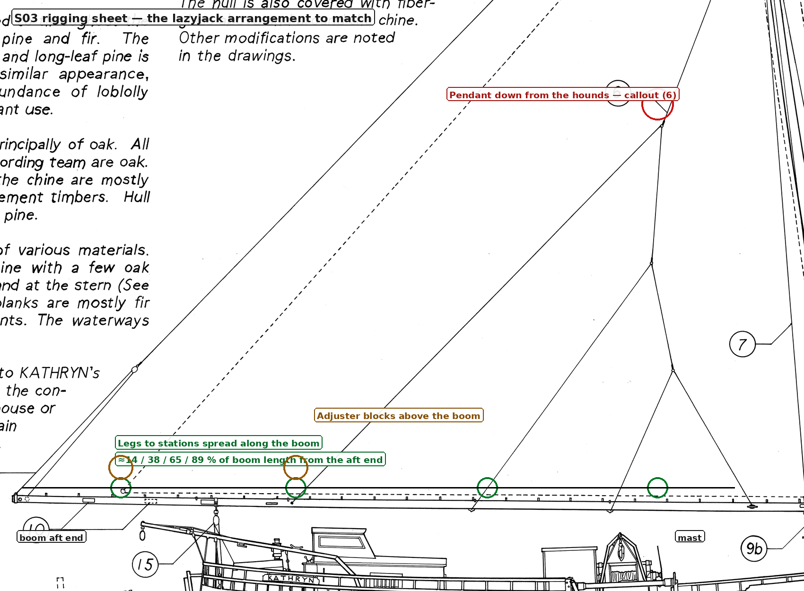
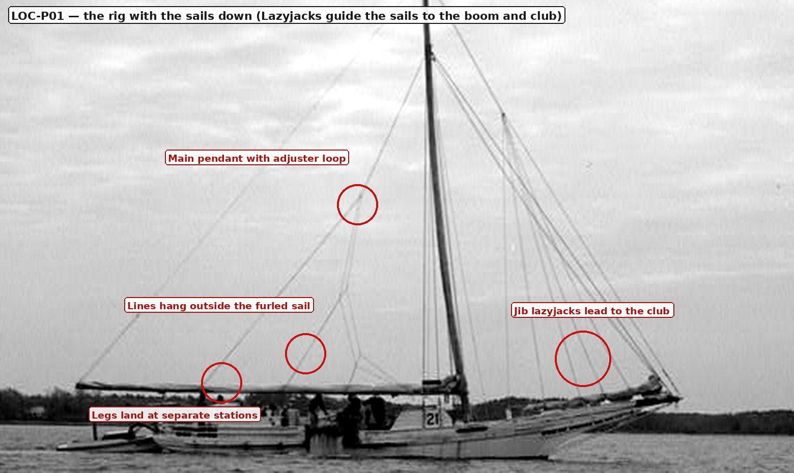
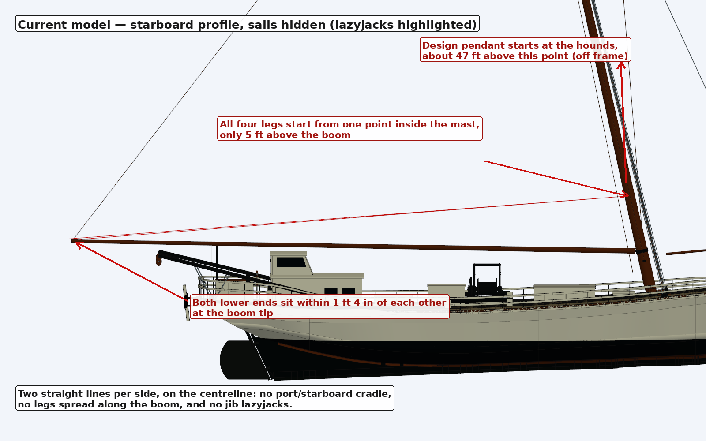
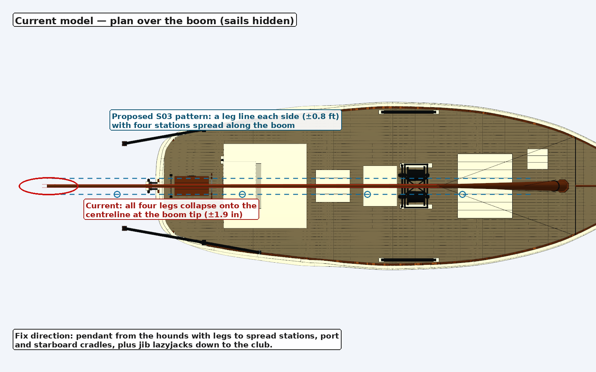

# M6 lazyjacks — gap analysis and fix plan

**Status: implemented 2026-11-14.**
The four as-found lazyjack parts did not represent the rig shown on the
source drawings. The fix below is now in the model: a main cradle per side
and jib lazyjacks down to the club.

## 0a. Implementation update (2026-11-14)

- **Main lazyjacks:** one pendant per side from the hounds to two junction
  blocks (`Y −8.2/Z 37.0` and `Y 6.0/Z 26.0`), with legs to four boom
  stations at `Y 30.3 / 17.7 / 4.0 / −8.2 ft`, an outboard line plane at
  `X ±0.75 ft`, boom-side attachments, and short adjuster tails.
- **Jib lazyjacks:** a pendant per side from the hounds to a junction at
  `Z 24 ft` above the jib club, with two legs landing at one-third and
  two-thirds of the club and an adjuster tail. The club itself was rebuilt
  for the bow fix (see `docs/BOWSPRIT_GAP_ANALYSIS.md`): it is now the
  25.7-ft spar along the raised jib foot, so the jib lazyjacks were rebased
  onto it.
- **Validation:** `check_m6_rigging.py` passes with 59 rigging parts and
  checks the mast/boom stations, the four main legs, the jib legs on the
  club, and the boom-tip containment. `soma build` is 903 parts.
- **Figures:** the annotated model figures in §3 are the as-found evidence
  captured before this change; the generator now skips them when the old
  `Port lazy jack 1` parts are no longer registered.

## 0. Summary

The current model has **four lazyjack parts — two straight lines per side**
(`src/parts/rigging.py:131-139`). Both lines on a side start from the same
point inside the mast, 4 ft 8 in above the boom, and run to two points
1 ft 4 in apart at the boom tip. One line per side ends **0.5 ft beyond the
boom end, in free air**. Both lines stay within ±1.9 in of the centreline
over their whole length.

The S03 rigging sheet (key item 6, *Lazy Jacks*) and the LOC photographs show
a different arrangement: a pendant from high on the mast (the hounds) down to
legs spread along the boom, with adjuster blocks, on **both sides** of the
sail — a cradle that catches the dropped sail. The LOC caption also says the
lazyjacks guide the **jib** down to its **club**, which the model does not
have at all.

## 1. Source evidence

- **S03-V01, hull profile & rigging.** The rigging key lists `6. Lazy Jacks`.
  Callout (6) points at a pendant descending from the hounds, with legs that
  branch down to the boom at four stations spread along its length, and small
  blocks above the boom. A second (6) callout appears on the forward fan of
  lines that leads to the bow / jib area.
- **S03-N02, rigging notes.** Key only; no separate dimensions. Running-gear
  notes mention the jib sheet leading "up to hounds, down to port pin rail",
  so the forward fan includes other running gear as well; the drawing and the
  photo caption separate the lazyjacks from that.
- **LOC-C01 / LOC-P01** (HAER MD-117, photo 1): *"STARBOARD PROFILE WITH
  DREDGE BASKET BEING RAISED — NOTE 'LAZYJACK' RIGGING TO GUIDE SAILS DOWN TO
  BOOM AND CLUB (REQUIRES LESS CREW)"*. With the sails down, pendants with
  hanging adjuster loops are visible above the boom, the legs land at several
  points along the furled sail, and lines lead down to the jib club.
- **LOC-P02** (3/4 view from the stern) confirms the legs hang just outside
  the furled sail and attach at separate points along the boom.
- **S08-V01, sail plan.** Gives the jib dimensions and shows the jib foot on
  its spar. This matters for the jib lazyjacks (see §4, step 5).

Figures (generated by `src/checks/build_lazyjack_gap_assets.py`):

## 2. Current model, measured

From the built part map (`.soma/model.map.json`, mm converted to feet):

| Part | Upper end (ft) | Lower end (ft) |
|---|---|---|
| Port lazy jack 1 | (+0.16, −13.29, 17.24) | (+0.16, 37.80, 13.29) |
| Port lazy jack 2 | (+0.16, −13.29, 17.24) | (+0.16, 36.50, 13.27) |
| Starboard lazy jack 1 | (−0.16, −13.29, 17.24) | (−0.16, 37.80, 13.29) |
| Starboard lazy jack 2 | (−0.16, −13.29, 17.24) | (−0.16, 36.50, 13.27) |

Reference geometry:

- Mast axis at the jack top is at Y = −13.29 ft; **mast radius there is
  0.468 ft (Ø 11.2 in)**, so the start points at X = ±0.16 ft are ~3.7 in
  **inside the mast solid**.
- Boom runs Y −13.75 to +37.30 ft; Z 11.99 to 13.26 ft; radius 0.24 to
  0.15 ft. The aft tip is **Y = 37.30 ft**.
- The two lower ends per side are **1.30 ft (1 ft 4 in) apart**; the aft one
  (Y = 37.80) is **0.50 ft beyond the boom tip**.
- The sail is a flat plate on the centreline (X = 0); the jack lines run at
  ±0.16 ft (1.9 in) from it over their whole length.

## 3. Gap table

| # | Gap | Evidence | Severity |
|---|---|---|---|
| G1 | No cradle. All four lines lie within ±1.9 in of the centreline; nothing hangs outboard on either side of the sail. A dropped sail passes between them. | current model, plan figure | high |
| G2 | No legs spread along the boom. All lower ends are at the boom tip (1 ft 4 in apart); the S03 sheet shows four stations at ≈14 / 38 / 65 / 89 % of the boom length from the aft end. | S03, LOC-P01/P02 | high |
| G3 | One line per side ends 0.5 ft aft of the boom tip, attached to nothing. | current model | high |
| G4 | Upper end is only 5 ft above the boom; the design pendant starts at the hounds (~64 ft up), with adjuster blocks. | S03 callout (6), LOC-P01 loops | high |
| G5 | No adjuster blocks, eyes or tails (the photos show hanging loops on the pendants). | LOC-C01/P01, S03 | medium |
| G6 | No jib lazyjacks. The caption explicitly covers the club, and S03 has a (6) callout on the forward fan. | LOC caption, S03 | medium |
| G7 | Lines start inside the mast solid and hug the sail plane, so they read as two thin diagonal lines drawn on the sail. | current model | medium (cosmetic but user-visible) |
| G8 | The current jib club is not on the jib foot: club at Y −25.0…−16.6 ft, Z 11.9…12.8 ft; the demonstration jib clew is at Y −14.6 ft, Z 17.6 ft. The jib lazyjack target is therefore unresolved until the club pose is checked against S08. | current model, S08 | dependency |

## 4. Fix plan

### Step 1 — Replace the main lazyjack lines (per side)

Build a pendant-and-legs system instead of four straight lines. Suggested
initial geometry (feet, model frame; to be tuned against the S03 overlay):

- **Pendant:** from just under the hounds band,
  `Z = HOUNDS_Z − 0.3 ≈ 63.9 ft`, on the aft face of the mast,
  `X = ±(mast_radius_at(Z) + 0.06) ≈ ±0.23 ft`,
  to the upper junction block J1.
- **J1:** `X = ±0.75`, `Y = −8.2`, `Z = 37.0` (above the forward-most boom
  station, as drawn on S03).
- **Legs to the four S03 stations** (boom spar length 51.05 ft, aft end
  Y = 37.30): `Y = 30.3, 17.7, 4.0, −8.2 ft`, at `X = ±0.75 ft` and at the
  boom's top edge (boom axis Z + radius + ~0.1 ft; ≈13.2–13.4 ft).
- **Second junction J2:** on the leg to the aft stations,
  `X = ±0.75`, `Y ≈ 10`, `Z ≈ 26` (the S03 sheet shows two junction
  blocks). Split the legs 1 + 3 at J1/J2 if reproducing the drawn tree, or
  use J1 only for a simpler fan; decide from the profile overlay.
- **Tails:** a short rope tail hanging below J1/J2, 0.5–1.0 ft, to read as the
  adjuster loops in the photo.

Use `spar_between(..., .012)` for the lines (same as now) and register the
junctions as small IRON blocks in `Rigging/Fittings`. Keep the main-sheet and
other lines untouched.

### Step 2 — Jib lazyjacks

After Step 5 (club check), add per side a pendant from the hounds
(`Z ≈ HOUNDS_Z`) down-forward to the rigged jib club, with two legs landing
at ~1/3 and ~2/3 of the club's rigged length, `X = ±(club radius + clearance +
outboard hang)`. Follow the same junction/tail pattern as the main system.

### Step 3 — Naming and groups

Rename the four current parts, e.g.:

- `Port main lazyjack pendant`, `Port main lazyjack leg 1…4`
- `Starboard main lazyjack pendant`, `Starboard main lazyjack leg 1…4`
- `Port jib lazyjack pendant`, `Port jib lazyjack leg 1…2` (and starboard)
- `Port main lazyjack junction 1/2`, `Port jib lazyjack junction`, etc.

Lines stay in `Rigging/Running`; blocks and eyes in `Rigging/Fittings`.

### Step 4 — Extend the rigging check

`src/checks/check_m6_rigging.py` currently asserts 33 rigging parts and only
indirectly covers the lazyjacks. Add:

- presence and names of the main and jib lazyjack systems;
- pendant top within 1 ft of `HOUNDS_Z` and outside the mast radius;
- every lower end within the boom span (`Y ≤ 37.30 + 0.2`) and at
  `|X| ≥ 0.6 ft`;
- station fractions within 2 % of (0.14, 0.38, 0.65, 0.89);
- no line intersects the mast, boom, sail or club (use shape clearance or
  sampled distances);
- write the lazyjack summary and sources to `m6_rigging_acceptance.json`.

### Step 5 — Resolve the jib club before attaching the jib lazyjacks

Confirm from S08/S03 whether the club is rigged along the jib foot (from the
bowsprit end aft) or stowed as currently modelled. If it is stowed, move it to
the rigged pose first; otherwise the jib lazyjacks have nothing meaningful to
attach to. Record the decision in `docs/milestones/M6.md`.

### Step 6 — Verification pictures

Re-run `src/checks/build_lazyjack_gap_assets.py` after the change, plus a new
profile overlay at S03 scale: the corrected pendant and legs should lie on
the drawn lines. Acceptance:

- profile overlay matches S03 within ~1 ft at the boom and ~2 ft at the
  junctions;
- plan view shows a clear port/starboard cradle with four stations each side;
- from astern the lines are separated by the full cradle width;
- no intersections; `soma build` and `check_m6_rigging.py` pass.

### Step 7 — Documentation

Update `docs/milestones/M6.md` (lazyjack arrangement, sources, open items) and
regenerate the README images if the rigging is visible enough to change them.

## 5. Open questions

1. **Leg count and junctions.** The S03 profile clearly shows multiple stations
   and blocks, but the number of pendants per side (one pendant with 4 legs vs
   two pendants with 2 legs each) is ambiguous in 2D. Plan assumes one pendant
   with two junctions; confirm on the overlay.
2. **Outboard hang.** 0.75 ft is proposed so the legs clear the sail plane and
   read as a cradle. The furled-cover width should be checked against the
   photos before fixing the value.
3. **Jib club pose.** See Step 5; this is a hard dependency.
4. **Jack stays vs lazyjacks.** S03 also lists *Jack Stays* (4) and the S08
   notes mention a *jackline*. Make sure the fix does not duplicate the same
   line under two names.

## 6. References

- `references/drawing_package/S03/S03-V01/native.png` — hull profile & rigging.
- `references/drawing_package/S03/S03-N02/ocr.txt` — rigging key and notes.
- `references/loc_photos/LOC_Kathryn_photos/01-LOC-C01.jpg`,
  `02-LOC-P01.jpg`, `03-LOC-P02.jpg` — photographs with the lazyjacks visible.
- `references/drawing_package/S08/S08-V01/native.png` — sail plan.
- `src/parts/rigging.py:131-139` — current lazyjack implementation.
- `src/checks/check_m6_rigging.py` — rigging acceptance check.
- `src/checks/build_lazyjack_gap_assets.py` — figure generator for this document.
