# Trailboard correction: implementation and verification

15 November 2026. Status: **implemented and verified from committed tree bb9a621**, then extended by the [timber-envelope correction](TRAILBOARD_ENVELOPE_CORRECTION.md). The current model contains **1024 registered parts**. This report implements the approved [gap analysis and specification](TRAILBOARD_GAP_ANALYSIS.md); its before figures remain preserved as the 928-part review snapshot. An [illustrated PDF](trailboard-correction.pdf) is provided beside this file.

The square plaque-like return, pointed head and generic leaf pattern have been replaced with the composition traced from HAER Sheet 1. The boards now have an oblique aft return, broad unequal curls, a shaped enclosure around KATHRYN, the original glyph contours, and a hooked head with eye, mouth/jaw and feather regions. The separate headrails now follow their identified Sheet 4 profile and plan positions.

## What changed

The subsequent [timber-envelope correction](TRAILBOARD_ENVELOPE_CORRECTION.md) adds the solid wood above and below these faces; the face contours and headrail positions described below are unchanged.

- The ornament comes from original native scan regions, not a substituted font, stock bird or repeated sine wave. Small enclosed stipple is excluded. White regions on foreground objects outside the facing are excluded, including the incidental fragment found in the first build.

- Source border and painted-field boundaries replace the old uniform offsets. Each legitimate separate carving island is registered. A clipped region that splits into two pieces retains both, rather than dropping the smaller piece or adding an invented connecting bridge.

- Seven traced glyphs and their counters form the name. The port-side word uses a declared reflection within the reserved name field so that both outward faces read KATHRYN. The original name enclosure and its two scroll terminals are present.

- The eye and mouth separator are seated on the facing. The mouth remains a shallow dark negative region; the drawing does not establish a through-opening in the timber. The inferred fixing stations remain F = 51.5, 56.0 and 60.0 ft, but their vertical positions are in the lower band, clear of the name. Matching passages in facing, backing and relief move together.

- The visible headrail spans follow the identified item-11 plan and profile picks. Their after ends retain a short fitted transition to the accepted hull rails. The related knees and walking-board bearer feet follow the corrected rails. The hidden transition remains an explicitly inferred detail.

- The model has 96 more registered parts than the 928-part baseline because the actual source ornament islands are retained separately. The accepted hull, stern, mast, complete spar, Samson-post station and jib geometry retain their baseline bounds. **893 fixed-part witnesses** were compared.

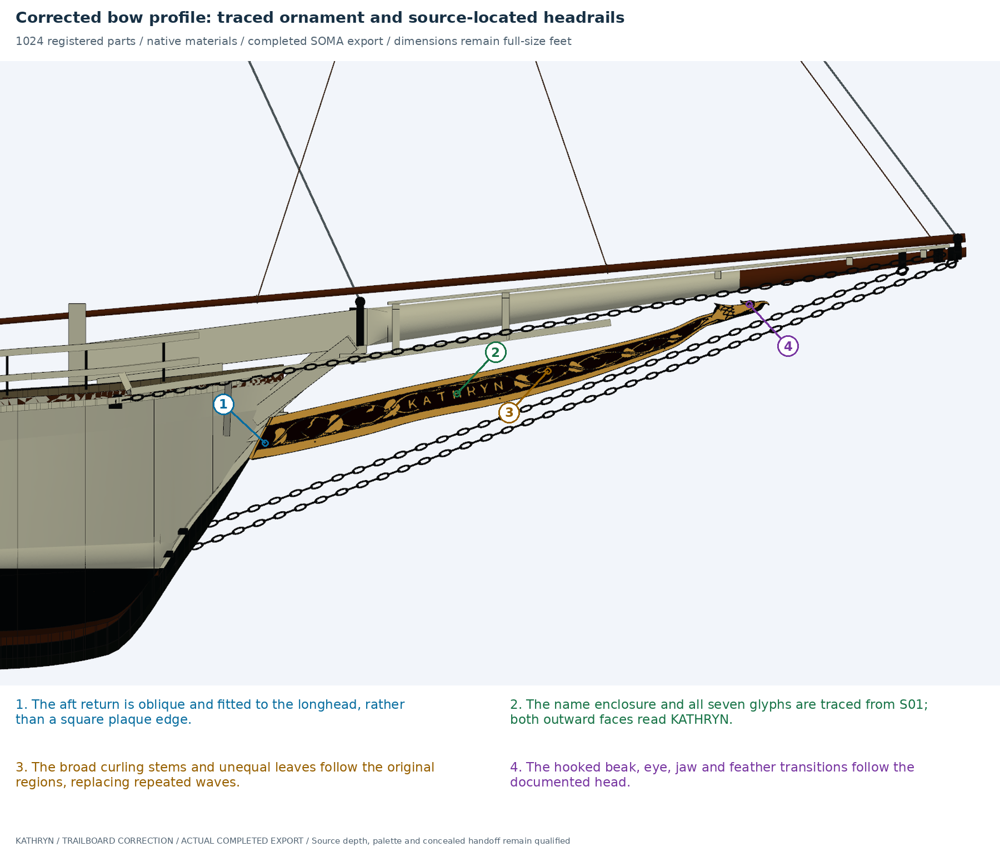

## Source tracing and coordinate transfer

The [target ledger](../references/drawing_package/trailboard_targets.json) records native source pixels, source hashes, semantic roles, closed paths, holes, region seeds, assumptions, physical transforms, held-out landmarks and occlusion masks. The [SVG overlay](../references/drawing_package/trailboard_traces/source-trace-overlay.svg) and [lossless trace overlay](../references/drawing_package/trailboard_traces/source-trace-overlay.png) retain the relationship to the original scan. The extraction is reproducible with `python docs/tools/trace_trailboards.py` and does not modify the originals.

Sheet 4 controls the physical body envelope and rail placement. Sheet 1 supplies ornament contours and proportions. The whole design uses one declared longitudinal/depth transfer, blending into a uniform native mapping at the head; individual leaves and letters are not independently fitted. The original common drawing registration is retained. Source geometry is in full-size feet; registered geometry is in millimetres at 304.8 mm per foot.

Fourteen source stations were held out of the fit: independent upper/lower body points and rail points. Native trace error, historical source uncertainty and CAD contact tolerance are checked separately. The inverse S01 overlay below checks the declared surface transfer; it does not replace the independent physical S04 comparisons.

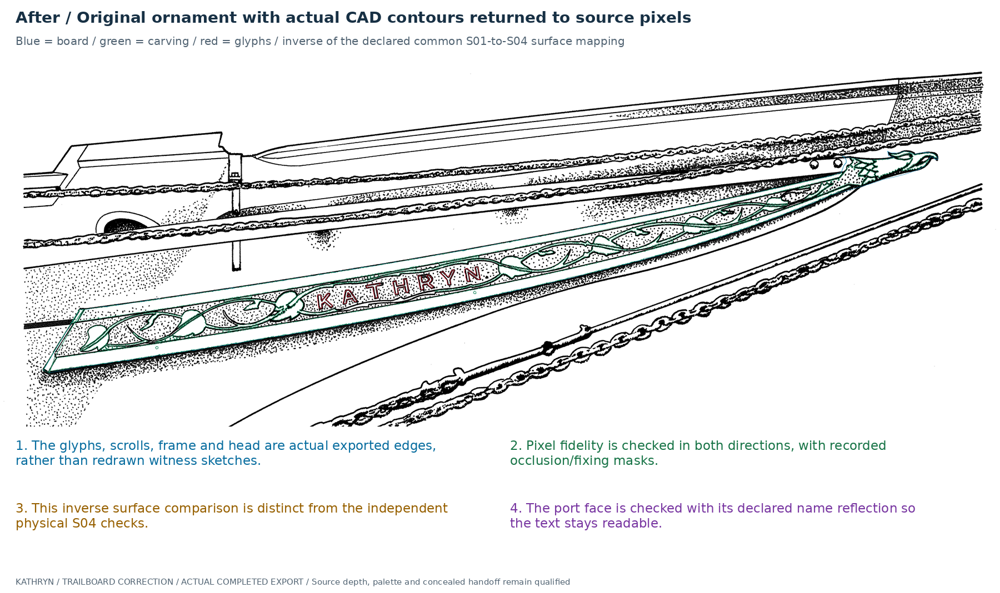

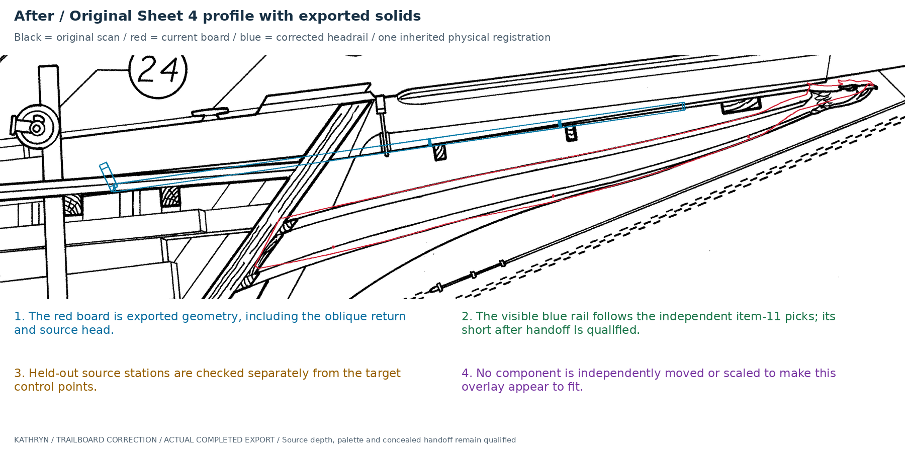

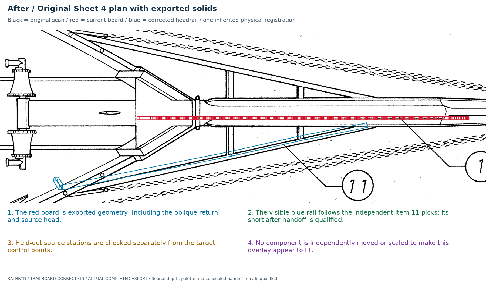

## Corrected faces and details

The two isolated faces below use matching camera scales. They show the actual completed export in its native materials, with the remainder of the boat hidden. The name reflection affects the lettering placement and orientation; the head and decorative design still face forward on each side.

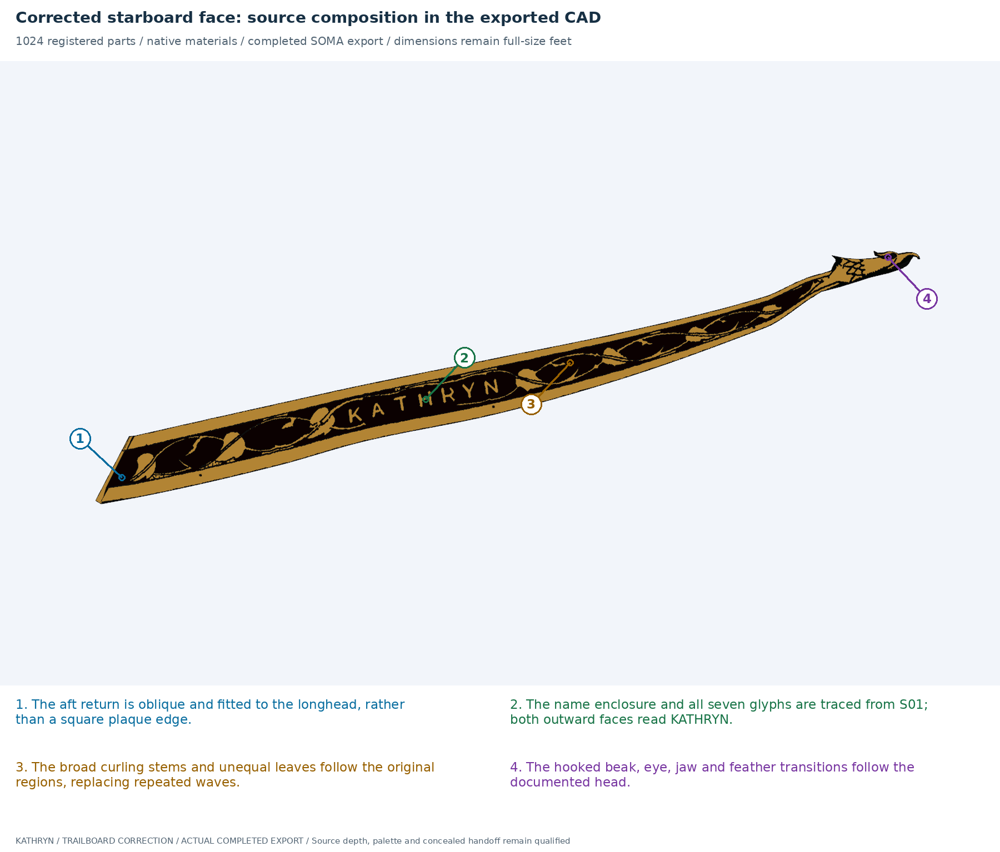

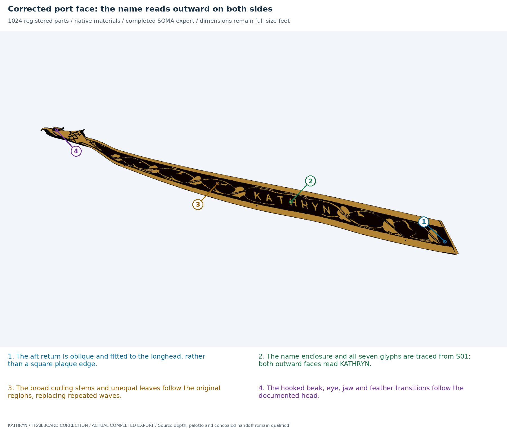

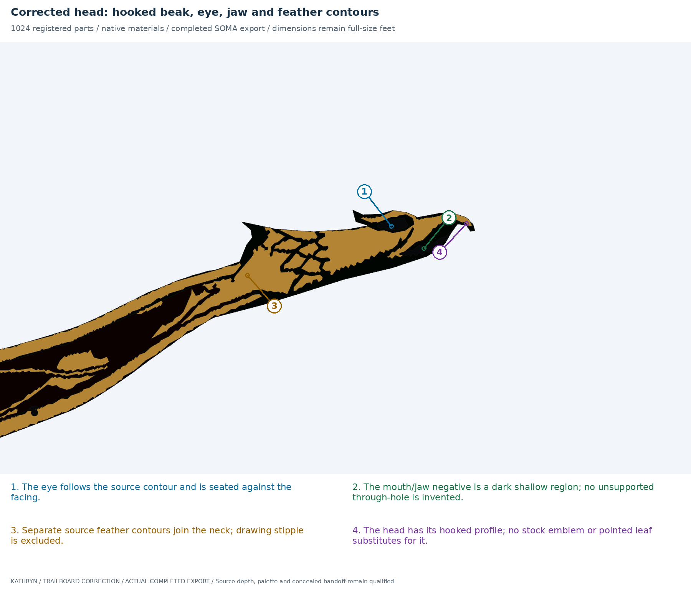

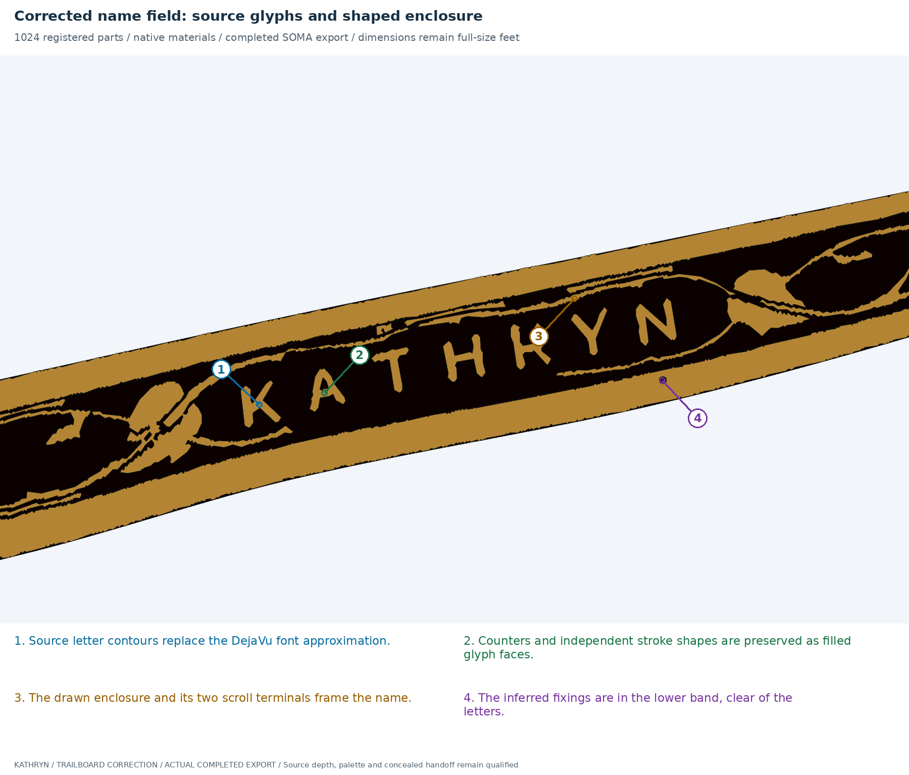

## Comparison with the drawing and photograph

These are appearance comparisons. The source illustration has no independent dimensional scale, and the photograph is in perspective. The actual physical residuals are reported separately below. The original [LOC-P06 crop and full-frame context](images/trailboard_review/source-loc-p06-context.png), [color transparency context](images/trailboard_review/source-loc-c01-context.png), captions and master hashes remain in the [review source record](images/trailboard_review/sources.json).

The source line work outlines the glyphs; this does not prove hollow physical lettering. The implementation uses the traced drawing-state contours as filled glyph strokes with counters. The serif-like appearance in the port photograph remains a documented photo-state observation, rather than a reason to claim that a generic font is an exact match.

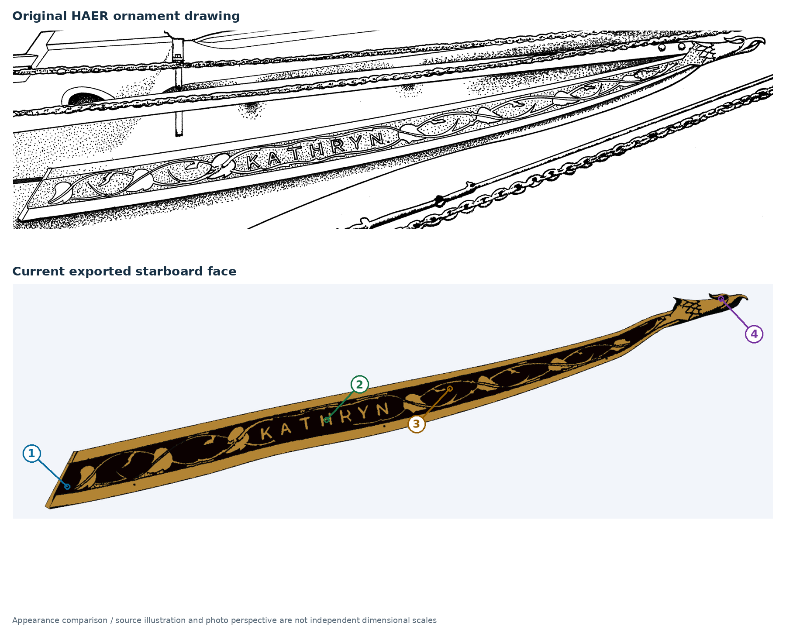

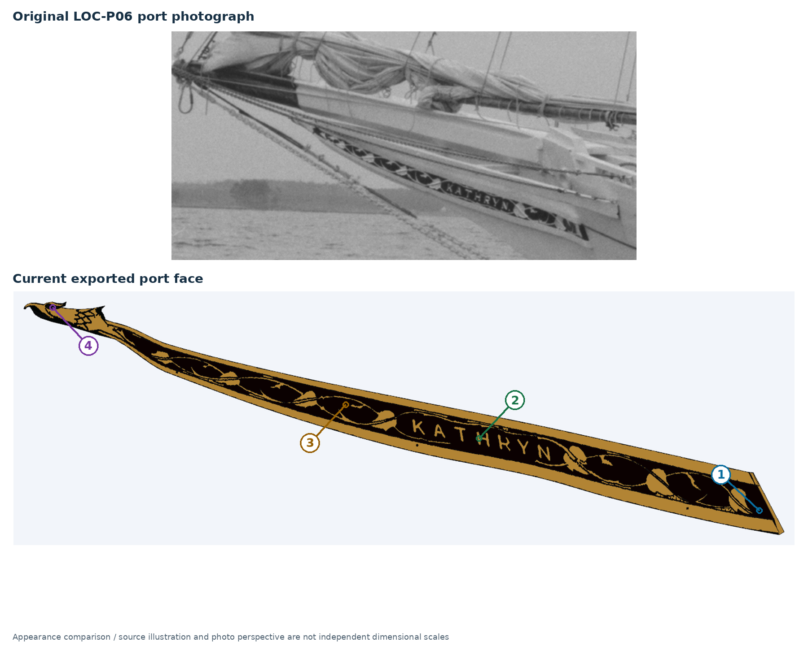

## Assembly and retained assumptions

Facing thickness remains **1.44 in**, common backing width **6.00 in**, and net relief stand-off approximately **0.36 in**. The green/maroon/pale-gold palette is retained. These are provisional reconstruction values, not newly measured historical dimensions or calibrated paint specifications. Source ink roughness is bounded by the native trace tolerance; it is not interpreted as a field of chisel marks or drilled stipple.

The body and its source-traced return fit the existing longhead/stem structure. Fixing passages and visible lower-band heads are coordinated. The fitted source rail/hull transition and unprinted fastening dimensions remain declared assumptions. Neither the facing nor a favorable rendering is used to conceal a missing primary spar attachment.

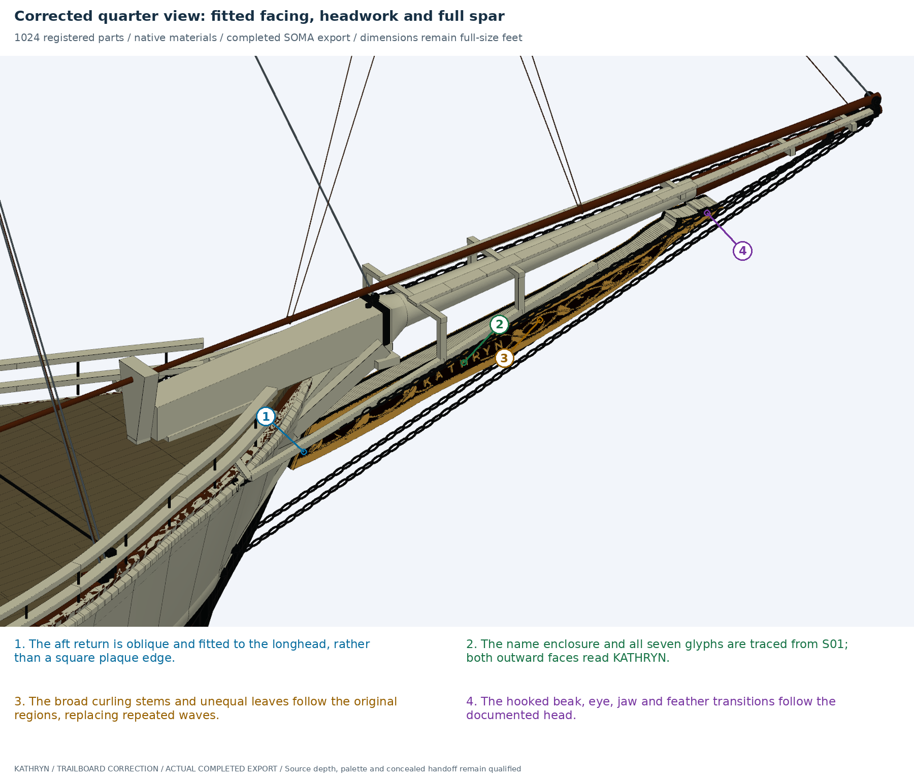

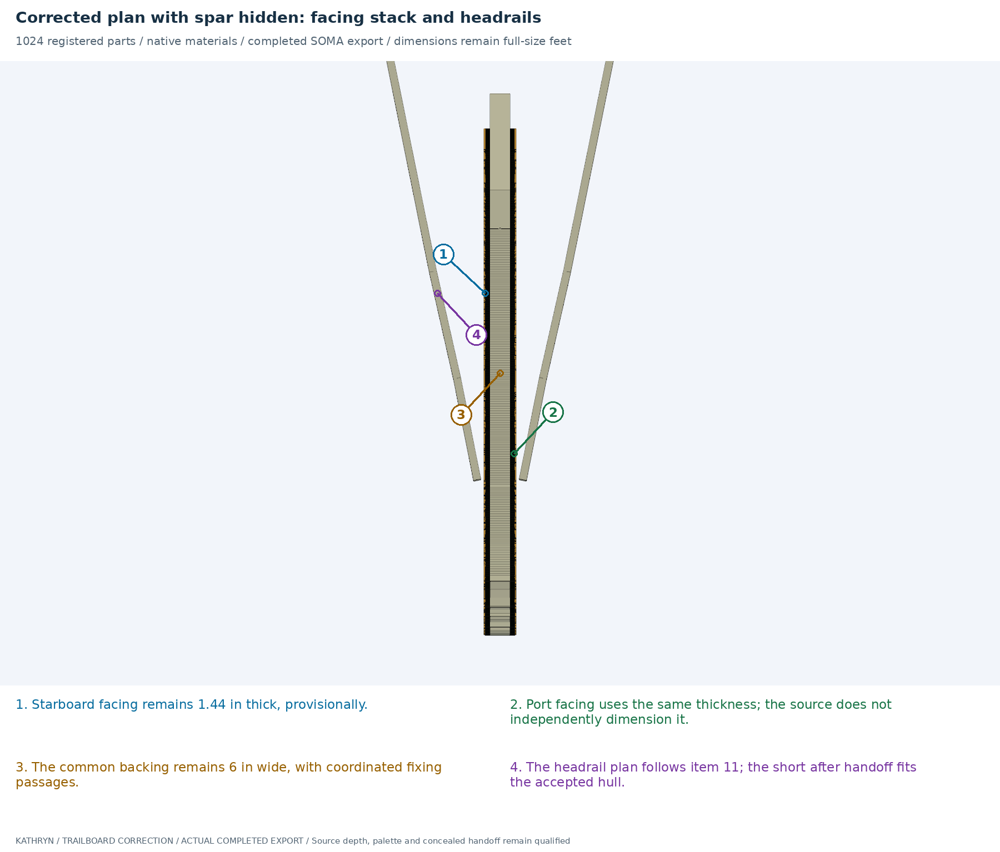

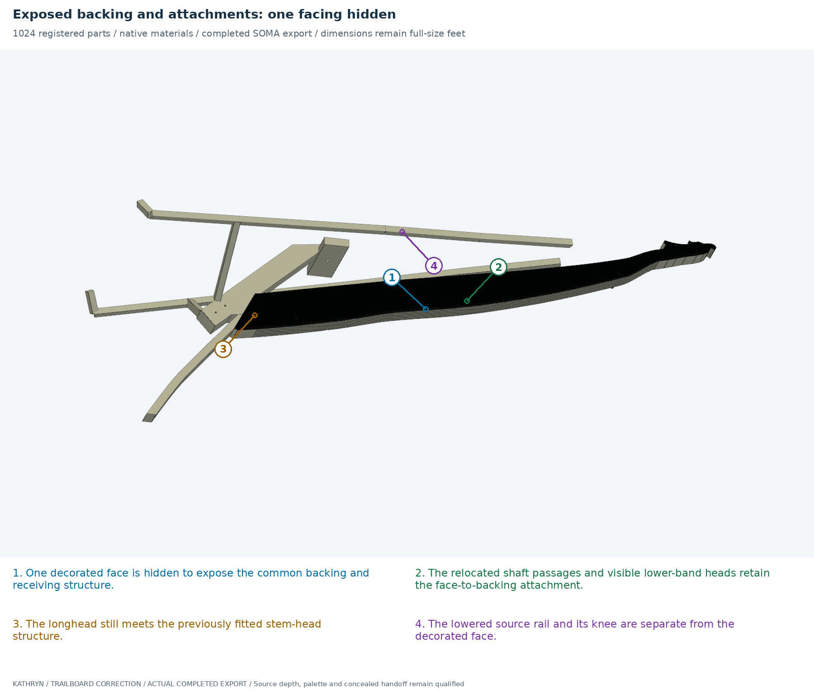

## Verification results

- Completed SOMA build: **1024 valid registered parts**, status OK and zero warnings. The current model STEP and viewer cache were regenerated by the official build.

- **AC-01:** 893 accepted fixed-part bounding witnesses agree within the 0.1 mm check tolerance. The source drawing hashes are checked against the pinned originals.

- **AC-02:** maximum held-out physical source residual **0.125701 ft**, or **1.508 in**, against the provisional **0.20 ft** historical envelope. No component is independently moved to improve an overlay.

- **AC-03:** actual exported outer-profile contour error **0.995 original pixels**, against the six-pixel digital trace limit.

- **AC-04/05:** the head and all source carving regions are present. Maximum ornament contour error **1.818 original pixels**. Region checks run in both directions against native contours, outside the recorded occlusion and inferred-fixing masks.

- **AC-06:** fourteen glyphs compared across both faces, maximum error **1.102 original pixels**. No unintended fixing-to-letter contact was found.

- **AC-07:** every checked region is a valid solid and contacts its board; maximum region-to-board separation **0.000 mm**. No unintended board-to-spar, board-to-headrail or board-to-backing common volume exceeded the stated limit. Paint and relief embed remain classified separately from timber interference.

- **AC-08:** thickness, depth, palette, photo state and hidden fitting assumptions are retained explicitly in the target and acceptance records.

- **AC-09:** maximum independent rail-profile residual **0.023510 ft**. Both modeled rail handoffs contact their accepted hull rails, with measured separation **0.000 mm**.

- **AC-10:** The geometry commit **bb9a621** was rebuilt from an archive without app state, output files or geometry caches. The clean build and its scale, deck, bow and trailboard checks passed. Later documentation checkpoints retain the same model-source hashes.

The [complete machine-readable acceptance](images/trailboard_correction/acceptance.json) contains per-region errors, contact measurements, held-out point residuals and the disposition of every TB finding. The [committed-build record](images/trailboard_correction/committed-build.json) identifies the independently rebuilt geometry commit and its image/source fingerprints. The previously pending bow-remedy source and checks are included with the geometry so that a repository checkout contains all required dependencies.

All eleven [README gallery images](../README.md) and the images in the [bow implementation note](BOWSPRIT_REMEDY_IMPLEMENTATION.md) are regenerated from this completed model. The original 928-part review figures remain before evidence and are labeled accordingly in the gap analysis.

## Reproduction

Run `soma build`, then `python src/checks/check_trailboards.py`, `python src/checks/check_bow_attachment.py` and the repository's scale/deck/rigging regressions. `python docs/tools/build_trailboard_correction.py --render VIEW` creates each of profile, starboard, port, head, name, quarter, plan and underside in a fresh process. Run `--overlays` and `--comparisons` for the source witnesses, and `python src/checks/render_readme_images.py` for the README gallery. The source-derived JSON is a model input and must be present in a clean checkout.

The [original gap analysis](TRAILBOARD_GAP_ANALYSIS.md), original scans and archived photographs remain the source specification. This implementation closes the identified visual composition defects while retaining the stated limits of the evidence.
