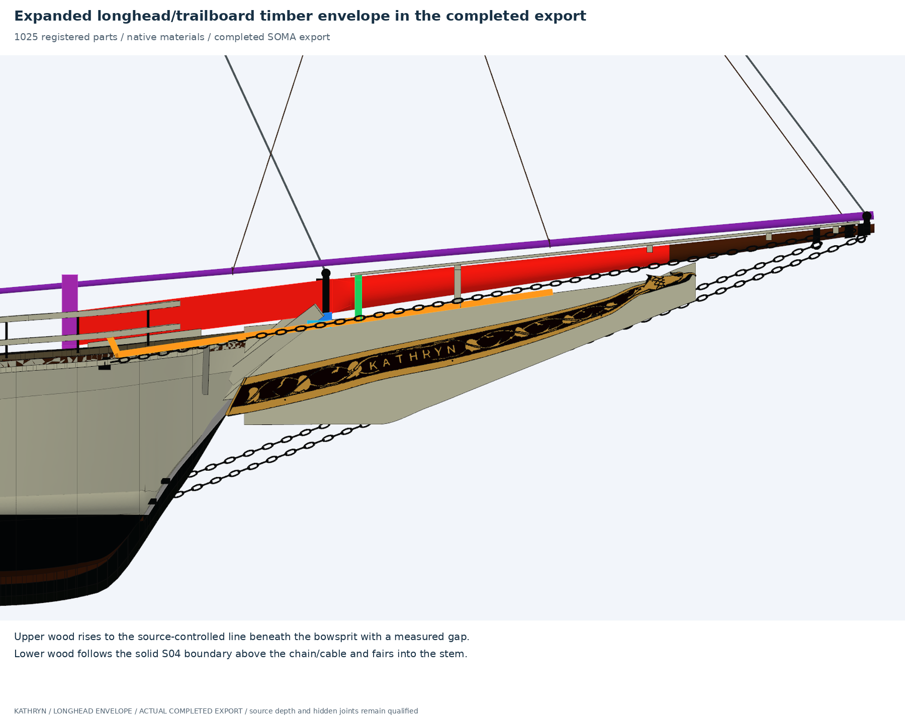
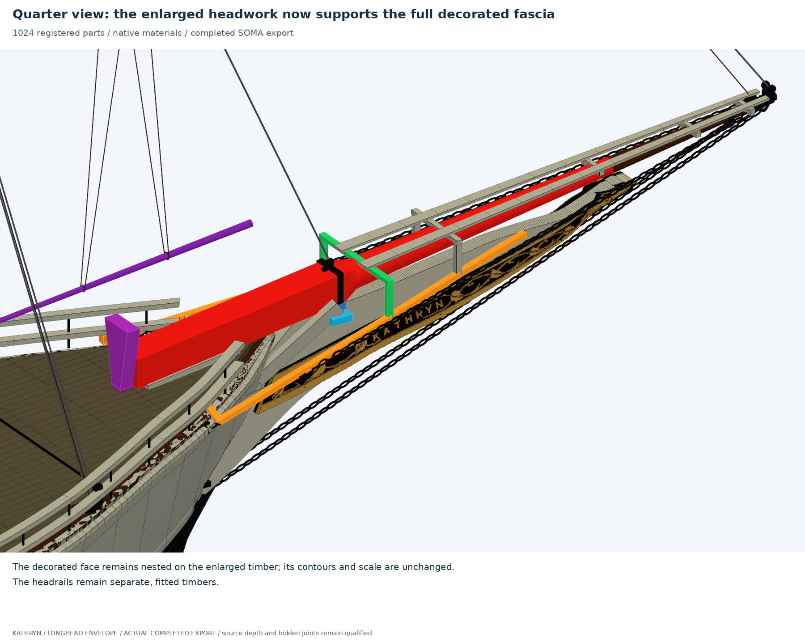
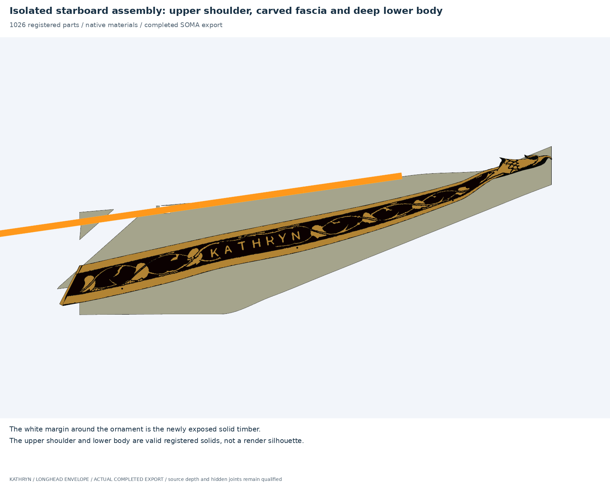
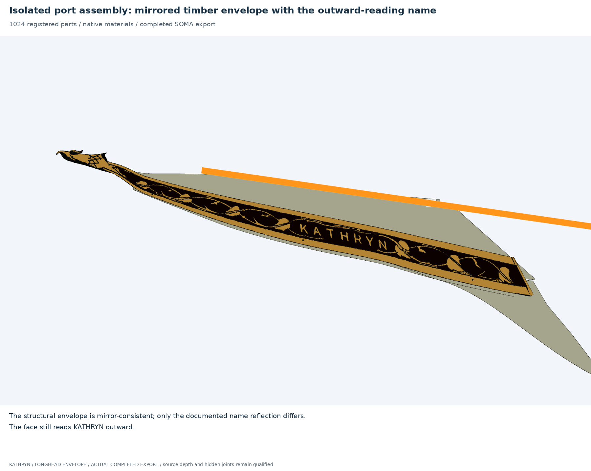
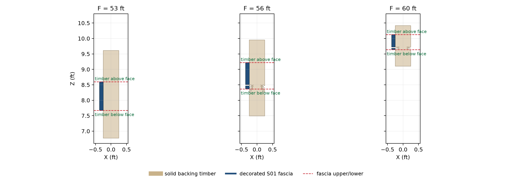

# Trailboard timber-envelope correction: implementation and verification

15 November 2026. Status: **implemented and verified from clean committed-tree build 5f13cd9**; the current committed-build record and acceptance are in [committed-build.json](images/trailboard_correction/committed-build.json). This report implements the [focused envelope gap analysis](TRAILBOARD_ENVELOPE_GAP_ANALYSIS.md) and the [earlier trailboard correction](TRAILBOARD_CORRECTION.md). The current model contains **1025 registered parts**.

The decorated S01 faces are unchanged. The missing wood above and below them is now a solid, source-controlled longhead/trailboard envelope. The upper member rises to the classified S04 line beneath the bowsprit with a positive clearance; the lower member follows the solid S04 boundary above the chain/cable and fairs into the stem/head structure.

## What changed

- A new [longhead-envelope ledger](../references/drawing_package/longhead_envelope.json) records the S04-V01 source hash, the locked registration, classified upper/lower timber lines, rejected rigging lines, 11 fit stations, 9 independent held-out stations, the clearance target and every inferred forward/aft transition.

- The common longhead backing now follows the classified outer envelope instead of the decorated-face outline. It is a valid solid, not a zero-thickness silhouette, and remains 0.5 ft wide.

- The backing is cut with fitted seats against the painted stem, hull envelope, keel, stem-head extension and heel cross-timber. The resulting aft shoulder above the stem-head extension is registered separately as **Longhead upper shoulder**.

- The existing S01-V03 boards, paint field, carving islands, letters and eagle remain in their accepted positions and contours. Their full thickness is seated on the enlarged backing.

- The item-11 headrails remain independent timbers. They are not used as the upper wood boundary; their measured clearance to the new backing is 143.5 mm.

## Source classification

The [S04-V01 profile overlay](images/trailboard_envelope_gap/source-profile-envelope.png) shows the completed export over the original scan. The classified **outer upper timber** is the continuous solid line below the item-11 headrail and above the decorated fascia. The classified **outer lower timber** is the solid line above the chain hardware and the dashed cable. The bowsprit, headrail, chain hardware, dashed cable and foreground rigging are excluded from the timber contour.

The drawing point-pick uncertainty remains **±0.20 ft**. It is not treated as a fit tolerance. The new envelope is not fitted independently to each leaf or letter.

## Verification results

Run after the official build:

```sh
python src/checks/check_longhead_envelope.py
python src/checks/check_trailboards.py
python src/checks/check_bow_attachment.py
```

| Check | Result |
|---|---|
| **LE-01** independent held-out S04 stations | maximum residual **0.1241 ft** against the 0.20 ft source envelope |
| **LE-02** actual exported envelope at F = 53, 56, 60, 62.5 ft | maximum residual **0.000033 ft** |
| **LE-03** cross-sections above and below the fascia | minimum timber margin **0.346 ft** at F = 53, 56 and 60 ft |
| **LE-04** bowsprit clearance | minimum **0.0694 ft (0.83 in)**, band 0.04–0.50 ft, **zero common volume** |
| **LE-05** fitted stem/head seats | stem, hull, keel, cross-timber and stem-head extension all at **0.000 mm** separation and zero common volume |
| **LE-06** face and headrail seats | both faces touch the backing at **0.000 mm**; headrails remain **143.5 mm** clear |
| **LE-07** bilateral symmetry | maximum envelope/part asymmetry **4.4 × 10⁻¹³ mm** |
| **LE-08** unintended common volume | **0.000 ft³** for bowsprit, headrails, faces, stem, hull, keel, cross-timber and extension |

The existing trailboard fidelity checks retain their accepted results: the maximum held-out physical source residual remains **0.1257 ft**, the outer S01 trace error **0.995 px**, and every carving/letter region remains in contact with its board. The bow attachment check passes with the enlarged backing seated on the stem-head extension.













## Retained assumptions and limits

- The common backing remains **0.5 ft wide** and the faces remain **1.44 in thick**. S04-V01/V02 do not independently dimension the side-timber width; these are retained reconstruction values, not new historical measurements.

- The forward head closure follows the source head/eagle silhouette. The last fitted transition and the concealed stem/head joints are inferred and documented in the ledger.

- The upper clearance is a source-derived nominal, not a machining allowance. The actual exported minimum is 0.83 in with zero common volume; the CAD tolerance is 0.005 ft.

- The S01 carving remains a raised decorative feature on the larger structural timber. The source does not establish that the eagle head and relief are flush with the surrounding wood.

- The existing hull, stern, spar, Samson station and headrail registrations are unchanged.

## Reproduction

```sh
soma build
python src/checks/check_longhead_envelope.py
python docs/tools/build_trailboard_envelope.py --render all --sections --overlay --comparison
```

The acceptance record is [acceptance.json](images/trailboard_envelope_gap/acceptance.json). The source ledger is [longhead_envelope.json](../references/drawing_package/longhead_envelope.json). The original S04 scan remains unmodified.
