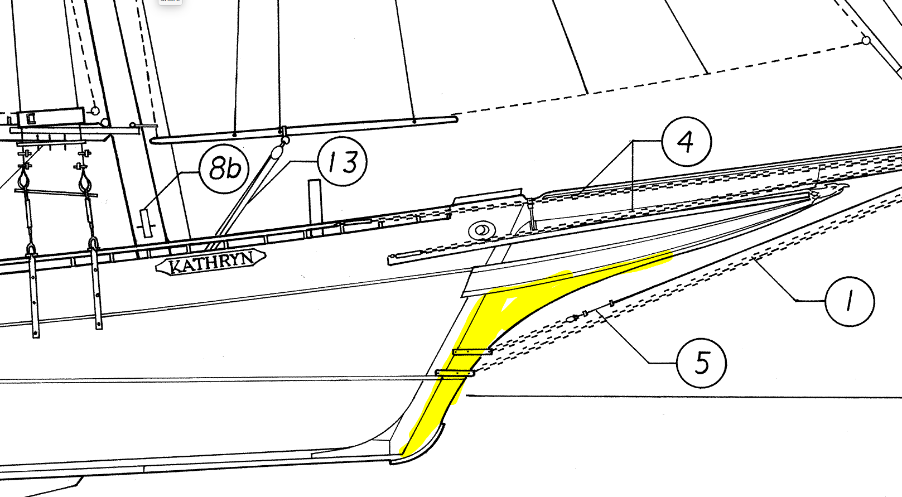
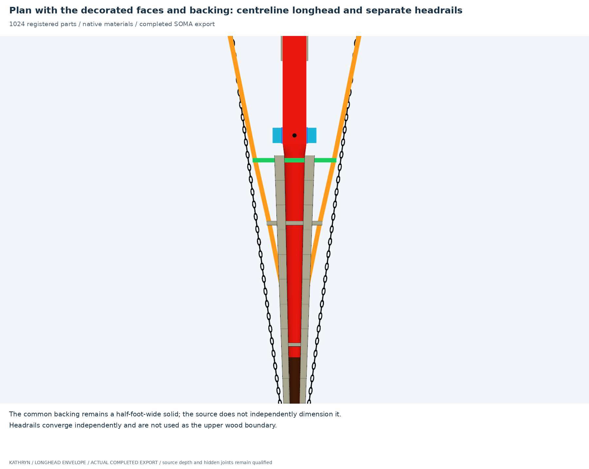
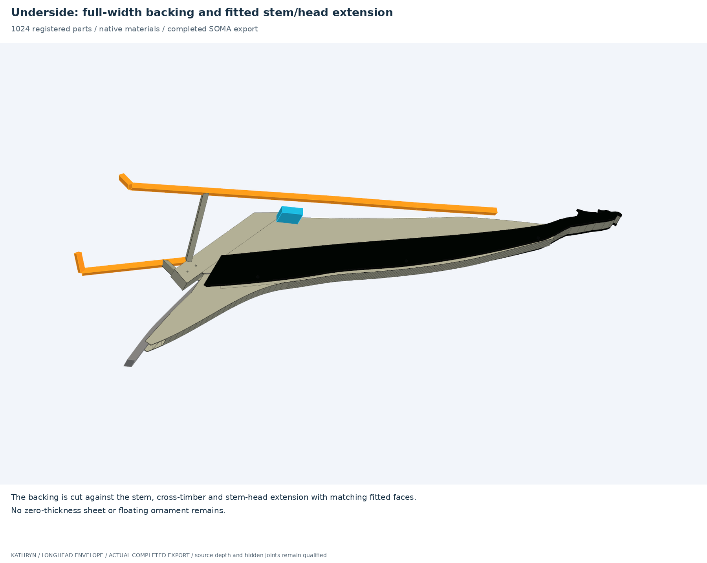
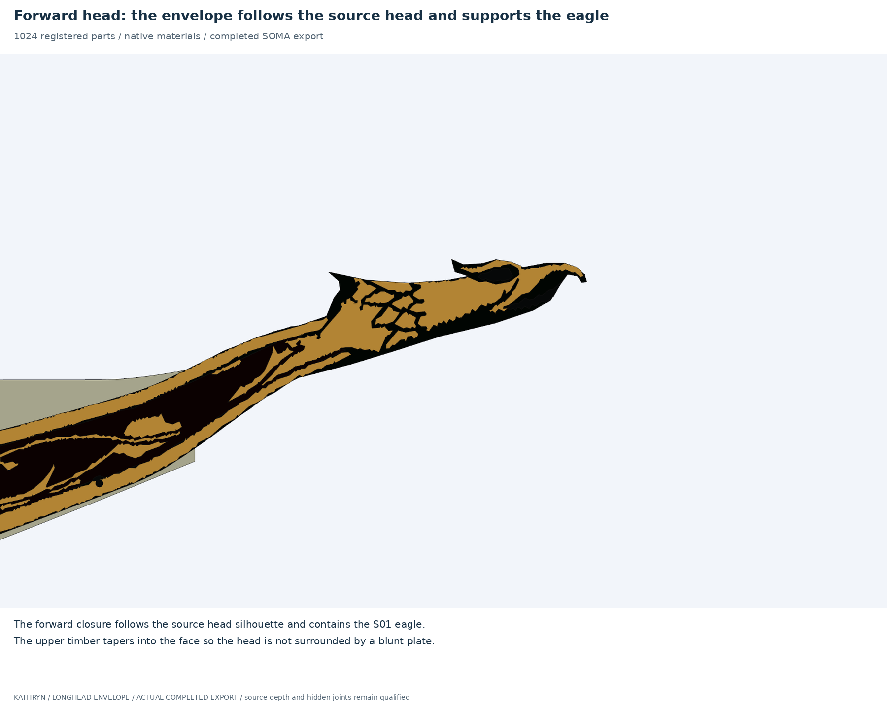
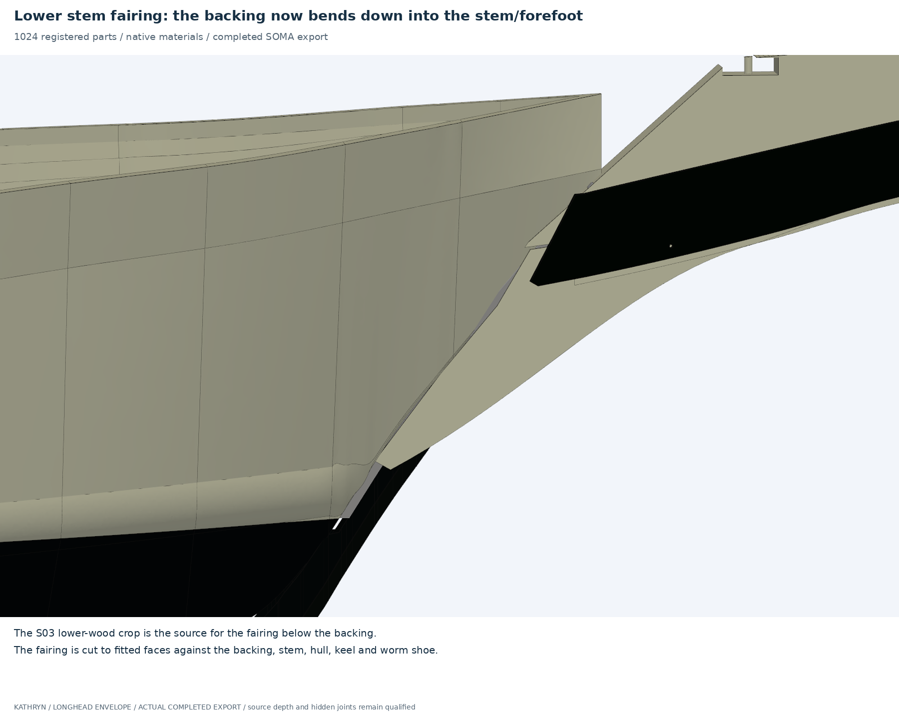
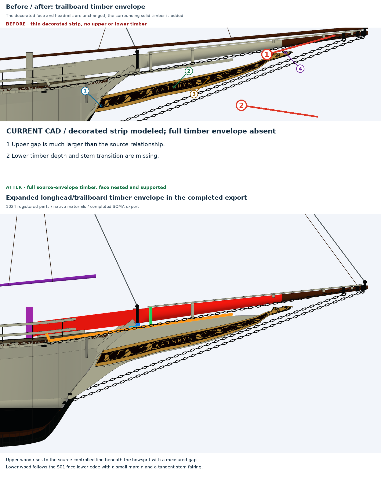

# Trailboard timber-envelope correction: implementation and verification

15 November 2026. Status: **implemented and verified from the completed working export**; the fresh clean committed-tree record is added after this revision. This report implements the [focused envelope gap analysis](TRAILBOARD_ENVELOPE_GAP_ANALYSIS.md), the [earlier trailboard correction](TRAILBOARD_CORRECTION.md) and the final 17 November markup. The current model contains **1024 registered parts**.

The decorated S01 faces and eagle are unchanged. The trailboard backing is now one visible longhead timber: an upper shoulder, a narrow lower margin around the decorated section, and a tangent lower stem fairing. It no longer has the deep board below the decoration, the sharp fairing corner, or backing above/below the eagle.

## What changed in the final revision

- The lower backing edge follows the **decorated S01 face lower edge with a 0.02–0.08 ft margin**, not the old deep S04 outer lower line. The over-deep lower board is removed.

- The upper shoulder remains, but tapers smoothly into the face: the margin falls from 1.38 ft at the aft root to 0.02 ft at the head. Forward of F = 60.5 ft the backing is trimmed to the actual S01 face/eagle outline, so no backing fills the eagle's concavities or sits above/below it.

- The lower stem fairing is fused into the main backing as one solid. Its outer boundary is a tangent Bezier leaving the backing lower edge at F = 52.5 ft, so the former sharp bend is now a radius. It descends to the stem/forefoot and is cut to fitted faces against the stem, hull, keel and worm shoe.

- The separate **Longhead upper shoulder** and **Lower trailboard stem fairing** parts are withdrawn. The registered part is **Longhead trailboard backing**, one valid solid. The small aft cap seat is occupied by the fitted stem-head extension.

- The existing S01 boards, paint field, carving islands, letters and headrails are unchanged.

The source crop from Sheet 3 is preserved as [source-s03-lower-wood.png](images/trailboard_envelope_gap/source-s03-lower-wood.png).

## Source classification

The [S04-V01 profile overlay](images/trailboard_envelope_gap/source-profile-envelope.png) shows the completed export over the original scan. The classified **upper** line remains the continuous solid edge below the item-11 headrail. The **lower** edge is now the decorated-face lower edge plus a small margin: the old S04 lower line is retained as a silhouette reference only, because using it as the backing bottom produced the over-deep board the final markup rejects. The bowsprit, headrail, chain hardware, dashed cable and foreground rigging remain excluded from the timber contour.

The drawing point-pick uncertainty remains **±0.20 ft**. The backing is not fitted independently to each leaf or letter.

## Final markup disposition

| 17 November markup point | Model response |
|---|---|
| Far too much board below the decorative section | Lower edge follows the S01 face lower edge with a 0.02–0.08 ft margin; the deep S04 lower line is no longer the backing bottom. |
| Radius the sharp bend | The stem fairing is a tangent Bezier fused into the backing; there is no separate fairing part and no sharp corner. |
| Cut around here / bottom edge blends into the decorative portion | The lower edge is continuous with the decorated face margin and the tangent fairing; see the profile and lower views. |
| Eagle has no backing above or below it | Forward of F = 60.5 ft the backing is trimmed to the S01 face/eagle section; LE-11 verifies zero backing outside the face. |
| Backing is one piece | The backing and tangent fairing are one registered solid; the separate upper-shoulder and lower-fairing parts are withdrawn. |

## Verification results

Run after the official build:

```sh
python src/checks/check_longhead_envelope.py
python src/checks/check_trailboards.py
python src/checks/check_bow_attachment.py
```

| Check | Result |
|---|---|
| **LE-01** independent held-out S04 stations | maximum residual **0.1241 ft** against the 0.20 ft upper-source envelope |
| **LE-02** actual exported envelope at F = 53, 56, 60 ft | maximum residual **0.000027 ft** |
| **LE-03** cross-sections above and below the fascia | minimum timber margin **0.020 ft** at F = 53, 56 and 60 ft |
| **LE-04** bowsprit clearance | minimum **0.1529 ft (1.83 in)**, band 0.04–0.50 ft, **zero common volume** |
| **LE-05** fitted stem/head seats | stem, hull, keel, cross-timber and stem-head extension at **0.000 mm** separation and zero common volume |
| **LE-06** face and headrail seats | both faces touch the backing at **0.000 mm**; headrails remain **143.5 mm** clear |
| **LE-07** bilateral symmetry | maximum envelope/part asymmetry **4.4 × 10⁻¹³ mm** |
| **LE-08** unintended common volume | **0.000 ft³** for bowsprit, headrails, faces, stem, hull, keel, cross-timber and extension |
| **LE-09** fused lower stem fairing | backing extends **2.170 ft below the face**; fitted to stem, hull, keel and worm shoe at 0.000 mm with zero common volume |
| **LE-10** lower margin | maximum **0.081 ft** below the S01 face lower edge, within the intended narrow margin |
| **LE-11** eagle trim | maximum backing outside the S01 face/eagle section **0.000 ft** forward of F = 61 |

The existing trailboard fidelity checks retain their accepted results: the maximum held-out physical source residual remains **0.1257 ft**, the outer S01 trace error **0.995 px**, and every carving/letter region remains in contact with its board. The bow attachment check passes with the backing seated on the stem-head extension.















## Retained assumptions and limits

- The common backing remains **0.5 ft wide** and the faces remain **1.44 in thick**. S04-V01/V02 do not independently dimension the side-timber width; these are retained reconstruction values.

- The tangent fairing Bezier and the F = 60.5 eagle trim station are inferred fitted transitions, recorded in the ledger.

- The upper shoulder follows the classified S04 upper line until it tapers into the face; the lower edge follows S01. The S04 lower line is not the backing bottom.

- The S01 carving remains a raised decorative feature on the structural timber. The eagle is exposed beyond the backing, as requested.

- The existing hull, stern, spar, Samson station and headrail registrations are unchanged.

## Reproduction

```sh
soma build
python src/checks/check_longhead_envelope.py
python docs/tools/build_trailboard_envelope.py --render all --sections --overlay --comparison
```

The acceptance record is [acceptance.json](images/trailboard_envelope_gap/acceptance.json). The source ledger is [longhead_envelope.json](../references/drawing_package/longhead_envelope.json). The original S04 scan remains unmodified.
