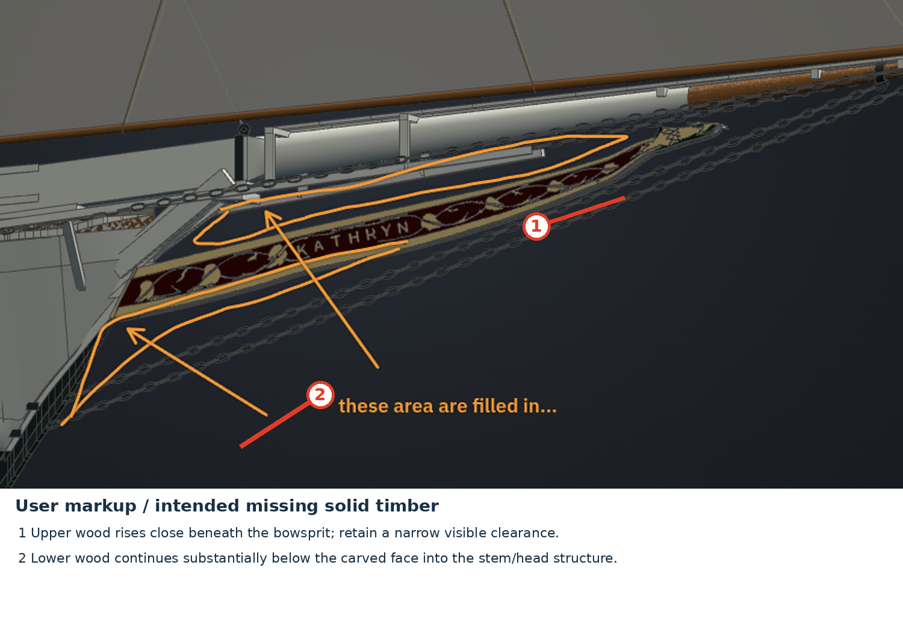
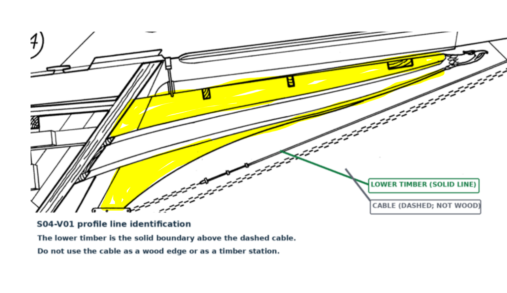
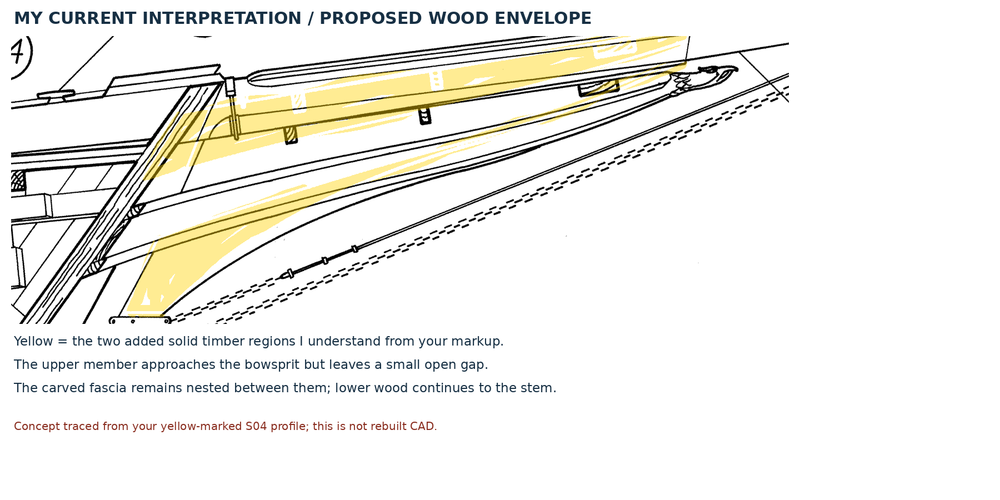
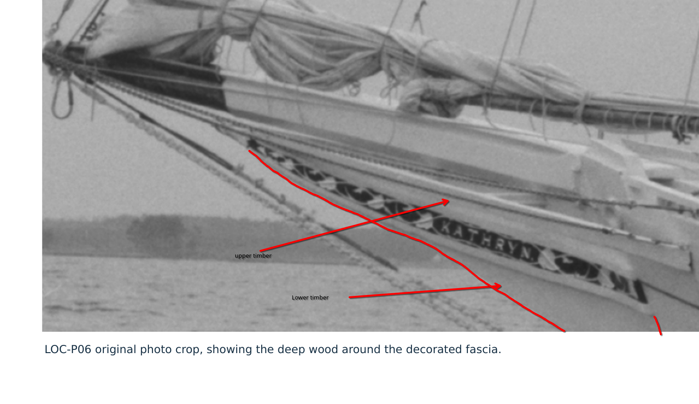

# Bow trailboard timber envelope: focused gap analysis and implementation specification

Status: **implemented and verified** in the [timber-envelope correction](TRAILBOARD_ENVELOPE_CORRECTION.md). This document preserves the as-found analysis and specification for the missing solid wood above and below the decorated trailboard faces. The carved face follows the ornament drawing; its enclosing timber volume is now modeled as the classified S04 envelope.

## Finding

The current model presents the decorated fascia and a backing cut to essentially the same narrow outline. That makes the whole assembly look like a thin ornamental strip suspended below the bowsprit. The markup identifies a much deeper, continuous wooden headwork: an upper member rises to just below the bowsprit with a small positive clearance, while a substantial lower member continues below the decorated face and fairs into the stem/head structure. These are solid timbers, not more carved relief and not empty spaces to be filled by color.

The previous implementation checked the decorated boundary, source tracing of that boundary, and contact of the ornament pieces with the trailboard board. Those checks did not measure the full section of headwork between the bowsprit, carved fascia, lower rail, and stem. Passing them did not establish that the assembly has the correct depth of wood. The next implementation must test that entire profile explicitly.

## My interpretation of the missing wood

The render below shows how I currently read your highlighted regions: two large timber masses, one above the carved strip and one below it. The fascia remains a narrower feature nested between them. The upper timber follows the underside of the bowsprit while leaving a small open clearance; the lower timber extends down and aft into the stem/head. The chain/cable remains outside the timber. This is a source-profile concept overlay, not a completed CAD rendering or a measured contour.

The implementing agent should first confirm these extents against the original linework and your marked regions, then replace this concept overlay with a dimensioned, classified source trace and the final model render.

## Source evidence

### S04-V01 inboard profile

Sheet 4, view 1, is the controlling source for the full-size longitudinal elevation and shared physical registration. Item 1 identifies the bowsprit; item 11 identifies the headrail. The drawing contains several close parallel lines for timber, headrail, and rigging. The preceding version incorrectly assigned a cable/chain line to the lower timber; that callout and any contour interpretation based on it are withdrawn. Use the user-annotated yellow regions and photo arrows to understand the requested areas. Yellow is schematic guidance, not a pixel-traced edge. The implementing agent must identify the actual continuous solid timber boundaries in S04-V01, explicitly distinguish the chain/cable, and record the classified evidence before modeling.

The yellow is the user's interpretation of the two wood regions, not a traced contour. The adjacent unmarked S04 detail is supplied for source context. The previous report annotation misidentified one of the cable/chain lines as the timber boundary; its line callouts are withdrawn. The implementing agent must classify each solid boundary against the drawing and this markup before tracing.

Use the original drawing package source `references/drawing_package/S04/S04-V01/native.png` and its parent sheet hash from `references/drawing_package/bow_remedy_registration.json`. Before tracing, classify every close line using the original S04 scan at native resolution, the yellow user markup, and the annotated LOC-P06 photo. The dashed chain/cable and its hardware are rigging; they are excluded from timber contours. Record a labeled source-pixel overlay showing each chosen wood edge and rejected rigging line. Preserve the existing locked S04 registration: F = 0.06664790115506147 × grid-x − 20.640752723186033 ft; profile height scale = 0.06689769121668057 ft per grid unit, anchored at the unchanged Samson/post datum. The drawing pick uncertainty is ±0.20 ft. This is a source uncertainty, not a license to fit the upper and lower edges independently.

The existing picks in `bow_remedy_registration.json` (`longhead_upper`, `longhead_lower`) are not accepted as outer timber boundaries. Their prior line identity is uncertain and the lower pick may follow the cable/chain. Re-measure from source pixels after classification; do not reuse these coordinates as truth.

### S01-V03 ornament drawing

Sheet 1 controls the carved composition and the relation between ornament and the plain wood margins. It defines the decorated face, not the complete timber section depth. Preserve its current traced contours and use them as a nested inner feature on the enlarged wood assembly. Never stretch the ornament to consume the upper and lower margins.

### Archival photographs

LOC-P06 is a port profile view. The user arrows identify the wood above and below the carving. Perspective, shadow, chains and paint prevent station-by-station dimensions; use this photo to distinguish members and confirm their continuity, not as a calibrated template.

The supplied color transparency LOC-C01 and full-frame/context versions in `docs/images/trailboard_review/` can be consulted for overall orientation. They do not replace S04 for physical dimensions.

## Required result

Model a continuous, substantial longhead/trailboard timber assembly on both sides of the bow. It must include:

1. **Upper shoulder / cap:** a broad solid timber band from the decorated face's upper edge to the source-controlled upper outline. Its upper surface follows the S04 profile toward the eagle/head. At the bowsprit it leaves a small, visible, positive clearance. It must never intersect or fuse to the bowsprit.
2. **Decorated fascia:** retain the already traced S01 face and its current proportions, letters, head and relief. The fascia sits within the larger wood envelope; it does not define the whole assembly outline.
3. **Deep lower body:** substantial solid wood below the fascia's lower edge, following the S04 lower boundary and fairing aft into the stem/longhead structure. It must not taper to the current thin strip or stop at the fascia edge.
4. **Forward transition:** carry the upper and lower members into the source-shaped head around the eagle. Avoid a pointed board tip floating in front of the supporting timber. All visible transitions should form a coherent timber silhouette.
5. **Port and starboard:** provide the same assembly on both sides with the established bilateral arrangement. Ornament may retain the documented port lettering reflection; structural envelopes must remain mirror-consistent.

## Geometry specification for the implementing agent

### Coordinate and source conventions

- Model coordinates are full-size feet in the source modules; SOMA registers millimetres at 304.8 mm/ft. F increases forward; Z is up; X is athwartships. The profile view is an elevation.
- Use `references/drawing_package/S04/S04-V01/native.png` as the master for the outer profile. Use the recorded sheet grid transform and Samson datum. Record source pixels, station picks, transform, source SHA-256, uncertainty, and every inferred segment in a new dedicated longhead-envelope ledger.
- Use S01-V03 only for the interior decorated-face geometry and its location relative to the timber margins. Use photographs to resolve which lines are continuous/exposed wood, never to derive dimensions from perspective pixels.
- At a minimum record profile points for the outer upper edge, outer lower edge, aft/root termination, forward/head termination, bowsprit clearance station, and board upper/lower edges. Add enough intermediate stations to preserve curvature; do not replace the source curves with a single straight wedge.

### Solid construction

- Construct the side assembly from the traced outer S04 timber envelope and a defined inboard boundary/section. Keep the port and starboard side timbers as valid registered solids, or split them into legitimate timber pieces with fitted contact faces. Do not create a zero-thickness sheet or merely enlarge the render silhouette.
- Join the enlarged wood to the existing stem/head structure with matching faces. Remove hidden duplicate/interpenetrating solids where the assembly is meant to be one timber. Register every physical component through `add_part`.
- Seat the existing decorated boards, paint field, and carved relief on the enlarged outer face. Preserve their current scale and contours. Ensure their full thickness is supported; no floating relief, detached face, or unsupported decorative strip.
- Keep the headrails as identifiable separate timbers at the locations supported by S04 item 11 and its plan. Their intersections with the expanded longhead must represent actual fitted seats, not accidental overlap. Do not use the headrail itself as the upper outer boundary if the drawing identifies a separate timber line.
- Provide the requested small gap beneath the bowsprit as a positive measured clearance along the nearest parallel span. Derive the target from registered S04 source line separation, accounting for line thickness and ±0.20 ft pick uncertainty; state the chosen nominal and acceptance band in the ledger. CAD clearance tolerance must be much smaller than the gap. Assert no common volume and no zero-distance contact.
- The lower timber must extend to its S04 outer boundary and join the stem/head root. Compare its station heights against held-out S04 points that were not used to fit the profile.

### Required views and acceptance

Generate profile, plan, underside/section, and isolated port/starboard views of the completed export. Add a profile overlay with the registered S04 scan and colored outlines for bowsprit, outer upper wood, decorated face, outer lower wood, stem, and item-11 headrail. Use a cross-section at several F stations to show that the area above and below the decorated board is occupied by timber.

Acceptance criteria:

- Full-size upper and lower outer boundaries agree with independent S04 profile stations within drawing pick uncertainty; record every residual.
- At least three cross-sections through aft, middle, and forward body show a continuous solid section extending above and below the decorated fascia.
- Minimum bowsprit clearance is positive, visible, and within the source-derived target band; no collision or contact at any station.
- Lower edge follows the source through its full length and meets the stem/head assembly without a gap.
- Port/starboard envelope bounds and section depths agree within the mirrored modeling tolerance.
- Existing S01 carved contours, name readability, and physical part bounds are preserved unless the envelope requires a documented fitted interface.
- All added solids are valid, registered, and free of unintended timber intersections. Rebuild the official SOMA model and render the actual export for visual review.

## Work sequence

1. Open the original S04-V01 scan at native resolution. Reclassify each line in the bow profile: bowsprit, upper outer timber, lower outer timber, fascia, hull/stem, headrail and chain. Save a color-coded annotated crop with source-pixel points and item labels.
2. Register the classified outer top/bottom curves to the existing S04 datum. Record samples, uncertainty, and the small bowsprit gap measurement. Cross-check the plan view S04-V02 before making the timber width/section assumption.
3. Build the expanded timber envelope and its stem/head interface. Keep the established hull, Samson station, bowsprit and rigging registration fixed.
4. Re-seat the current decorated boards and headrails on the new supporting wood. Retain their traced contours and outward-facing name behavior.
5. Add source-station, section occupancy, clearance, contact, symmetry and intersection checks. Render the completed SOMA export in the required views and make a new before/after comparison.

Do not call this correction complete because the carved pattern still matches S01. Completion requires the solid wood above and below the face, the small positive bowsprit gap, the full solid-timber lower return, and independent S04 profile verification to pass together.
