# Trailboards: gap analysis and implementation specification

15 November 2026. Status: **approved correction implemented and verified from a clean committed tree**; the later [timber-envelope correction](TRAILBOARD_ENVELOPE_CORRECTION.md) adds the solid wood above and below the faces. Current verification is recorded in those implementation reports. Scope: the paired decorated faces, their longhead backing, the eagle-like forward termination, the name field, and their visible relationship to the stem, bowsprit and headrails. Read this report with the [illustrated PDF](trailboard-gap-analysis.pdf). Requirements are also indexed in the [implementation contract](images/trailboard_review/implementation-contract.json).

## Implemented correction

The approved work replaces the generic pattern with traced source regions, adds the shaped name enclosure and hooked head, corrects the visible headrail span, and coordinates the lower-band fixings. See the [current implementation and verification](TRAILBOARD_CORRECTION.md) ([PDF](trailboard-correction.pdf)) for all regenerated after views, original-source overlays and acceptance results.

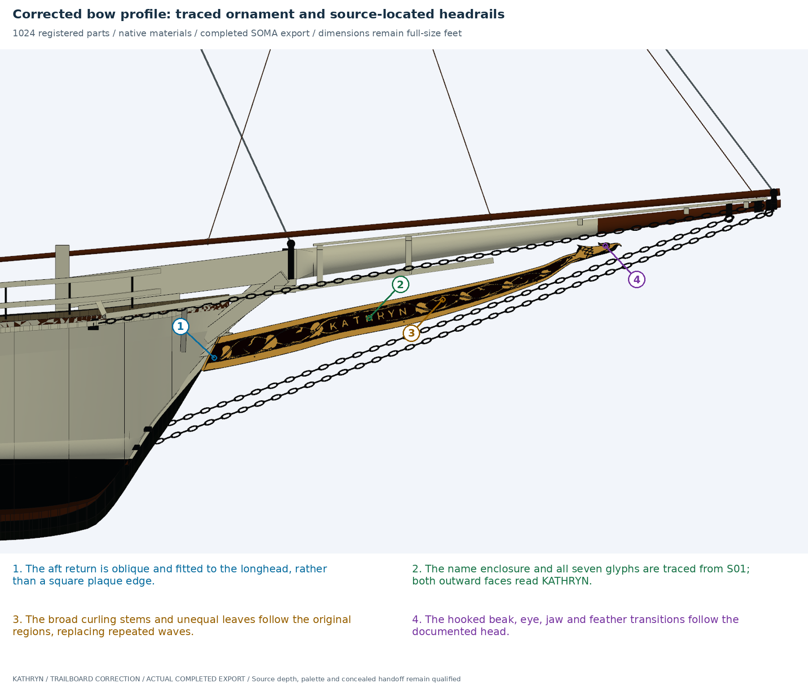

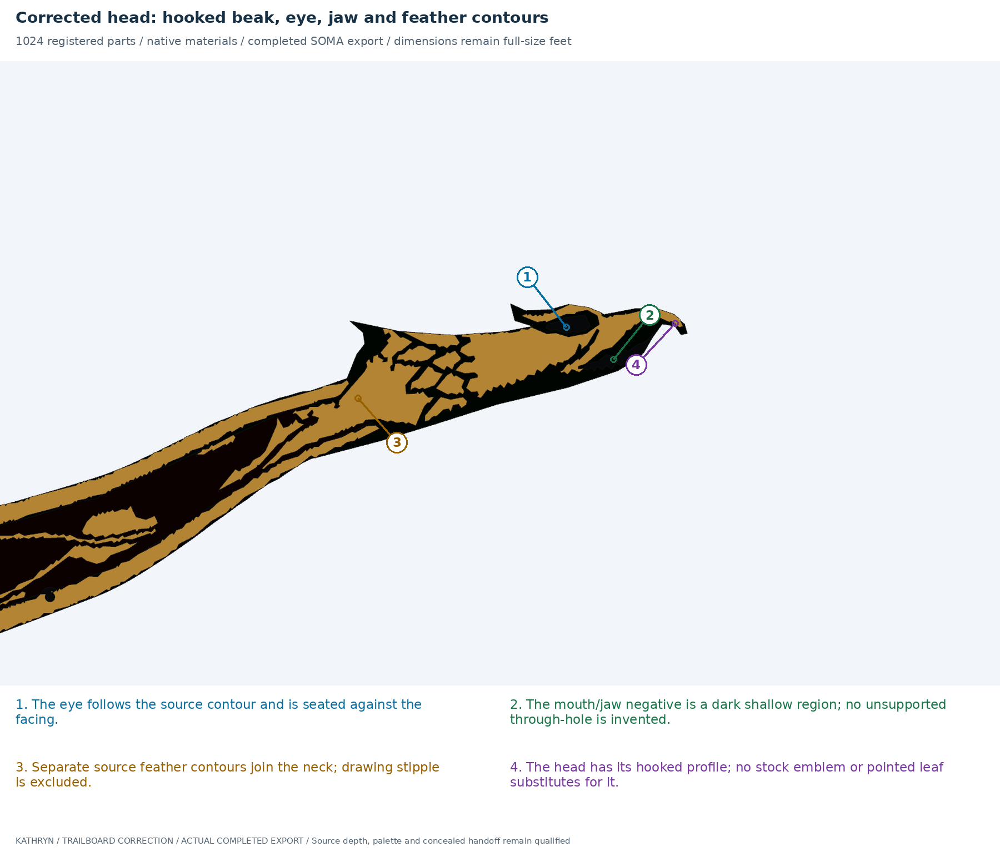

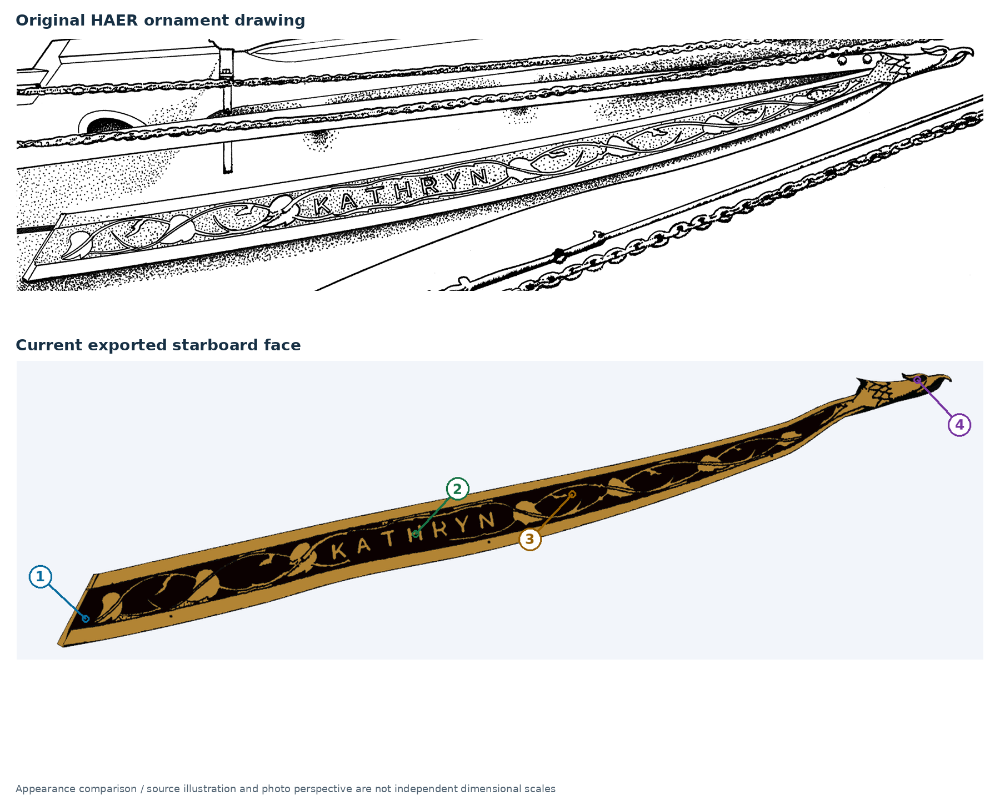

## Original approved analysis: before correction

**The analysis and C figures below describe the preserved 928-part snapshot. Its uses of “current” refer to that reviewed state.** Original measurements and source figures remain intact as the approved specification; use the implementation report for the present model and after measurements.

The current trailboards do not reproduce the ornament shown in the supplied drawings and vessel photographs. The clearest differences are the simplified pointed head, generic repeating vines, missing shaped enclosure around the name, and square aft return. The board has become a bordered plaque decorated with text and leaves. The source shows a coordinated carved composition in which the frame, scrolls, name enclosure and bird-like head form one design.

The underlying attachment repair did improve the model. There are two facing boards, a common backing, fixing passages, and an eye on each head. This review does not repeat the obsolete claims that the current model has one floating centreline board or no backing. Nor does it establish that the whole assembly should be moved, widened or repainted. Those changes require different evidence from the clearly observable carving defects.

## 1. Exact model being reviewed

This report examines the **928-part working-tree SOMA export completed at 22:03:12 UTC on 15 November 2026**. It uses the same export used to regenerate all eleven README gallery images. The local HEAD at capture was **085c2f1**. That commit contains the refreshed images; the bow-remedy geometry and its associated checks were still uncommitted. A checkout of 085c2f1 alone will therefore not recreate this as-found model.

The [frozen provenance record](images/trailboard_review/provenance.json) contains SHA-256 hashes of the actual source files, source registration ledger, app parameters when present, GLB, map, build record and STEP file. It records measurements of 32 relevant exported solids. The export reported status OK and zero build warnings. These are build observations, not historical-shape acceptance.

All six C figures below are newly rendered from that export. D figures use the original HAER scans. P figures use downloaded original Library of Congress photographs. The number on a leader refers to the corresponding explanation below that figure. Source coordinates, crop boxes and source hashes are in the [source evidence record](images/trailboard_review/sources.json).

Coordinates: source F increases forward; the model uses X across, port positive, Y = 25 - F, and Z up. Source geometry is in full-size feet. The export is full-size millimetres, with 304.8 mm per foot. Do not measure source-foot quantities directly on an unconverted exported BREP.

The current board body runs from F = **50.40591 to 62.55000 ft**, including its head: a horizontal span of **12.14409 ft**. Each facing occupies X = 0.25 to 0.37 ft, or the corresponding negative interval. Each is **1.44 in thick**. The common backing is **6.00 in wide**, giving an **8.88 in timber stack** before relief. Current relief reaches X = +/-0.400 ft, making the maximum visible stack approximately **9.60 in**.

At F = 52, 54, 56, 58 and 60 ft, the current body depths are approximately **9.63, 11.24, 11.48, 9.72 and 7.15 in**. These values describe the model; they are not newly established historical dimensions. Both boards are valid single solids. Each touches its backing with zero common volume. Each board is approximately **207.50 mm, or 8.17 in, clear of its own headrail solid**. This is a minimum three-dimensional distance, not the vertical gap at a particular profile station.

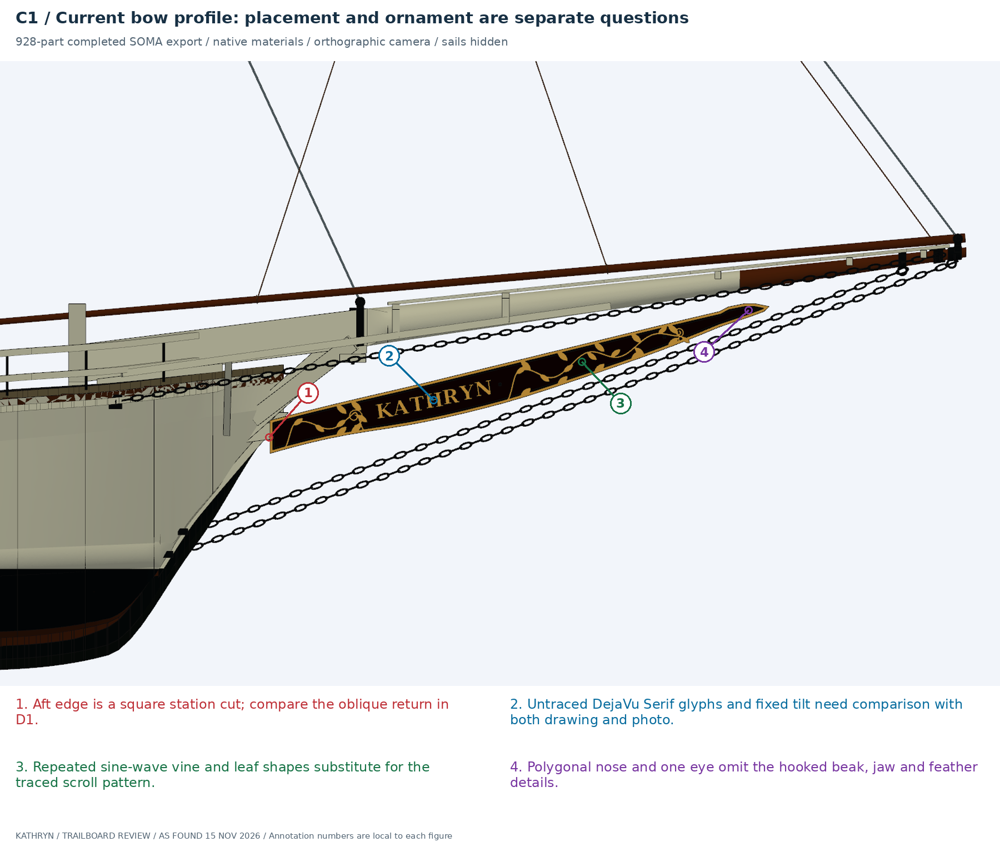

## 2. Evidence hierarchy and reconstruction state

The target is the **HAER documented arrangement and ornament**, cross-checked against vessel-specific photographs in the same collection. Later or undated restoration photographs can identify differences, but must not silently redefine the survey-state model.

**D1-D3: Sheet 1, view S01-V03, bow ornament and chains.** This is the clearest primary reference for the head, scroll paths, border, name enclosure, glyph boundaries and aft return. It is a pictorial ornament detail, not an independently calibrated cutting template. Its stippling represents drawing treatment; it must not become a field of holes or raised dots. Chains, rigging and the foreground rail crossing the detail are separate objects, not ornament strokes.

**D4-D5: Sheet 4, profile S04-V01 and plan S04-V02.** Use these for the assembly's physical stations, the broad longhead envelope and identification of separate headrails. The overlays retain the existing bow-ledger registration and one common scale for all parts. The board itself was generated from that ledger's picks. Agreement between those picks and the resulting board is therefore partly circular; it is not an independent proof of fidelity.

**P1: LOC-P06, port profile with push boat, closer view.** This original 5000 x 3620 pixel photograph is the strongest photo witness used here for the visible name, light scrolls on a dark field, and the return toward the hull. Its forward end is at the left. The crop is not mirrored. The [full-frame context with crop rectangle](images/trailboard_review/source-loc-p06-context.png) shows its location. Perspective, rigging and paint condition limit precision.

**P2: LOC-C01, starboard profile color transparency.** This original 4958 x 3540 pixel image supplies an opposite-side and color-context check. The visible panel is small even in the master. It supports a dark field and contrasting light ornament, but cannot establish calibrated paint values, fine carving depth or exact fastening dimensions. See its [full-frame context](images/trailboard_review/source-loc-c01-context.png).

The line drawing outlines the letters. That alone does **not** prove that the physical lettering was hollow, unfilled or sans serif. P1 shows light letters with serif-like features. A correction must compare glyph contours, spacing and the enclosing ornament without claiming that filled serif lettering is inherently a defect. The current specific font remains untraced and unverified.

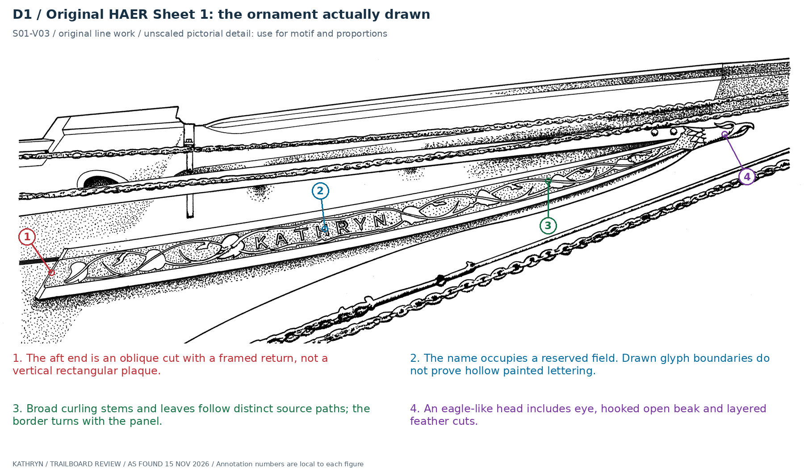

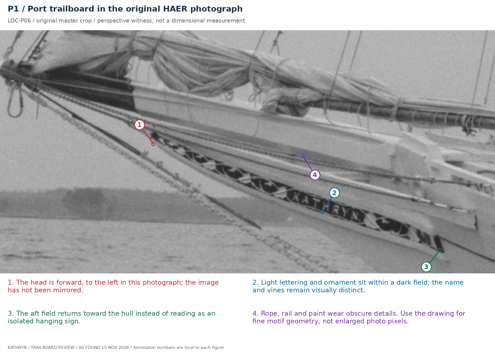

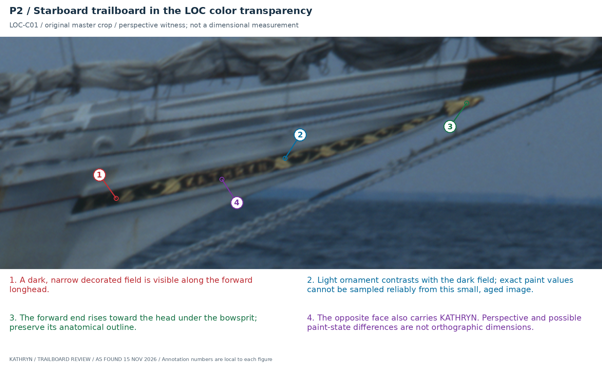

## 3. Findings, consequences and required corrections

### TB-01. High: the forward head is a pointed polygon rather than the drawn carving

**Observed:** `panel_outline()` appends seven manually chosen forward points to the body envelope. The result has straight nose segments and a dark interior. A separate eye exists at approximately F = 62.17 ft, Z = 10.68 ft. There is no corresponding source-traced brow, hooked mouth boundary, jaw separation or feather division. C6 and D2 expose the discrepancy without rigging in the way.

**Consequence:** the most recognizable end feature reads as a pointed sign or leaf. Adding an eye does not reconstruct the head. A generic eagle image or stock emblem would also be a different design.

**Correction:** trace the actual visible head and neck contours from D2, keeping separate identities for outer head, eye, brow, upper beak, mouth negative region, jaw and feather boundaries. Transfer the composition to the physically registered longhead. Preserve the source's relationship between the head and the adjacent vine. Decide explicitly whether each interior contour is a paint boundary, relief edge, recess or confirmed through-opening. The drawing does not authorize drilling every white region completely through the wood.

**Closure:** AC-03 and AC-04. A plain pointed polygon with an eye fails regardless of successful solid/contact tests.

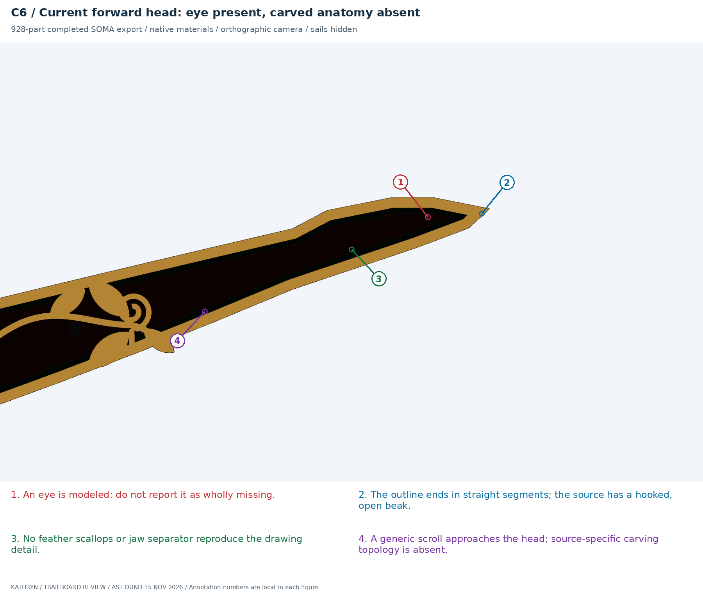

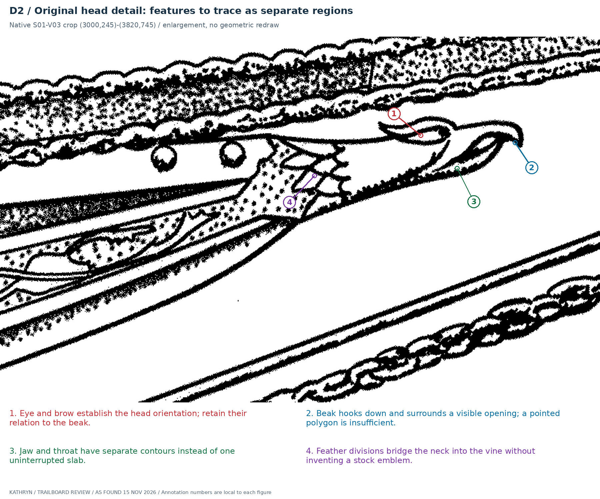

### TB-02. High: the vines and scrolls are generated decoration rather than the documented pattern

**Observed:** `_vine()` uses a sine wave with a nominal 1.6 ft period and alternating leaves. `_leaf_at()` makes repeated two-arc leaf shapes. Two arithmetic spirals supplement the border. Their arrangement is a procedural approximation, not a trace of the drawing. The real design contains broad curling stems, unequal lobes and deliberate transitions around the name and head. P1 also shows broad contrasting curls, rather than the current sequence of small uniform leaves.

**Consequence:** even a correctly located board will continue to look unlike the sources if the repeated decorative pattern is retained. Increasing leaf count, making the letters larger, or changing paint colors would not resolve the missing composition.

**Correction:** replace the wave/leaf/spiral generators for this vessel with named paths and closed regions traced from D1. Segment the design into aft scroll, aft name terminal, name enclosure, forward name terminal, forward vine, neck transition and border. Keep counter-spaces and branch junctions. Exclude stipple, chains and foreground rails. Do not force every separate raised region to join the border merely to satisfy the existing one-solid expectation; separately register legitimate disconnected carved or painted elements.

**Closure:** AC-03 and AC-05. The topology, branch positions and recognizable lobes must match the source, not simply occupy a similar area.

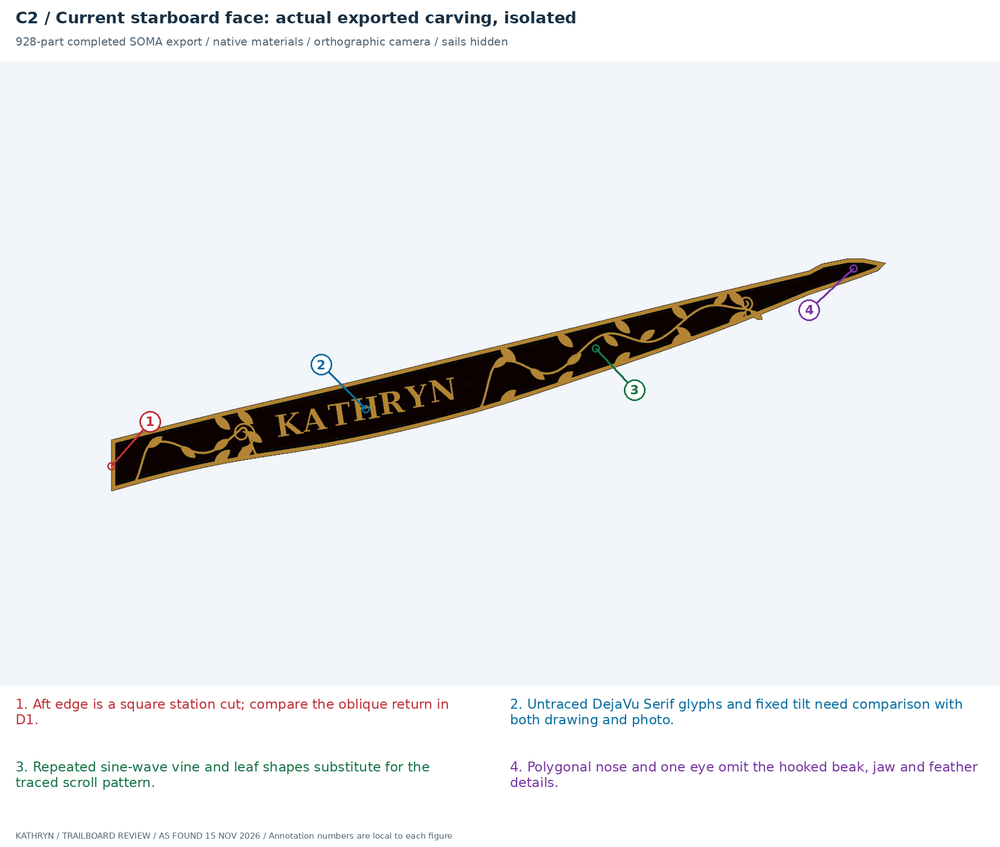

### TB-03. High: the shaped name enclosure is missing; lettering placement is not source-controlled

**Observed:** the code creates seven `DejaVu Serif` bold characters at nominal height 0.48 ft, or 5.76 in. Their centers follow the body mid-depth. Each glyph receives a fixed rotation of approximately 8.53 degrees, independent of a traced lettering baseline. The surrounding field is an inset of the outer board, rather than the distinct, elongated enclosure drawn around KATHRYN. Current letter centers run approximately F = 53.18 to 55.60 ft, reversing station order on the opposite face so the name reads outward.

**Consequence:** the name appears as typeset text placed between generated vines. The designed relationship between letter spacing, the enclosure and the terminal scrolls is lost. The name is readable on both sides in the current model; this review does not diagnose mirrored or reversed text as a present defect.

**Correction:** trace the name enclosure and its joins to both scrolls first. Record each glyph's contour or a justified font approximation, bounding box, center, angle and counter-regions. Compare drawing and photo before choosing stroke style. For the HAER drawing target, D3 supplies the default contour reference; differences visible in P1 must be recorded rather than blended into arbitrary new lettering. Derive placement from the reserved name field, with independent control of glyph tilt and inter-letter spacing. Maintain readable KATHRYN on both outward faces.

**Closure:** AC-05 and AC-06. Readable text alone does not close the name-field finding. Hollow lettering is not a required outcome.

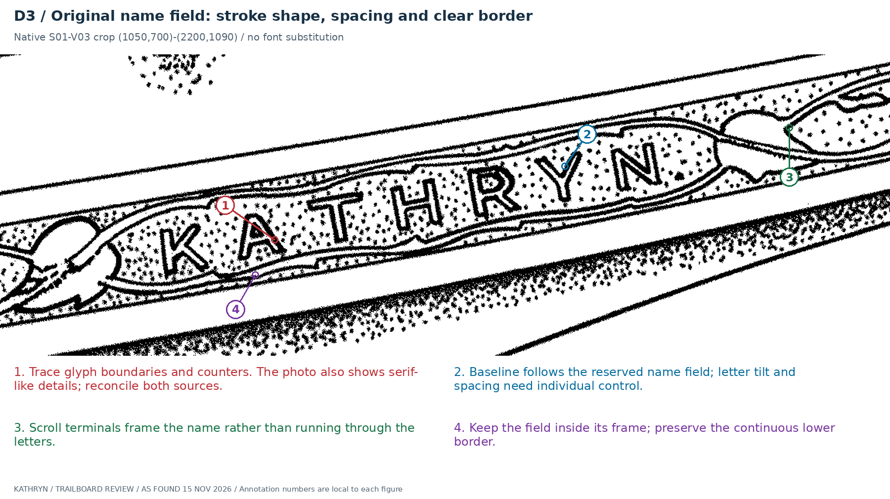

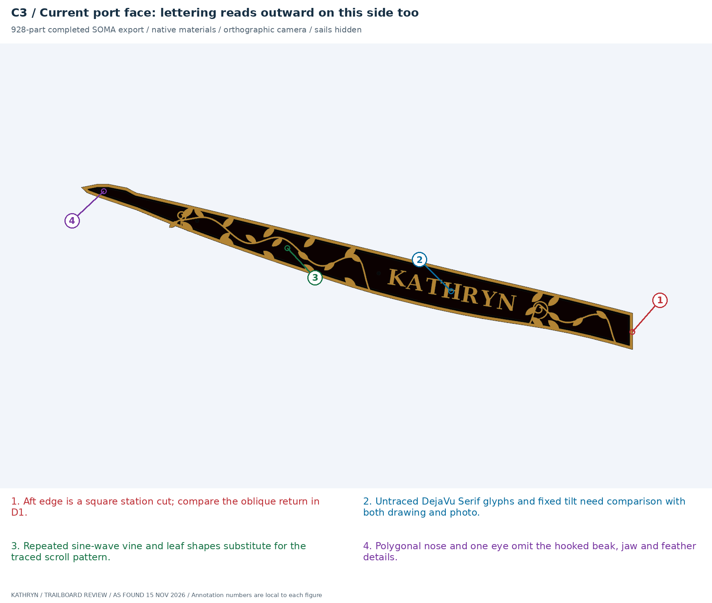

### TB-04. High: the aft return and body envelope need an independent boundary trace

**Observed:** the current body closes at one F station, creating a vertical aft edge before any hull trimming. D1 has a distinctly oblique aft termination and framed return. The source/profile overlay also shows local contour differences. The existing upper/lower envelope has only seven picks per edge, and its approximate forward head is added separately.

**Consequence:** the aft end reads as the squared end of a plaque, and the body-to-head transition lacks the drawn contour. The existing ledger cannot certify itself by comparing generated geometry to its own seven picks.

**Correction:** separately identify the facing outline, longhead timber outline, stem boundary and any foreground rail in the source. Re-trace the actual intended boundaries in original native pixels. Use held-out points not used to fit the transform. Resolve the oblique aft cut against both S01 and S04, then inspect its handoff to the existing stem and hull in quarter view. Do not pull the whole board aft, move the Samson post, or alter the repaired spar simply to make this return look attached.

The evidence here establishes the square-versus-oblique difference and visible contour mismatch. It does not establish a new precise whole-board translation, a replacement total length, or a new final board thickness. Those values must come from the independent trace and the declared source hierarchy.

**Closure:** AC-02, AC-03 and AC-07. A different root coordinate applied to the same rectangular outline is insufficient.

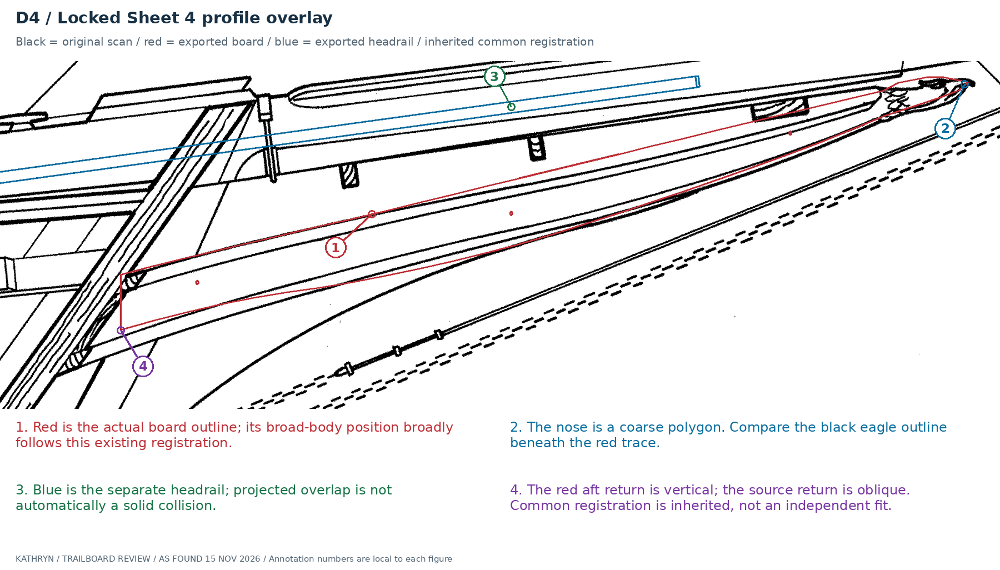

### TB-05. Medium: flat relief and uniform insets are modeling assumptions

**Observed:** the border is formed by a uniform 0.065 ft inward offset, or 0.78 in. The painted field uses a different uniform 0.10 ft inset, or 1.20 in. Relief is extruded 0.035 ft, or 0.42 in, with 0.005 ft embedded in the board. Its net stand-off from the nominal board outer face is therefore 0.030 ft, or 0.36 in. The eye is another separate extrusion. These are code dimensions, not printed historical carving measurements.

**Consequence:** the design reads as a set of flat raised strips. Uniform offsetting narrows the available field and distorts small regions at the head and return. A constant-height extrusion cannot represent every carved, recessed or painted boundary shown pictorially.

**Correction:** replace global offsets with source-traced border and field boundaries. Store a feature classification for each region. Preserve existing relief depth provisionally until stronger section or close-up evidence supports a change; label it as an assumption. Apply varied relief or rounded carving only where the chosen representation and evidence justify it. Keep a clean, valid CAD representation rather than treating stipple as tool marks or inventing detailed carving that cannot be checked.

**Closure:** AC-05 and AC-08. Source appearance can improve before physical depth is known; the report must retain that distinction.

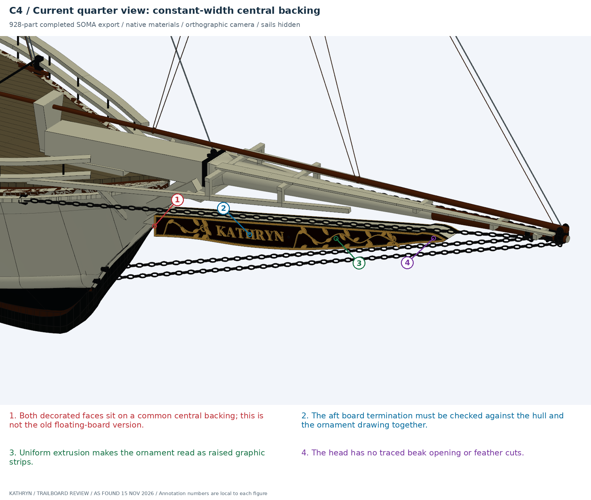

### TB-06. Medium: the plan width and rail relationship remain qualified, not historically accepted

**Observed:** the backing and faces form a constant-width central stack, while the separate headrails converge. The current source ledger explicitly treats concealed dimensions as reconstruction choices. D5 does not directly dimension the facing-board thickness. D4 shows a visibly different projected relationship between the blue model headrail and black source lines. S01 is pictorial, and the overlapping objects there must be identified before assigning those lines to the board or rail.

**Consequence:** an arbitrary outward translation of the boards could damage a now-connected assembly while leaving the visual error unresolved. Conversely, passing a board/rail collision test says nothing about whether the rail is at the correct height or whether it obscures the correct part of the ornament in profile.

**Correction:** identify Sheet 4 item 11's rail in plan and profile and correlate it with the separate rail in D1. Record both end stations and heights under the common transform. Compare those independent points to the actual headrail BREP. If a rail discrepancy is confirmed, make its correction a separate named change in the implementation, preserving its hull-rail connection. Retain current board thickness and backing width as provisional values until evidence justifies changes. Provide the same source/model comparisons from both sides and above.

**Closure:** AC-02, AC-07 and AC-09. Neither constant-offset boards nor flared boards are accepted solely because one arrangement looks more plausible.

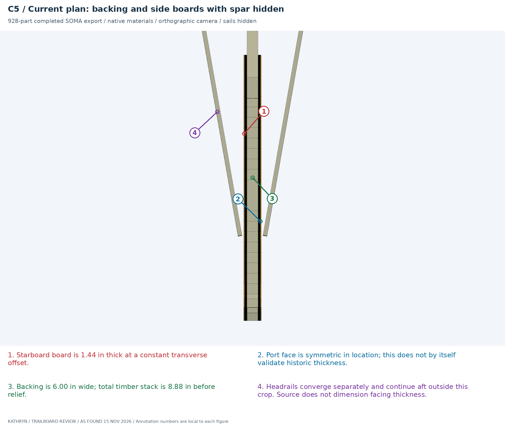

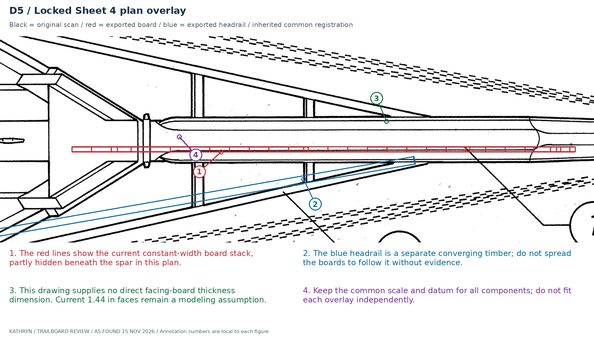

### TB-07. Medium: the existing pass criteria can accept the wrong-looking result

**Observed:** `check_bow_attachment.py` checks valid solids, backing contact, no board/spar or board/rail intersection, relief proximity, letters near the board and fixing contact. It contains no comparison of head silhouette, scroll topology, name enclosure, independent source landmarks, paint regions or lettering proportions.

**Consequence:** the current generic decoration can pass every attachment check. A future implementation could repeat this failure by treating a successful SOMA build or an attractive quarter image as completion.

**Correction:** retain attachment regression checks and add separate source-fidelity acceptance. Store independently reviewed trace data and held-out landmarks outside the CAD implementation. Generate isolated face masks and source overlays automatically from the final export. Require explicit disposition of each finding and each unresolved assumption. Use both geometric metrics and the specified visual witnesses.

**Closure:** every AC item below. Unresolved evidence cannot be reported as a passing historical dimension.

### TB-08. Qualified: palette and photo-state differences need documentation

Current model colors are dark green ground, dark maroon inset, and pale gold/ivory relief. P1 is monochrome. P2 is a small image of an aged color transparency. They support contrasting light ornament on a dark field, but do not establish that the current colors are definitively wrong or supply defensible replacement RGB values. P1's serif-like lettering also differs in presentation from D3's line work.

Keep current colors provisionally while rebuilding the composition. Record the selected HAER drawing state, photo observations, palette assumptions and any later restoration evidence separately. Do not sample a few enlarged pixels and call the result historical paint matching. AC-08 requires an assumption record, not an invented color specification.

## 4. Implementation sequence for a lower-level agent

This sequence is a specification for future work. It does not authorize the implementing agent to declare uncertain source details resolved by changing the captions.

### Phase A. Freeze the actual starting state

Read this report, its implementation contract, `AGENTS.md`, `model.py`, `src/parts/bow.py`, `src/parts/bow_layout.py`, the bow registration ledger and the existing bow attachment check. Match all model hashes in the frozen record before using its measurements. If the model has advanced, preserve this review and create a new current-state comparison; never overwrite these as-found witnesses with after images.

Keep the complete repaired spar, its support and jib connections, the hull, accepted stern, mast and source-located Samson post fixed throughout ornament work. Work only on the trailboard/longhead construction and an independently confirmed rail correction. Any required structural interface adjustment must have its own source justification and regression evidence.

Deliverable A: a baseline inventory with source hashes, part names, positions and the actual successful build used for implementation.

### Phase B. Produce independent source traces

Create `references/drawing_package/trailboard_targets.json` and lossless annotated SVG/PNG trace overlays. Do not edit original scans or reuse the CAD generator's outline as the target. The source evidence record identifies native crops and original sheet hashes. Native S01-V03 pixels start at sheet pixel (9522, 853); its image size is 3960 x 2107. Native S04-V01 starts at (2462, 2358); native S04-V02 starts at (2412, 5017).

Every trace record must contain a stable feature ID, source file/hash, original pixel coordinates, closed/open status, semantic role, evidence class, selected state, ambiguity notes and control points. Use separate closed loops for outer boundary and holes/counters. Classify intentional negative regions instead of accidentally filling them during a polygon union. At minimum, include outer facing, aft return, border inner/outer, name enclosure, seven glyphs, aft scroll, forward scroll/vine, head outline, eye, beak/mouth, jaw and feather transitions.

For S04 physical registration retain F = 0.06664790115506147 * grid_x - 20.640752723186033. Retain the ledger's vertical increment of 0.06689769121668057 ft per grid unit, its post-deck vertical anchor, and plan centreline grid_y = 636.5 until an independent calibration review justifies changing them. Grid coordinates refer to the 1440 x 960 sheet convention; convert native pixels with the actual sheet sizes, not a crop's width. Never use the code's screen-image pixels as drawing coordinates.

Reserve at least six S04 boundary/rail landmarks as held-out checks not used to fit a transform. Include the aft return endpoints, head tip, one upper-body point, one lower-body point and a positively identified rail point. Retain the current ledger's +/-0.20 ft pick uncertainty as a provisional historical envelope, not a machining allowance. Refine it only with a documented independent pixel-pick and calibration assessment.

S01 is unscaled. Trace its ornament in native pixels and retain normalized surface coordinates: longitudinal fraction along the facing, and local depth fraction between its traced upper/lower boundaries. Transfer those motifs to the physically registered S04 envelope with one declared surface mapping. This is an explicit design transfer between drawings, not a new physical measurement or proof that both views agree exactly. Record distortion and landmark residuals. Do not independently stretch each glyph, leaf or head until it appears to match.

Reconcile the lettering with P1. Keep D3 as the default drawing-state contour reference; record the serif-like photo observation. Do not infer hollow paint merely from outlined line work. Resolve rail identity before using a crossing line as a board boundary. If a source region is occluded or ambiguous, retain an explicit uncertainty mask and qualified reconstruction; do not create a supposedly measured dimension there.

Deliverable B: reviewed trace data and overlays with no silent source conflicts. This gate must pass before detailed ornament geometry is accepted.

### Phase C. Rebuild the outer composition before fine relief

Replace the vertical aft station cut and hand-written head polygon with the traced outline and its source-mapped transitions. Resolve the body upper/lower boundaries and fit to the existing longhead/stem interfaces. Establish the source border and name enclosure as independent curves. Verify profile, both sides, quarter and plan with simple contrasting materials before adding detailed leaves or typography.

Update both the geometry consumer and any target-ledger relationships consistently. Keep model dimensions in `src/parts/params.py` or the established shared ledger; avoid a second unrelated station system. Retain 1.44 in facing thickness and 6.00 in backing width provisionally unless Phase B provides evidence for changes. Adjust the backing and real fixing passages coherently if the traced outline changes; do not leave bolts outside the wood or through uncut material.

Deliverable C: valid registered outline/backing/field parts, source overlays and a contact/clearance report. No generic ornament is accepted at this gate merely because it is temporary and visually attractive.

### Phase D. Build the source-specific ornament and lettering

Replace `_vine()`, `_leaf_at()` and the arithmetic-spiral design for this vessel with the reviewed feature data. Preserve broad curls, branch junctions, the name enclosure, neck transition and the head's anatomy. Keep paint, relief and negative regions distinct. Preserve filled glyph faces where the selected representation calls for them; maintain intended counters. Use traced contours where practical. Any font approximation needs measured contour/bounding-box residuals and an explicit reason.

Mirror the side geometry deliberately while restoring outward reading order for KATHRYN on both faces. Source-coordinate mirroring must not reverse the spelling. Do not force all carved islands into one solid by adding visible bridges absent from the source. Register each legitimate separate part with unique names and meaningful groups, then adapt checks to the intended part topology.

Deliverable D: a recognizable source-matched composition on both faces, including the head and name enclosure. Depth and paint assumptions remain labeled.

### Phase E. Verify attachments and source fidelity independently

Run the existing bow attachment regressions and the new source-fidelity checks against the actual completed SOMA export. Do not validate only helper shapes or compare the model with target points copied from the same code. Required witnesses: port and starboard isolated faces, head close-up, full bow profile, source-locked profile and plan overlays, quarter and underside/attachment view, plus side-by-side source/photo comparisons. Label what is hidden and preserve native materials in at least one full-bow view.

Record all AC results below and write `docs/images/trailboard_correction/acceptance.json`. Its entries must distinguish pass, fail and unresolved, with actual values and evidence paths. Regenerate the eleven README images after the final model passes. Replace the README's present-day trailboard status with links to the new implementation report while retaining historical reports as dated evidence.

Deliverable E: complete acceptance evidence, corrected README gallery and a concise implementation report with outstanding qualifications. Do not use this analysis's as-found figures as after images.

### Phase F. Save and validate the committed model

Follow the repository's local commit rules and use `./project-git`. A model/source/check/reference-data commit must pass the clean committed-tree build described in `docs/VERSION_HISTORY.md`. Update the expected part count only for legitimate added or separated geometry, with an explanation. Confirm the clean tree contains every target ledger, trace and imported resource required by the model. Record the verified commit and results. Publishing remains subject to the user's instructions.

## 5. Acceptance criteria and evidence required

All thresholds below are **proposed project QA thresholds**, not claims about the original builders' tolerances. Digital trace accuracy, historical source uncertainty and CAD assembly clearance are separate quantities.

- **AC-01 / Reproducible baseline:** implementation names its starting commit and working-tree hashes; original source hashes match; all before images remain preserved. Source changes since this snapshot are explicitly described.

- **AC-02 / Independent registration:** the source transform is recorded once per physical view, with at least six held-out S04 landmarks and their residuals. Maximum unexplained physical-view discrepancy is no greater than the provisional 0.20 ft historical envelope. A larger residual fails or remains unresolved until the view/state conflict is resolved; it cannot be fixed by fitting each part independently.

- **AC-03 / Outer outline:** model-projected aft return, body and head are compared to independently traced source boundaries. The aft edge is oblique as selected from the source; the head has its documented contour. For digitization itself, curve-to-reviewed-native-trace deviation must be at most six original pixels outside declared occlusion masks. Report this digital metric separately from AC-02's physical uncertainty.

- **AC-04 / Head anatomy:** eye, brow, hooked beak/mouth region, jaw and feather transition are identifiable in an isolated close-up and represented by named features. Their curves meet the six-pixel trace criterion in the declared S01 mapping. Each interior feature is classified as relief, recess, paint boundary or confirmed through-cut. A polygon with an eye fails.

- **AC-05 / Ornament composition:** aft scroll, name enclosure, forward scroll/vine and neck transition match reviewed trace topology and landmarks. Source branch junctions and intended negative regions survive CAD operations. No sine-wave repetition, arbitrary stock leaves, stipple-as-geometry or invented bridges substitute for source paths. Border and field boundaries come from traces, not just global offsets.

- **AC-06 / Lettering:** seven correctly ordered letters read KATHRYN from each outward face. Individual glyph contour or justified-font residuals, baseline, tilt, bounding boxes, spacing and counters are documented against D3/P1. All glyphs fit within the traced name enclosure without unintended contact with adjacent scrolls. The two sides are shown at matching camera scale. Filled versus outlined treatment is resolved as a representation choice, not inferred solely from line art.

- **AC-07 / Assembly:** every registered part is a valid solid. Boards and intended backing/fixing contacts are within 1 mm at full size; unintended timber-to-timber common volume is below 0.000001 ft3 unless a declared lap/recess is modeled. No unexplained board/spar/rail clash, out-of-wood fixing, disconnected head feature or false contact is accepted. Paint/relief embed is explicitly distinguished from an unintended timber overlap. The repaired spar, post, hull and jib connections retain their regression results.

- **AC-08 / Material and state record:** physical depth, board thickness, backing width, color values and engraving/paint interpretations each carry an evidence class and source or assumption. Existing 0.36 in net relief stand-off, 1.44 in boards, 6.00 in backing and palette remain provisional if not independently resolved. No unsupported historical measurement is labeled verified.

- **AC-09 / Rail relationship:** item-11 rail identity is resolved in profile and plan. Independently traced endpoint stations/heights and their residuals are reported. Any confirmed rail correction is documented separately and preserves its hull connection. A no-collision result alone does not pass this criterion.

- **AC-10 / Final package:** completed SOMA build, actual-export checks, clean committed-tree build, required annotated after views, source/photo comparison, acceptance JSON and refreshed README gallery all identify the same final model. Every TB finding has a disposition. Remaining uncertainty is explicit and cannot be silently counted as a historical-fidelity pass.

## 6. Files and data contract for implementation

**Read first:** this Markdown/PDF; `images/trailboard_review/implementation-contract.json`; `images/trailboard_review/provenance.json`; `images/trailboard_review/sources.json`; original S01-V03, S04-V01 and S04-V02 native images; original LOC-P06 and LOC-C01 references; `src/parts/bow.py`; `src/parts/bow_layout.py`; `references/drawing_package/bow_remedy_registration.json`; `src/checks/check_bow_attachment.py`; `docs/VERSION_HISTORY.md`.

**Expected model edits:** chiefly `panel_outline()`, `make_painted_field()`, `make_trailboard_relief()`, `make_name_letters()`, the backing/return consumers and their shared source ledger. A new dedicated ornament module is reasonable if it keeps `model.py` readable. Rail functions change only when the independent rail finding is resolved. Do not refactor unrelated hull, stern, sail or framing code as part of this correction.

**New target data:** `references/drawing_package/trailboard_targets.json` must contain `schema_version`, `target_state`, `sources`, `physical_transforms`, `surface_mapping`, `features`, `held_out_landmarks`, `uncertainty_masks`, `assumptions` and `review_status`. Each feature contains `id`, `source_id`, `source_sha256`, `native_points`, `closed`, `holes`, `role`, `evidence_class`, `mapping_id` and `notes`. Empty evidence fields are unresolved, not measured zeroes.

**New acceptance data:** `docs/images/trailboard_correction/acceptance.json` must contain `model_commit`, `model_source_hashes`, `build_hashes`, `target_hash`, `part_count`, `checks`, `finding_disposition` and `remaining_assumptions`. Each check contains `id`, `status` (pass/fail/unresolved), `actual`, `limit`, `units`, `method` and `evidence_paths`. Do not create passing results in advance. This review's machine-readable contract starts every future acceptance check as not run.

**Completion rule:** the new ornament must be demonstrably derived from the actual source composition, not described as source-inspired after replacing one procedural pattern with another. Passing contact tests, a single favorable camera angle, changed colors or updated captions cannot substitute for the specified comparisons.

## 7. Reproducing and auditing this review

The generator is [docs/tools/build_trailboard_review.py](tools/build_trailboard_review.py). Run `python docs/tools/build_trailboard_review.py --capture` to verify the frozen baseline. Run `--render context`, `--render starboard`, `--render port`, `--render quarter`, `--render plan` and `--render head` in separate processes. Run `--sources` for source figures and `--pdf` for the document. The final PDF is deliberately written beside this Markdown in `docs/`, as requested.

`--capture` refuses to replace an existing snapshot with different source/build hashes. Model and source figures also check those hashes before running. The tool does not change model geometry, app parameters or original references. Original photo masters were downloaded to `/tmp/kathryn-trailboard-sources/`; their SHA-256 hashes, original URLs, original sizes and crop boxes are retained in `sources.json`. Lossless native crops and full-frame context derivatives are retained here, so the annotated photo figures can be rebuilt offline without the temporary masters.

The installed environment supplies Pillow, NumPy, CadQuery, VTK, matplotlib, pdfplumber and Poppler. ReportLab is absent, so the PDF uses matplotlib's existing vector PDF backend and searchable text. No new modeling dependency is required. Rendered PDF pages and intermediate QA contact sheets belong under temporary storage rather than replacing this evidence.

The earlier [bow attachment review](BOWSPRIT_ATTACHMENT_REVIEW.md) describes the 903-part model at e341989. Its old gaps must not be copied into this report as current measurements. The [bow remedy implementation note](BOWSPRIT_REMEDY_IMPLEMENTATION.md) documents the intervening structural work; its claims about source-based decorative appearance are subject to this more specific ornament review.

## 8. Primary source register

- **S01 / HAER MD-117 Sheet 1:** [original Library of Congress TIFF](https://tile.loc.gov/storage-services/master/pnp/habshaer/md/md1400/md1454/sheet/00001a.tif); [archived native ornament image](../references/drawing_package/S01/S01-V03/native.png). Original sheet SHA-256: 2331daad060a890dcaf424a5c3148d069958564fa24096fce737f284e43e9b7f.

- **S04 / HAER MD-117 Sheet 4:** [original Library of Congress TIFF](https://tile.loc.gov/storage-services/master/pnp/habshaer/md/md1400/md1454/sheet/00004a.tif); [archived profile](../references/drawing_package/S04/S04-V01/native.png); [archived plan](../references/drawing_package/S04/S04-V02/native.png). Original sheet SHA-256: 26613443160fe74ec23712f68d934a4e5e39086e7aed33f81e43dee582ec8fd4.

- **LOC-P06 / port profile, closer view:** [Library of Congress catalog view, gallery page 7](https://www.loc.gov/resource/hhh.md1454.photos/?sp=7); [original photograph TIFF](https://tile.loc.gov/storage-services/master/pnp/habshaer/md/md1400/md1454/photos/185744pu.tif). Original master SHA-256: ef923a4a61f8ed7b605c23a760271c18128cd5c66cba02dd447acd5e49c2d71a. The printed photo number is 6; the gallery page is 7.

- **LOC-C01 / starboard color transparency:** [Library of Congress catalog view, gallery page 1](https://www.loc.gov/resource/hhh.md1454.photos/?sp=1); [original color TIFF](https://tile.loc.gov/storage-services/master/pnp/habshaer/md/md1400/md1454/color/572189cu.tif). Original master SHA-256: 82d38d4ea6b78e889fe9ea1d1f5516a20ef8fe3f1d9531dee9d72278e66a777a.

- **Collection metadata and caption evidence:** [official LOC item](https://www.loc.gov/item/md1454/); [archived catalog JSON](../references/loc_photos/LOC_Kathryn_photos/item.json); [archived photo manifest](../references/loc_photos/LOC_Kathryn_photos/manifest.json). Use the catalog's actual dating/attribution fields; this report does not assign an unsupported exact capture date to each photograph.
